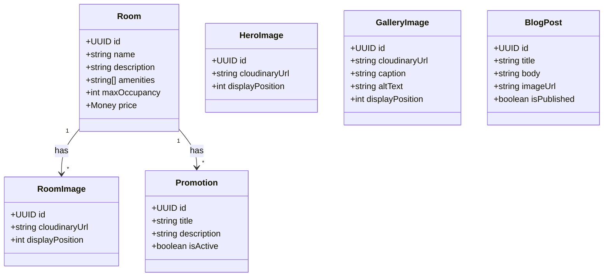

# API Contract

| Project | Client | Version | Date |
| --- | --- | --- | --- |
| Alam Guest house | Abid Alam | 1.0 | 2026-11-01 |

## 1. Overview

### Purpose and Consumers

The Alam Guest House Admin and Content API serves two distinct audiences. The first is the single administrator (Abid Alam) who manages room listings, hero carousel images, promotions, gallery images, and blog posts through the admin dashboard. These admin operations require a Poly-X access token with the admin role, validated by introspection. The second audience is the public website visited by prospective guests; it reads managed content (rooms with active promotions, hero images, gallery images, and published blog posts) through unauthenticated endpoints that have no runtime dependency on Poly-X. The API also provides an image upload endpoint that sends files to Cloudinary and returns the CDN URL for storage in PostgreSQL.

### Base URLs

| Environment | Base URL | Notes |
|---|---|---|
| All (development, preview, production) | `/v1` | Host comes from the environment's configuration. The major version is in the URL path. |

### Design Components

| Design Component | Resources |
|---|---|
| DC-003 (Cloudinary Image Upload Service) | Image uploads |
| DC-004 (Room Listing Management) | Room listings, room prices |
| DC-005 (Hero Section Image Management) | Hero images, hero image ordering |
| DC-006 (Promotion Management) | Promotions |
| DC-007 (Gallery Management) | Gallery images |
| DC-008 (Blog Post Management) | Blog posts, blog post publishing |
| DC-009 (Public Content Delivery) | Public rooms, hero images, gallery, blog posts |

### Resource Model



A Room owns many RoomImage records and many Promotion records. HeroImage, GalleryImage, and BlogPost are standalone resources. All content is persisted in PostgreSQL (DC-002) and served to the public site through DC-009.

## 2. Authentication

### Scheme

All admin operations use the `polyxBearer` security scheme: HTTP Bearer tokens that are Poly-X access tokens, validated by Poly-X token introspection (`POST /v1/auth/authz/introspect`). The caller obtains a token through the Poly-X sign-in flow, which enforces multi-factor authentication for the admin role (REQ-FUNC-002). Token lifetime, refresh, and revocation are managed by Poly-X; the product never holds credentials. Introspection results are cached briefly (keyed by user, session, and `permVersion`, max-age 60 seconds) and re-checked when `permVersion` changes. The middleware fails closed: it returns 401 when the token is missing or inactive, 403 when the admin role is absent, and 503 when Poly-X cannot be reached within 5 seconds (REQ-FUNC-003, REQ-NFUNC-002). The public content endpoints do not call Poly-X and have no runtime dependency on it (REQ-NFUNC-007).

### Authorization

| Operation | Permission module | Action | Notes |
|---|---|---|---|
| createRoom | alam_rooms | create | Admin role required |
| replaceRoom | alam_rooms | update | Admin role required |
| deleteRoom | alam_rooms | delete | Admin role required |
| updateRoomPrice | alam_rooms | update | Admin role required |
| createHeroImage | alam_hero | create | Admin role required |
| deleteHeroImage | alam_hero | delete | Admin role required |
| reorderHeroImages | alam_hero | update | Admin role required |
| createPromotion | alam_promotions | create | Admin role required |
| updatePromotion | alam_promotions | update | Admin role required |
| deletePromotion | alam_promotions | delete | Admin role required |
| createGalleryImage | alam_gallery | create | Admin role required |
| updateGalleryImage | alam_gallery | update | Admin role required |
| deleteGalleryImage | alam_gallery | delete | Admin role required |
| createBlogPost | alam_blog | create | Admin role required |
| updateBlogPost | alam_blog | update | Admin role required |
| deleteBlogPost | alam_blog | delete | Admin role required |
| publishBlogPost | alam_blog | update | Admin role required |
| uploadImage | alam_rooms | create | Admin role required |
| listPublicRooms | public | read | No authentication |
| listPublicHeroImages | public | read | No authentication |
| listPublicGallery | public | read | No authentication |
| listPublicBlogPosts | public | read | No authentication |

Every admin operation carries the `organization-id` header. The middleware checks it against the token's organization and returns 403 on a mismatch. Existence of a resource in another organization returns 404, so existence never leaks across tenants.

### Public Operations

`listPublicRooms`, `listPublicHeroImages`, `listPublicGallery`, and `listPublicBlogPosts` are public (`security: []`). They serve managed content to the public website without authentication, reading directly from PostgreSQL. This isolation ensures the public site remains available during a Poly-X outage (REQ-NFUNC-007).

## 3. Conventions

### Naming and Identifiers

Resource paths use plural kebab-case nouns: `/rooms`, `/hero-images`, `/promotions`, `/gallery`, `/blog-posts`, `/uploads`, `/content/rooms`, `/content/hero-images`, `/content/gallery`, `/content/blog-posts`. Path parameters are named `<resource>Id` (for example `{roomId}`, `{heroImageId}`). Operation IDs are camelCase verbNoun: `createRoom`, `replaceRoom`, `deleteRoom`, `updateRoomPrice`, `createHeroImage`, `deleteHeroImage`, `reorderHeroImages`, `createPromotion`, `updatePromotion`, `deletePromotion`, `createGalleryImage`, `updateGalleryImage`, `deleteGalleryImage`, `createBlogPost`, `updateBlogPost`, `deleteBlogPost`, `publishBlogPost`, `uploadImage`, `listPublicRooms`, `listPublicHeroImages`, `listPublicGallery`, `listPublicBlogPosts`. Resource identifiers are UUIDs (`format: uuid`).

### Request and Response Format

Requests and responses use `application/json; charset=utf-8`. Errors use `application/problem+json` (RFC 9457). Image uploads use `multipart/form-data`. Timestamps are RFC 3339 UTC strings with the `Z` suffix (for example `2026-11-01T10:00:00.000Z`). Money is represented as `{ "amount": "3000.00", "currency": "PKR" }` where amount is a decimal string and currency is an ISO 4217 code; never a float. Null values use `"type": ["<type>", "null"]`. Request body schemas set `additionalProperties: false`.

### Pagination, Filtering and Sorting

The public content endpoints return arrays directly in a `data` envelope without pagination parameters, because the content volume is small (tens of rooms, hundreds of images and posts). Admin create, update, and delete operations return single resources. The `reorderHeroImages` operation returns the full ordered list. If the client later requires pagination on any collection, cursor-based pagination (`limit`, `cursor`, `nextCursor`, `hasMore`) will be added as a non-breaking change.

### Idempotency

Every POST that creates a resource (`createRoom`, `createHeroImage`, `createPromotion`, `createGalleryImage`, `createBlogPost`, `uploadImage`) takes the `Idempotency-Key` header (a UUID). Keys are kept for 24 hours. A retry with the same key and the same body returns the first response. A retry with the same key but a different body returns 409 Conflict.

### Concurrency and Caching

All PUT and DELETE operations on existing resources take the `If-Match` header (the ETag from the prior GET). A stale ETag returns 412 Precondition Failed. A missing `If-Match` on a resource that requires it returns 428 Precondition Required. Public content GET responses include an `ETag` and `Cache-Control` header and honour `If-None-Match`, returning 304 when the representation has not changed. Admin GET responses (where applicable) also carry ETags. Personal data is not cached (`private, no-store`); public content is cached with a short max-age.

### Rate Limits

Rate limits are applied per tenant (organization) and per user on admin operations. When the limit is exceeded, the API returns 429 Too Many Requests with a `Retry-After` header and the `RateLimit-Limit`, `RateLimit-Remaining`, and `RateLimit-Reset` headers. The specific limit values are taken from configuration, as the input does not state a figure.

### Correlation and Tracing

Every response echoes an `X-Request-Id` header (generated when the caller sends none). The API accepts and propagates the W3C `traceparent` header for distributed tracing.

### Headers

| Header | Direction | Operations | Purpose |
|---|---|---|---|
| organization-id | Request | All admin operations | Tenant scope; checked against the token's organization |
| Idempotency-Key | Request | All POST creates | Deduplicates retries for 24 hours |
| If-Match | Request | PUT, DELETE on existing resources | Optimistic concurrency; stale ETag returns 412 |
| If-None-Match | Request | Public GET endpoints | Conditional read; returns 304 when unchanged |
| Authorization | Request | All admin operations | Poly-X Bearer access token |
| X-Request-Id | Response | All operations | Correlation id, echoed back |
| ETag | Response | GET, POST create, PUT | Entity tag for caching and concurrency |
| Location | Response | POST creates (201) | URL of the newly created resource |
| Cache-Control | Response | Public GET endpoints | Caching directive for public content |
| RateLimit-Limit | Response | 429 responses | The rate limit ceiling |
| RateLimit-Remaining | Response | 429 responses | Remaining requests in the window |
| RateLimit-Reset | Response | 429 responses | When the limit resets |
| Retry-After | Response | 429, 503 responses | Seconds to wait before retrying |

### CORS

The API is called from the Next.js server side (server components and route handlers) via the Poly-X data proxy, so the browser never holds a token. CORS is not exposed to browsers directly. If a browser client is later added, allowed origins, credentials policy, and exposed headers (X-Request-Id, ETag) will be stated in configuration.

### Webhooks and Events

The API emits no outbound webhooks or events. The design does not name any event interfaces that another system consumes. Notifications to the administrator (if any) are dispatched internally through the Poly-X alert service (DC-012) and are not part of this API contract.

## 4. Endpoints

| Method | Path | Operation | Purpose | Auth / permission | Design component | Requirements |
|---|---|---|---|---|---|---|
| POST | /rooms | createRoom | Create a room listing | polyxBearer, alam_rooms:create | DC-004 | REQ-FUNC-004 |
| PUT | /rooms/{roomId} | replaceRoom | Edit a room listing | polyxBearer, alam_rooms:update | DC-004 | REQ-FUNC-005 |
| DELETE | /rooms/{roomId} | deleteRoom | Delete a room listing | polyxBearer, alam_rooms:delete | DC-004 | REQ-FUNC-006 |
| PUT | /rooms/{roomId}/price | updateRoomPrice | Update a room price | polyxBearer, alam_rooms:update | DC-004 | REQ-FUNC-011 |
| POST | /hero-images | createHeroImage | Add a hero image | polyxBearer, alam_hero:create | DC-005 | REQ-FUNC-007 |
| DELETE | /hero-images/{heroImageId} | deleteHeroImage | Remove a hero image | polyxBearer, alam_hero:delete | DC-005 | REQ-FUNC-008 |
| PUT | /hero-images:reorder | reorderHeroImages | Reorder hero images | polyxBearer, alam_hero:update | DC-005 | REQ-FUNC-009 |
| POST | /promotions | createPromotion | Create a promotion | polyxBearer, alam_promotions:create | DC-006 | REQ-FUNC-012 |
| PUT | /promotions/{promotionId} | updatePromotion | Edit a promotion | polyxBearer, alam_promotions:update | DC-006 | REQ-FUNC-013 |
| DELETE | /promotions/{promotionId} | deletePromotion | Remove a promotion | polyxBearer, alam_promotions:delete | DC-006 | REQ-FUNC-014 |
| POST | /gallery | createGalleryImage | Add a gallery image | polyxBearer, alam_gallery:create | DC-007 | REQ-FUNC-016 |
| PUT | /gallery/{galleryImageId} | updateGalleryImage | Edit gallery image caption and alt text | polyxBearer, alam_gallery:update | DC-007 | REQ-FUNC-017 |
| DELETE | /gallery/{galleryImageId} | deleteGalleryImage | Remove a gallery image | polyxBearer, alam_gallery:delete | DC-007 | REQ-FUNC-018 |
| POST | /blog-posts | createBlogPost | Create a blog post | polyxBearer, alam_blog:create | DC-008 | REQ-FUNC-022 |
| PUT | /blog-posts/{blogPostId} | updateBlogPost | Edit a blog post | polyxBearer, alam_blog:update | DC-008 | REQ-FUNC-023 |
| DELETE | /blog-posts/{blogPostId} | deleteBlogPost | Delete a blog post | polyxBearer, alam_blog:delete | DC-008 | REQ-FUNC-025 |
| PUT | /blog-posts/{blogPostId}/publish | publishBlogPost | Publish a blog post | polyxBearer, alam_blog:update | DC-008 | REQ-FUNC-024 |
| POST | /uploads | uploadImage | Upload an image to Cloudinary | polyxBearer, alam_rooms:create | DC-003 | REQ-FUNC-010 |
| GET | /content/rooms | listPublicRooms | List rooms with prices and active promotions | public | DC-009 | REQ-FUNC-019, REQ-FUNC-015 |
| GET | /content/hero-images | listPublicHeroImages | List hero images in display order | public | DC-009 | REQ-FUNC-019 |
| GET | /content/gallery | listPublicGallery | List gallery images in display order | public | DC-009 | REQ-FUNC-019 |
| GET | /content/blog-posts | listPublicBlogPosts | List published blog posts | public | DC-009 | REQ-FUNC-019, REQ-FUNC-024 |

## 5. Error Model

### Problem Details

All error responses use RFC 9457 problem details served as `application/problem+json`. The body contains:

- `type`: a URI reference naming the problem (for example `/problems/validation-error`)
- `title`: a short human-readable summary
- `status`: the HTTP status code
- `detail`: a longer explanation specific to this occurrence
- `instance`: a URI reference identifying the specific occurrence
- `code`: a stable, UPPER_SNAKE error code (for example `VALIDATION_ERROR`)
- `requestId`: the correlation id

Validation errors (400 and 422) additionally carry an `errors` array, each item with `field` (a JSON Pointer or dotted path), `message`, and `code`.

Example:

```json
{
  "type": "/problems/validation-error",
  "title": "Validation failed",
  "status": 422,
  "detail": "The name field must not be blank.",
  "instance": "/v1/rooms",
  "code": "VALIDATION_ERROR",
  "requestId": "req_abc123",
  "errors": [
    { "field": "/name", "message": "Name must not be blank.", "code": "FIELD_REQUIRED" }
  ]
}
```

### Status Codes

| Status | Meaning | When this API returns it |
|---|---|---|
| 200 | OK | Successful read or update returning a resource |
| 201 | Created | A POST that creates a resource, with a Location header |
| 204 | No Content | A successful DELETE |
| 304 | Not Modified | A public GET with a matching If-None-Match |
| 400 | Bad Request | Malformed request body or query parameter |
| 401 | Unauthorized | Missing, expired, or invalid Poly-X token |
| 403 | Forbidden | Authenticated but lacking the admin role or organization-id mismatch |
| 404 | Not Found | Resource not found, or resource in another organization |
| 409 | Conflict | Idempotency-Key reused with a different body |
| 412 | Precondition Failed | If-Match did not match the current ETag |
| 415 | Unsupported Media Type | Unsupported Content-Type on upload |
| 422 | Unprocessable Entity | Well-formed request failing validation or a business rule |
| 428 | Precondition Required | If-Match missing on a resource that requires it |
| 429 | Too Many Requests | Rate limit exceeded |
| 500 | Internal Server Error | Unexpected error |
| 503 | Service Unavailable | Poly-X or a dependency is unreachable |

### Error Codes

| Code | Status | Title | When | Caller action |
|---|---|---|---|---|
| VALIDATION_ERROR | 400, 422 | Validation failed | A field fails schema or business-rule validation | Fix the named field and retry |
| UNAUTHENTICATED | 401 | Unauthenticated | No token, expired token, or revoked session | Re-authenticate through Poly-X sign-in |
| FORBIDDEN | 403 | Forbidden | Admin role absent or organization-id mismatch | Confirm the caller has the admin role in the correct organization |
| NOT_FOUND | 404 | Not found | The resource does not exist or belongs to another organization | Check the resource id and organization |
| IDEMPOTENCY_CONFLICT | 409 | Idempotency conflict | Idempotency-Key reused with a different request body | Use a new Idempotency-Key or the same body |
| PRECONDITION_FAILED | 412 | Precondition failed | If-Match ETag is stale | Re-fetch the resource, obtain a fresh ETag, and retry |
| PRECONDITION_REQUIRED | 428 | Precondition required | If-Match is missing on a PUT or DELETE that requires it | Include the If-Match header with the current ETag |
| UNSUPPORTED_MEDIA_TYPE | 415 | Unsupported media type | Upload Content-Type is not a supported image format | Use a supported image format (JPEG, PNG, WebP) |
| RATE_LIMIT_EXCEEDED | 429 | Rate limit exceeded | Too many requests in the time window | Wait for Retry-After seconds, then retry |
| INTERNAL_ERROR | 500 | Internal server error | An unexpected error occurred | Retry with backoff; contact the development team if it persists |
| SERVICE_UNAVAILABLE | 503 | Service unavailable | Poly-X auth service or a dependency is unreachable | Retry after a brief wait; admin operations require Poly-X to be available |

## 6. Versioning

### Version Scheme

The API is versioned by major version in the URL path (`/v1`). The contract version is `1.0.0`. Additive changes (a new optional field, a new endpoint, a new enum value where clients tolerate unknown values) bump the minor version and are non-breaking. Breaking changes (removing or renaming a field, changing a type, making an optional field required, changing a status code, tightening validation) require a new major version (`/v2`).

### Breaking and Non-Breaking Changes

**Breaking changes (require a new major version):**
- Removing or renaming a request or response field
- Changing a field's type
- Making an optional field required
- Changing a status code
- Tightening validation (for example reducing a maximum length)
- Removing an endpoint or operation

**Non-breaking changes (additive, minor version bump):**
- Adding a new optional request or response field
- Adding a new endpoint or operation
- Adding a new enum value where clients are told to tolerate unknown values
- Loosening validation (for example increasing a maximum length)

### Deprecation Policy

A deprecated operation sends `Deprecation` and `Sunset` headers and remains available for the notice period stated in the requirements. If the input does not state a notice period, it is assumed to be 90 days, pending confirmation by the client. Consumers are told through the API changelog and the `Sunset` header, which carries the date the operation will be removed. No operations are deprecated in this initial contract.

## OpenAPI Specification

The machine-readable contract (OpenAPI 3.1). Each operation names the design component that implements it (`x-design-component`) and the requirements it serves (`x-requirements`).

```json
{
  "openapi": "3.1.0",
  "jsonSchemaDialect": "https://json-schema.org/draft/2020-12/schema",
  "info": {
    "title": "Alam Guest House Admin and Content API",
    "version": "1.0.0",
    "description": "Admin content management API for room listings, hero images, promotions, gallery images, blog posts, and image uploads, plus public content delivery endpoints. Admin operations require a Poly-X access token with the admin role, validated by introspection. Public content endpoints require no authentication.",
    "contact": {
      "name": "Alam Guest House Development Team"
    }
  },
  "servers": [
    {
      "url": "/v1",
      "description": "Host comes from the environment's configuration (development, preview, production)."
    }
  ],
  "tags": [
    {
      "name": "Rooms",
      "description": "Room listing management (DC-004)."
    },
    {
      "name": "Hero Images",
      "description": "Hero section image management (DC-005)."
    },
    {
      "name": "Promotions",
      "description": "Promotion management (DC-006)."
    },
    {
      "name": "Gallery",
      "description": "Gallery image management (DC-007)."
    },
    {
      "name": "Blog Posts",
      "description": "Blog post management (DC-008)."
    },
    {
      "name": "Uploads",
      "description": "Cloudinary image upload service (DC-003)."
    },
    {
      "name": "Public Content",
      "description": "Public content delivery endpoints (DC-009)."
    }
  ],
  "security": [
    {
      "polyxBearer": []
    }
  ],
  "paths": {
    "/rooms": {
      "post": {
        "operationId": "createRoom",
        "summary": "Create a room listing",
        "description": "Creates a new room listing with name, description, amenities, images, maximum occupancy, and price. Stores the room in PostgreSQL. Returns 201 with the created room and a Location header.",
        "tags": [
          "Rooms"
        ],
        "x-design-component": "DC-004",
        "x-requirements": [
          "REQ-FUNC-004"
        ],
        "x-permission": {
          "module": "alam_rooms",
          "action": "create"
        },
        "parameters": [
          {
            "$ref": "#/components/parameters/OrganizationId"
          },
          {
            "$ref": "#/components/parameters/IdempotencyKey"
          }
        ],
        "requestBody": {
          "required": true,
          "content": {
            "application/json; charset=utf-8": {
              "schema": {
                "$ref": "#/components/schemas/RoomCreate"
              },
              "examples": {
                "standardRoom": {
                  "summary": "Standard room listing",
                  "value": {
                    "name": "Standard Room",
                    "description": "A comfortable room with a queen bed.",
                    "amenities": [
                      "wifi",
                      "ac",
                      "breakfast"
                    ],
                    "imageUrls": [
                      "https://res.cloudinary.com/alamguesthouse/image/upload/v20261101/standard-room.jpg"
                    ],
                    "maxOccupancy": 2,
                    "price": {
                      "amount": "3000.00",
                      "currency": "PKR"
                    }
                  }
                }
              }
            }
          }
        },
        "responses": {
          "201": {
            "description": "Room created successfully.",
            "headers": {
              "Location": {
                "$ref": "#/components/headers/Location"
              },
              "X-Request-Id": {
                "$ref": "#/components/headers/X-Request-Id"
              },
              "ETag": {
                "$ref": "#/components/headers/ETag"
              }
            },
            "content": {
              "application/json; charset=utf-8": {
                "schema": {
                  "$ref": "#/components/schemas/Room"
                },
                "examples": {
                  "createdRoom": {
                    "summary": "Created room",
                    "value": {
                      "id": "f47ac10b-58cc-4372-a567-0e02b2c3d479",
                      "name": "Standard Room",
                      "description": "A comfortable room with a queen bed.",
                      "amenities": [
                        "wifi",
                        "ac",
                        "breakfast"
                      ],
                      "images": [
                        {
                          "id": "a1b2c3d4-e5f6-7890-abcd-ef1234567890",
                          "cloudinaryUrl": "https://res.cloudinary.com/alamguesthouse/image/upload/v20261101/standard-room.jpg",
                          "displayPosition": 0
                        }
                      ],
                      "maxOccupancy": 2,
                      "price": {
                        "amount": "3000.00",
                        "currency": "PKR"
                      },
                      "createdAt": "2026-11-01T10:00:00.000Z",
                      "updatedAt": "2026-11-01T10:00:00.000Z"
                    }
                  }
                }
              }
            }
          },
          "400": {
            "$ref": "#/components/responses/BadRequest"
          },
          "401": {
            "$ref": "#/components/responses/Unauthorized"
          },
          "403": {
            "$ref": "#/components/responses/Forbidden"
          },
          "409": {
            "$ref": "#/components/responses/Conflict"
          },
          "422": {
            "$ref": "#/components/responses/UnprocessableEntity"
          },
          "429": {
            "$ref": "#/components/responses/TooManyRequests"
          },
          "500": {
            "$ref": "#/components/responses/InternalError"
          },
          "503": {
            "$ref": "#/components/responses/ServiceUnavailable"
          }
        }
      }
    },
    "/rooms/{roomId}": {
      "parameters": [
        {
          "$ref": "#/components/parameters/RoomId"
        }
      ],
      "put": {
        "operationId": "replaceRoom",
        "summary": "Edit a room listing",
        "description": "Updates an existing room listing's fields. Validates with zod. Updates the updated_at timestamp. Requires If-Match for optimistic concurrency.",
        "tags": [
          "Rooms"
        ],
        "x-design-component": "DC-004",
        "x-requirements": [
          "REQ-FUNC-005"
        ],
        "x-permission": {
          "module": "alam_rooms",
          "action": "update"
        },
        "parameters": [
          {
            "$ref": "#/components/parameters/OrganizationId"
          },
          {
            "$ref": "#/components/parameters/IfMatch"
          }
        ],
        "requestBody": {
          "required": true,
          "content": {
            "application/json; charset=utf-8": {
              "schema": {
                "$ref": "#/components/schemas/RoomUpdate"
              },
              "examples": {
                "updatePrice": {
                  "summary": "Update price and amenities",
                  "value": {
                    "name": "Standard Room",
                    "description": "A comfortable room with a queen bed and city view.",
                    "amenities": [
                      "wifi",
                      "ac",
                      "breakfast",
                      "cityview"
                    ],
                    "imageUrls": [
                      "https://res.cloudinary.com/alamguesthouse/image/upload/v20261101/standard-room.jpg"
                    ],
                    "maxOccupancy": 2,
                    "price": {
                      "amount": "4500.00",
                      "currency": "PKR"
                    }
                  }
                }
              }
            }
          }
        },
        "responses": {
          "200": {
            "description": "Room updated successfully.",
            "headers": {
              "X-Request-Id": {
                "$ref": "#/components/headers/X-Request-Id"
              },
              "ETag": {
                "$ref": "#/components/headers/ETag"
              }
            },
            "content": {
              "application/json; charset=utf-8": {
                "schema": {
                  "$ref": "#/components/schemas/Room"
                },
                "examples": {
                  "updatedRoom": {
                    "summary": "Updated room",
                    "value": {
                      "id": "f47ac10b-58cc-4372-a567-0e02b2c3d479",
                      "name": "Standard Room",
                      "description": "A comfortable room with a queen bed and city view.",
                      "amenities": [
                        "wifi",
                        "ac",
                        "breakfast",
                        "cityview"
                      ],
                      "images": [
                        {
                          "id": "a1b2c3d4-e5f6-7890-abcd-ef1234567890",
                          "cloudinaryUrl": "https://res.cloudinary.com/alamguesthouse/image/upload/v20261101/standard-room.jpg",
                          "displayPosition": 0
                        }
                      ],
                      "maxOccupancy": 2,
                      "price": {
                        "amount": "4500.00",
                        "currency": "PKR"
                      },
                      "createdAt": "2026-11-01T10:00:00.000Z",
                      "updatedAt": "2026-11-01T11:00:00.000Z"
                    }
                  }
                }
              }
            }
          },
          "400": {
            "$ref": "#/components/responses/BadRequest"
          },
          "401": {
            "$ref": "#/components/responses/Unauthorized"
          },
          "403": {
            "$ref": "#/components/responses/Forbidden"
          },
          "404": {
            "$ref": "#/components/responses/NotFound"
          },
          "412": {
            "$ref": "#/components/responses/PreconditionFailed"
          },
          "422": {
            "$ref": "#/components/responses/UnprocessableEntity"
          },
          "428": {
            "$ref": "#/components/responses/PreconditionRequired"
          },
          "429": {
            "$ref": "#/components/responses/TooManyRequests"
          },
          "500": {
            "$ref": "#/components/responses/InternalError"
          },
          "503": {
            "$ref": "#/components/responses/ServiceUnavailable"
          }
        }
      },
      "delete": {
        "operationId": "deleteRoom",
        "summary": "Delete a room listing",
        "description": "Removes a room listing from the data store. Cascade-deletes associated RoomImage and Promotion records. Requires If-Match for optimistic concurrency.",
        "tags": [
          "Rooms"
        ],
        "x-design-component": "DC-004",
        "x-requirements": [
          "REQ-FUNC-006"
        ],
        "x-permission": {
          "module": "alam_rooms",
          "action": "delete"
        },
        "parameters": [
          {
            "$ref": "#/components/parameters/OrganizationId"
          },
          {
            "$ref": "#/components/parameters/IfMatch"
          }
        ],
        "responses": {
          "204": {
            "description": "Room deleted successfully.",
            "headers": {
              "X-Request-Id": {
                "$ref": "#/components/headers/X-Request-Id"
              }
            }
          },
          "401": {
            "$ref": "#/components/responses/Unauthorized"
          },
          "403": {
            "$ref": "#/components/responses/Forbidden"
          },
          "404": {
            "$ref": "#/components/responses/NotFound"
          },
          "412": {
            "$ref": "#/components/responses/PreconditionFailed"
          },
          "428": {
            "$ref": "#/components/responses/PreconditionRequired"
          },
          "429": {
            "$ref": "#/components/responses/TooManyRequests"
          },
          "500": {
            "$ref": "#/components/responses/InternalError"
          },
          "503": {
            "$ref": "#/components/responses/ServiceUnavailable"
          }
        }
      }
    },
    "/rooms/{roomId}/price": {
      "parameters": [
        {
          "$ref": "#/components/parameters/RoomId"
        }
      ],
      "put": {
        "operationId": "updateRoomPrice",
        "summary": "Update a room price",
        "description": "Updates the price field of an existing room listing specifically. Validates the price is positive numeric. Updates the updated_at timestamp. Requires If-Match for optimistic concurrency.",
        "tags": [
          "Rooms"
        ],
        "x-design-component": "DC-004",
        "x-requirements": [
          "REQ-FUNC-011"
        ],
        "x-permission": {
          "module": "alam_rooms",
          "action": "update"
        },
        "parameters": [
          {
            "$ref": "#/components/parameters/OrganizationId"
          },
          {
            "$ref": "#/components/parameters/IfMatch"
          }
        ],
        "requestBody": {
          "required": true,
          "content": {
            "application/json; charset=utf-8": {
              "schema": {
                "$ref": "#/components/schemas/RoomPriceUpdate"
              },
              "examples": {
                "newPrice": {
                  "summary": "Set price to 3500 PKR",
                  "value": {
                    "price": {
                      "amount": "3500.00",
                      "currency": "PKR"
                    }
                  }
                }
              }
            }
          }
        },
        "responses": {
          "200": {
            "description": "Room price updated successfully.",
            "headers": {
              "X-Request-Id": {
                "$ref": "#/components/headers/X-Request-Id"
              },
              "ETag": {
                "$ref": "#/components/headers/ETag"
              }
            },
            "content": {
              "application/json; charset=utf-8": {
                "schema": {
                  "$ref": "#/components/schemas/Room"
                },
                "examples": {
                  "priceUpdatedRoom": {
                    "summary": "Room with updated price",
                    "value": {
                      "id": "f47ac10b-58cc-4372-a567-0e02b2c3d479",
                      "name": "Standard Room",
                      "description": "A comfortable room with a queen bed.",
                      "amenities": [
                        "wifi",
                        "ac",
                        "breakfast"
                      ],
                      "images": [
                        {
                          "id": "a1b2c3d4-e5f6-7890-abcd-ef1234567890",
                          "cloudinaryUrl": "https://res.cloudinary.com/alamguesthouse/image/upload/v20261101/standard-room.jpg",
                          "displayPosition": 0
                        }
                      ],
                      "maxOccupancy": 2,
                      "price": {
                        "amount": "3500.00",
                        "currency": "PKR"
                      },
                      "createdAt": "2026-11-01T10:00:00.000Z",
                      "updatedAt": "2026-11-01T12:00:00.000Z"
                    }
                  }
                }
              }
            }
          },
          "400": {
            "$ref": "#/components/responses/BadRequest"
          },
          "401": {
            "$ref": "#/components/responses/Unauthorized"
          },
          "403": {
            "$ref": "#/components/responses/Forbidden"
          },
          "404": {
            "$ref": "#/components/responses/NotFound"
          },
          "412": {
            "$ref": "#/components/responses/PreconditionFailed"
          },
          "422": {
            "$ref": "#/components/responses/UnprocessableEntity"
          },
          "428": {
            "$ref": "#/components/responses/PreconditionRequired"
          },
          "429": {
            "$ref": "#/components/responses/TooManyRequests"
          },
          "500": {
            "$ref": "#/components/responses/InternalError"
          },
          "503": {
            "$ref": "#/components/responses/ServiceUnavailable"
          }
        }
      }
    },
    "/hero-images": {
      "post": {
        "operationId": "createHeroImage",
        "summary": "Add a hero image",
        "description": "Adds a hero section image with a Cloudinary URL and display position to the homepage carousel. Returns 201 with the created hero image and a Location header.",
        "tags": [
          "Hero Images"
        ],
        "x-design-component": "DC-005",
        "x-requirements": [
          "REQ-FUNC-007"
        ],
        "x-permission": {
          "module": "alam_hero",
          "action": "create"
        },
        "parameters": [
          {
            "$ref": "#/components/parameters/OrganizationId"
          },
          {
            "$ref": "#/components/parameters/IdempotencyKey"
          }
        ],
        "requestBody": {
          "required": true,
          "content": {
            "application/json; charset=utf-8": {
              "schema": {
                "$ref": "#/components/schemas/HeroImageCreate"
              },
              "examples": {
                "newHeroImage": {
                  "summary": "Add a hero carousel image",
                  "value": {
                    "cloudinaryUrl": "https://res.cloudinary.com/alamguesthouse/image/upload/v20261101/hero-pool.jpg",
                    "displayPosition": 4
                  }
                }
              }
            }
          }
        },
        "responses": {
          "201": {
            "description": "Hero image created successfully.",
            "headers": {
              "Location": {
                "$ref": "#/components/headers/Location"
              },
              "X-Request-Id": {
                "$ref": "#/components/headers/X-Request-Id"
              },
              "ETag": {
                "$ref": "#/components/headers/ETag"
              }
            },
            "content": {
              "application/json; charset=utf-8": {
                "schema": {
                  "$ref": "#/components/schemas/HeroImage"
                },
                "examples": {
                  "createdHeroImage": {
                    "summary": "Created hero image",
                    "value": {
                      "id": "b8c9d0e1-f2a3-4567-89ab-cdef01234567",
                      "cloudinaryUrl": "https://res.cloudinary.com/alamguesthouse/image/upload/v20261101/hero-pool.jpg",
                      "displayPosition": 4
                    }
                  }
                }
              }
            }
          },
          "400": {
            "$ref": "#/components/responses/BadRequest"
          },
          "401": {
            "$ref": "#/components/responses/Unauthorized"
          },
          "403": {
            "$ref": "#/components/responses/Forbidden"
          },
          "409": {
            "$ref": "#/components/responses/Conflict"
          },
          "422": {
            "$ref": "#/components/responses/UnprocessableEntity"
          },
          "429": {
            "$ref": "#/components/responses/TooManyRequests"
          },
          "500": {
            "$ref": "#/components/responses/InternalError"
          },
          "503": {
            "$ref": "#/components/responses/ServiceUnavailable"
          }
        }
      }
    },
    "/hero-images/{heroImageId}": {
      "parameters": [
        {
          "$ref": "#/components/parameters/HeroImageId"
        }
      ],
      "delete": {
        "operationId": "deleteHeroImage",
        "summary": "Remove a hero image",
        "description": "Removes a hero section image from the data store and the public carousel. Requires If-Match for optimistic concurrency.",
        "tags": [
          "Hero Images"
        ],
        "x-design-component": "DC-005",
        "x-requirements": [
          "REQ-FUNC-008"
        ],
        "x-permission": {
          "module": "alam_hero",
          "action": "delete"
        },
        "parameters": [
          {
            "$ref": "#/components/parameters/OrganizationId"
          },
          {
            "$ref": "#/components/parameters/IfMatch"
          }
        ],
        "responses": {
          "204": {
            "description": "Hero image deleted successfully.",
            "headers": {
              "X-Request-Id": {
                "$ref": "#/components/headers/X-Request-Id"
              }
            }
          },
          "401": {
            "$ref": "#/components/responses/Unauthorized"
          },
          "403": {
            "$ref": "#/components/responses/Forbidden"
          },
          "404": {
            "$ref": "#/components/responses/NotFound"
          },
          "412": {
            "$ref": "#/components/responses/PreconditionFailed"
          },
          "428": {
            "$ref": "#/components/responses/PreconditionRequired"
          },
          "429": {
            "$ref": "#/components/responses/TooManyRequests"
          },
          "500": {
            "$ref": "#/components/responses/InternalError"
          },
          "503": {
            "$ref": "#/components/responses/ServiceUnavailable"
          }
        }
      }
    },
    "/hero-images:reorder": {
      "put": {
        "operationId": "reorderHeroImages",
        "summary": "Reorder hero images",
        "description": "Updates display positions for hero section images by accepting an array of image IDs in the new order. Updates all display positions in a single transaction.",
        "tags": [
          "Hero Images"
        ],
        "x-design-component": "DC-005",
        "x-requirements": [
          "REQ-FUNC-009"
        ],
        "x-permission": {
          "module": "alam_hero",
          "action": "update"
        },
        "parameters": [
          {
            "$ref": "#/components/parameters/OrganizationId"
          }
        ],
        "requestBody": {
          "required": true,
          "content": {
            "application/json; charset=utf-8": {
              "schema": {
                "$ref": "#/components/schemas/HeroImageReorder"
              },
              "examples": {
                "reorderExample": {
                  "summary": "Move image 3 to position 1",
                  "value": {
                    "orderedIds": [
                      "b8c9d0e1-f2a3-4567-89ab-cdef01234567",
                      "c9d0e1f2-a3b4-5678-9abc-def012345678",
                      "d0e1f2a3-b4c5-6789-abcd-ef0123456789"
                    ]
                  }
                }
              }
            }
          }
        },
        "responses": {
          "200": {
            "description": "Hero images reordered successfully.",
            "headers": {
              "X-Request-Id": {
                "$ref": "#/components/headers/X-Request-Id"
              }
            },
            "content": {
              "application/json; charset=utf-8": {
                "schema": {
                  "$ref": "#/components/schemas/HeroImageList"
                },
                "examples": {
                  "reorderedHeroImages": {
                    "summary": "Reordered hero images",
                    "value": {
                      "data": [
                        {
                          "id": "b8c9d0e1-f2a3-4567-89ab-cdef01234567",
                          "cloudinaryUrl": "https://res.cloudinary.com/alamguesthouse/image/upload/v20261101/hero-pool.jpg",
                          "displayPosition": 0
                        },
                        {
                          "id": "c9d0e1f2-a3b4-5678-9abc-def012345678",
                          "cloudinaryUrl": "https://res.cloudinary.com/alamguesthouse/image/upload/v20261101/hero-garden.jpg",
                          "displayPosition": 1
                        },
                        {
                          "id": "d0e1f2a3-b4c5-6789-abcd-ef0123456789",
                          "cloudinaryUrl": "https://res.cloudinary.com/alamguesthouse/image/upload/v20261101/hero-entrance.jpg",
                          "displayPosition": 2
                        }
                      ]
                    }
                  }
                }
              }
            }
          },
          "400": {
            "$ref": "#/components/responses/BadRequest"
          },
          "401": {
            "$ref": "#/components/responses/Unauthorized"
          },
          "403": {
            "$ref": "#/components/responses/Forbidden"
          },
          "422": {
            "$ref": "#/components/responses/UnprocessableEntity"
          },
          "429": {
            "$ref": "#/components/responses/TooManyRequests"
          },
          "500": {
            "$ref": "#/components/responses/InternalError"
          },
          "503": {
            "$ref": "#/components/responses/ServiceUnavailable"
          }
        }
      }
    },
    "/promotions": {
      "post": {
        "operationId": "createPromotion",
        "summary": "Create a promotion",
        "description": "Creates a new promotion associated with a room. Validates that the room exists and the title is non-blank. Returns 201 with the created promotion and a Location header.",
        "tags": [
          "Promotions"
        ],
        "x-design-component": "DC-006",
        "x-requirements": [
          "REQ-FUNC-012"
        ],
        "x-permission": {
          "module": "alam_promotions",
          "action": "create"
        },
        "parameters": [
          {
            "$ref": "#/components/parameters/OrganizationId"
          },
          {
            "$ref": "#/components/parameters/IdempotencyKey"
          }
        ],
        "requestBody": {
          "required": true,
          "content": {
            "application/json; charset=utf-8": {
              "schema": {
                "$ref": "#/components/schemas/PromotionCreate"
              },
              "examples": {
                "summerPromo": {
                  "summary": "Summer discount promotion",
                  "value": {
                    "roomId": "f47ac10b-58cc-4372-a567-0e02b2c3d479",
                    "title": "Summer Discount",
                    "description": "10 percent off for stays in July and August.",
                    "isActive": true
                  }
                }
              }
            }
          }
        },
        "responses": {
          "201": {
            "description": "Promotion created successfully.",
            "headers": {
              "Location": {
                "$ref": "#/components/headers/Location"
              },
              "X-Request-Id": {
                "$ref": "#/components/headers/X-Request-Id"
              },
              "ETag": {
                "$ref": "#/components/headers/ETag"
              }
            },
            "content": {
              "application/json; charset=utf-8": {
                "schema": {
                  "$ref": "#/components/schemas/Promotion"
                },
                "examples": {
                  "createdPromotion": {
                    "summary": "Created promotion",
                    "value": {
                      "id": "e1f2a3b4-c5d6-7890-abcd-ef01234567890a",
                      "roomId": "f47ac10b-58cc-4372-a567-0e02b2c3d479",
                      "title": "Summer Discount",
                      "description": "10 percent off for stays in July and August.",
                      "isActive": true,
                      "createdAt": "2026-11-01T10:00:00.000Z",
                      "updatedAt": "2026-11-01T10:00:00.000Z"
                    }
                  }
                }
              }
            }
          },
          "400": {
            "$ref": "#/components/responses/BadRequest"
          },
          "401": {
            "$ref": "#/components/responses/Unauthorized"
          },
          "403": {
            "$ref": "#/components/responses/Forbidden"
          },
          "409": {
            "$ref": "#/components/responses/Conflict"
          },
          "422": {
            "$ref": "#/components/responses/UnprocessableEntity"
          },
          "429": {
            "$ref": "#/components/responses/TooManyRequests"
          },
          "500": {
            "$ref": "#/components/responses/InternalError"
          },
          "503": {
            "$ref": "#/components/responses/ServiceUnavailable"
          }
        }
      }
    },
    "/promotions/{promotionId}": {
      "parameters": [
        {
          "$ref": "#/components/parameters/PromotionId"
        }
      ],
      "put": {
        "operationId": "updatePromotion",
        "summary": "Edit a promotion",
        "description": "Updates an existing promotion's title, description, or active status. Requires If-Match for optimistic concurrency.",
        "tags": [
          "Promotions"
        ],
        "x-design-component": "DC-006",
        "x-requirements": [
          "REQ-FUNC-013"
        ],
        "x-permission": {
          "module": "alam_promotions",
          "action": "update"
        },
        "parameters": [
          {
            "$ref": "#/components/parameters/OrganizationId"
          },
          {
            "$ref": "#/components/parameters/IfMatch"
          }
        ],
        "requestBody": {
          "required": true,
          "content": {
            "application/json; charset=utf-8": {
              "schema": {
                "$ref": "#/components/schemas/PromotionUpdate"
              },
              "examples": {
                "deactivatePromo": {
                  "summary": "Deactivate a promotion",
                  "value": {
                    "isActive": false
                  }
                }
              }
            }
          }
        },
        "responses": {
          "200": {
            "description": "Promotion updated successfully.",
            "headers": {
              "X-Request-Id": {
                "$ref": "#/components/headers/X-Request-Id"
              },
              "ETag": {
                "$ref": "#/components/headers/ETag"
              }
            },
            "content": {
              "application/json; charset=utf-8": {
                "schema": {
                  "$ref": "#/components/schemas/Promotion"
                },
                "examples": {
                  "updatedPromotion": {
                    "summary": "Updated promotion",
                    "value": {
                      "id": "e1f2a3b4-c5d6-7890-abcd-ef01234567890a",
                      "roomId": "f47ac10b-58cc-4372-a567-0e02b2c3d479",
                      "title": "Summer Discount",
                      "description": "10 percent off for stays in July and August.",
                      "isActive": false,
                      "createdAt": "2026-11-01T10:00:00.000Z",
                      "updatedAt": "2026-11-01T11:00:00.000Z"
                    }
                  }
                }
              }
            }
          },
          "400": {
            "$ref": "#/components/responses/BadRequest"
          },
          "401": {
            "$ref": "#/components/responses/Unauthorized"
          },
          "403": {
            "$ref": "#/components/responses/Forbidden"
          },
          "404": {
            "$ref": "#/components/responses/NotFound"
          },
          "412": {
            "$ref": "#/components/responses/PreconditionFailed"
          },
          "422": {
            "$ref": "#/components/responses/UnprocessableEntity"
          },
          "428": {
            "$ref": "#/components/responses/PreconditionRequired"
          },
          "429": {
            "$ref": "#/components/responses/TooManyRequests"
          },
          "500": {
            "$ref": "#/components/responses/InternalError"
          },
          "503": {
            "$ref": "#/components/responses/ServiceUnavailable"
          }
        }
      },
      "delete": {
        "operationId": "deletePromotion",
        "summary": "Remove a promotion",
        "description": "Removes a promotion from the data store. The promotion no longer appears on the public site. Requires If-Match for optimistic concurrency.",
        "tags": [
          "Promotions"
        ],
        "x-design-component": "DC-006",
        "x-requirements": [
          "REQ-FUNC-014"
        ],
        "x-permission": {
          "module": "alam_promotions",
          "action": "delete"
        },
        "parameters": [
          {
            "$ref": "#/components/parameters/OrganizationId"
          },
          {
            "$ref": "#/components/parameters/IfMatch"
          }
        ],
        "responses": {
          "204": {
            "description": "Promotion deleted successfully.",
            "headers": {
              "X-Request-Id": {
                "$ref": "#/components/headers/X-Request-Id"
              }
            }
          },
          "401": {
            "$ref": "#/components/responses/Unauthorized"
          },
          "403": {
            "$ref": "#/components/responses/Forbidden"
          },
          "404": {
            "$ref": "#/components/responses/NotFound"
          },
          "412": {
            "$ref": "#/components/responses/PreconditionFailed"
          },
          "428": {
            "$ref": "#/components/responses/PreconditionRequired"
          },
          "429": {
            "$ref": "#/components/responses/TooManyRequests"
          },
          "500": {
            "$ref": "#/components/responses/InternalError"
          },
          "503": {
            "$ref": "#/components/responses/ServiceUnavailable"
          }
        }
      }
    },
    "/gallery": {
      "post": {
        "operationId": "createGalleryImage",
        "summary": "Add a gallery image",
        "description": "Adds a gallery image with a Cloudinary URL, optional caption, optional alt text, and display position. Returns 201 with the created gallery image and a Location header.",
        "tags": [
          "Gallery"
        ],
        "x-design-component": "DC-007",
        "x-requirements": [
          "REQ-FUNC-016"
        ],
        "x-permission": {
          "module": "alam_gallery",
          "action": "create"
        },
        "parameters": [
          {
            "$ref": "#/components/parameters/OrganizationId"
          },
          {
            "$ref": "#/components/parameters/IdempotencyKey"
          }
        ],
        "requestBody": {
          "required": true,
          "content": {
            "application/json; charset=utf-8": {
              "schema": {
                "$ref": "#/components/schemas/GalleryImageCreate"
              },
              "examples": {
                "poolsideImage": {
                  "summary": "Add a poolside gallery image",
                  "value": {
                    "cloudinaryUrl": "https://res.cloudinary.com/alamguesthouse/image/upload/v20261101/poolside.jpg",
                    "caption": "Poolside view",
                    "altText": "Poolside view from room balcony",
                    "displayPosition": 11
                  }
                }
              }
            }
          }
        },
        "responses": {
          "201": {
            "description": "Gallery image created successfully.",
            "headers": {
              "Location": {
                "$ref": "#/components/headers/Location"
              },
              "X-Request-Id": {
                "$ref": "#/components/headers/X-Request-Id"
              },
              "ETag": {
                "$ref": "#/components/headers/ETag"
              }
            },
            "content": {
              "application/json; charset=utf-8": {
                "schema": {
                  "$ref": "#/components/schemas/GalleryImage"
                },
                "examples": {
                  "createdGalleryImage": {
                    "summary": "Created gallery image",
                    "value": {
                      "id": "f2a3b4c5-d6e7-8901-abcd-ef012345678901",
                      "cloudinaryUrl": "https://res.cloudinary.com/alamguesthouse/image/upload/v20261101/poolside.jpg",
                      "caption": "Poolside view",
                      "altText": "Poolside view from room balcony",
                      "displayPosition": 11
                    }
                  }
                }
              }
            }
          },
          "400": {
            "$ref": "#/components/responses/BadRequest"
          },
          "401": {
            "$ref": "#/components/responses/Unauthorized"
          },
          "403": {
            "$ref": "#/components/responses/Forbidden"
          },
          "409": {
            "$ref": "#/components/responses/Conflict"
          },
          "422": {
            "$ref": "#/components/responses/UnprocessableEntity"
          },
          "429": {
            "$ref": "#/components/responses/TooManyRequests"
          },
          "500": {
            "$ref": "#/components/responses/InternalError"
          },
          "503": {
            "$ref": "#/components/responses/ServiceUnavailable"
          }
        }
      }
    },
    "/gallery/{galleryImageId}": {
      "parameters": [
        {
          "$ref": "#/components/parameters/GalleryImageId"
        }
      ],
      "put": {
        "operationId": "updateGalleryImage",
        "summary": "Edit gallery image caption and alt text",
        "description": "Updates the caption and alt text of an existing gallery image. Requires If-Match for optimistic concurrency.",
        "tags": [
          "Gallery"
        ],
        "x-design-component": "DC-007",
        "x-requirements": [
          "REQ-FUNC-017"
        ],
        "x-permission": {
          "module": "alam_gallery",
          "action": "update"
        },
        "parameters": [
          {
            "$ref": "#/components/parameters/OrganizationId"
          },
          {
            "$ref": "#/components/parameters/IfMatch"
          }
        ],
        "requestBody": {
          "required": true,
          "content": {
            "application/json; charset=utf-8": {
              "schema": {
                "$ref": "#/components/schemas/GalleryImageUpdate"
              },
              "examples": {
                "updateCaption": {
                  "summary": "Update caption and alt text",
                  "value": {
                    "caption": "Poolside view",
                    "altText": "Poolside view from room balcony"
                  }
                }
              }
            }
          }
        },
        "responses": {
          "200": {
            "description": "Gallery image updated successfully.",
            "headers": {
              "X-Request-Id": {
                "$ref": "#/components/headers/X-Request-Id"
              },
              "ETag": {
                "$ref": "#/components/headers/ETag"
              }
            },
            "content": {
              "application/json; charset=utf-8": {
                "schema": {
                  "$ref": "#/components/schemas/GalleryImage"
                },
                "examples": {
                  "updatedGalleryImage": {
                    "summary": "Updated gallery image",
                    "value": {
                      "id": "f2a3b4c5-d6e7-8901-abcd-ef012345678901",
                      "cloudinaryUrl": "https://res.cloudinary.com/alamguesthouse/image/upload/v20261101/poolside.jpg",
                      "caption": "Poolside view",
                      "altText": "Poolside view from room balcony",
                      "displayPosition": 11
                    }
                  }
                }
              }
            }
          },
          "400": {
            "$ref": "#/components/responses/BadRequest"
          },
          "401": {
            "$ref": "#/components/responses/Unauthorized"
          },
          "403": {
            "$ref": "#/components/responses/Forbidden"
          },
          "404": {
            "$ref": "#/components/responses/NotFound"
          },
          "412": {
            "$ref": "#/components/responses/PreconditionFailed"
          },
          "422": {
            "$ref": "#/components/responses/UnprocessableEntity"
          },
          "428": {
            "$ref": "#/components/responses/PreconditionRequired"
          },
          "429": {
            "$ref": "#/components/responses/TooManyRequests"
          },
          "500": {
            "$ref": "#/components/responses/InternalError"
          },
          "503": {
            "$ref": "#/components/responses/ServiceUnavailable"
          }
        }
      },
      "delete": {
        "operationId": "deleteGalleryImage",
        "summary": "Remove a gallery image",
        "description": "Removes a gallery image, its caption, and alt text from the data store. The image no longer appears in the gallery on the public site. Requires If-Match for optimistic concurrency.",
        "tags": [
          "Gallery"
        ],
        "x-design-component": "DC-007",
        "x-requirements": [
          "REQ-FUNC-018"
        ],
        "x-permission": {
          "module": "alam_gallery",
          "action": "delete"
        },
        "parameters": [
          {
            "$ref": "#/components/parameters/OrganizationId"
          },
          {
            "$ref": "#/components/parameters/IfMatch"
          }
        ],
        "responses": {
          "204": {
            "description": "Gallery image deleted successfully.",
            "headers": {
              "X-Request-Id": {
                "$ref": "#/components/headers/X-Request-Id"
              }
            }
          },
          "401": {
            "$ref": "#/components/responses/Unauthorized"
          },
          "403": {
            "$ref": "#/components/responses/Forbidden"
          },
          "404": {
            "$ref": "#/components/responses/NotFound"
          },
          "412": {
            "$ref": "#/components/responses/PreconditionFailed"
          },
          "428": {
            "$ref": "#/components/responses/PreconditionRequired"
          },
          "429": {
            "$ref": "#/components/responses/TooManyRequests"
          },
          "500": {
            "$ref": "#/components/responses/InternalError"
          },
          "503": {
            "$ref": "#/components/responses/ServiceUnavailable"
          }
        }
      }
    },
    "/blog-posts": {
      "post": {
        "operationId": "createBlogPost",
        "summary": "Create a blog post",
        "description": "Creates a new blog post with title, body content, and an optional image. Validates that title and body are non-blank. Stores the post with is_published default false. Returns 201 with the created blog post and a Location header.",
        "tags": [
          "Blog Posts"
        ],
        "x-design-component": "DC-008",
        "x-requirements": [
          "REQ-FUNC-022"
        ],
        "x-permission": {
          "module": "alam_blog",
          "action": "create"
        },
        "parameters": [
          {
            "$ref": "#/components/parameters/OrganizationId"
          },
          {
            "$ref": "#/components/parameters/IdempotencyKey"
          }
        ],
        "requestBody": {
          "required": true,
          "content": {
            "application/json; charset=utf-8": {
              "schema": {
                "$ref": "#/components/schemas/BlogPostCreate"
              },
              "examples": {
                "newPost": {
                  "summary": "Create a blog post about local attractions",
                  "value": {
                    "title": "Top 5 Attractions Near Alam Guest House",
                    "body": "Here are five must-visit attractions within walking distance of our guest house.",
                    "imageUrl": "https://res.cloudinary.com/alamguesthouse/image/upload/v20261101/blog-attractions.jpg"
                  }
                }
              }
            }
          }
        },
        "responses": {
          "201": {
            "description": "Blog post created successfully.",
            "headers": {
              "Location": {
                "$ref": "#/components/headers/Location"
              },
              "X-Request-Id": {
                "$ref": "#/components/headers/X-Request-Id"
              },
              "ETag": {
                "$ref": "#/components/headers/ETag"
              }
            },
            "content": {
              "application/json; charset=utf-8": {
                "schema": {
                  "$ref": "#/components/schemas/BlogPost"
                },
                "examples": {
                  "createdBlogPost": {
                    "summary": "Created blog post",
                    "value": {
                      "id": "a3b4c5d6-e7f8-9012-abcd-ef012345678901",
                      "title": "Top 5 Attractions Near Alam Guest House",
                      "body": "Here are five must-visit attractions within walking distance of our guest house.",
                      "imageUrl": "https://res.cloudinary.com/alamguesthouse/image/upload/v20261101/blog-attractions.jpg",
                      "isPublished": false,
                      "createdAt": "2026-11-01T10:00:00.000Z",
                      "updatedAt": "2026-11-01T10:00:00.000Z"
                    }
                  }
                }
              }
            }
          },
          "400": {
            "$ref": "#/components/responses/BadRequest"
          },
          "401": {
            "$ref": "#/components/responses/Unauthorized"
          },
          "403": {
            "$ref": "#/components/responses/Forbidden"
          },
          "409": {
            "$ref": "#/components/responses/Conflict"
          },
          "422": {
            "$ref": "#/components/responses/UnprocessableEntity"
          },
          "429": {
            "$ref": "#/components/responses/TooManyRequests"
          },
          "500": {
            "$ref": "#/components/responses/InternalError"
          },
          "503": {
            "$ref": "#/components/responses/ServiceUnavailable"
          }
        }
      }
    },
    "/blog-posts/{blogPostId}": {
      "parameters": [
        {
          "$ref": "#/components/parameters/BlogPostId"
        }
      ],
      "put": {
        "operationId": "updateBlogPost",
        "summary": "Edit a blog post",
        "description": "Updates an existing blog post's title, body content, or image URL. Updates the updated_at timestamp. Requires If-Match for optimistic concurrency.",
        "tags": [
          "Blog Posts"
        ],
        "x-design-component": "DC-008",
        "x-requirements": [
          "REQ-FUNC-023"
        ],
        "x-permission": {
          "module": "alam_blog",
          "action": "update"
        },
        "parameters": [
          {
            "$ref": "#/components/parameters/OrganizationId"
          },
          {
            "$ref": "#/components/parameters/IfMatch"
          }
        ],
        "requestBody": {
          "required": true,
          "content": {
            "application/json; charset=utf-8": {
              "schema": {
                "$ref": "#/components/schemas/BlogPostUpdate"
              },
              "examples": {
                "updateBody": {
                  "summary": "Update body content",
                  "value": {
                    "title": "Top 5 Attractions Near Alam Guest House",
                    "body": "Here are five must-visit attractions within walking distance, updated for the 2026 season."
                  }
                }
              }
            }
          }
        },
        "responses": {
          "200": {
            "description": "Blog post updated successfully.",
            "headers": {
              "X-Request-Id": {
                "$ref": "#/components/headers/X-Request-Id"
              },
              "ETag": {
                "$ref": "#/components/headers/ETag"
              }
            },
            "content": {
              "application/json; charset=utf-8": {
                "schema": {
                  "$ref": "#/components/schemas/BlogPost"
                },
                "examples": {
                  "updatedBlogPost": {
                    "summary": "Updated blog post",
                    "value": {
                      "id": "a3b4c5d6-e7f8-9012-abcd-ef012345678901",
                      "title": "Top 5 Attractions Near Alam Guest House",
                      "body": "Here are five must-visit attractions within walking distance, updated for the 2026 season.",
                      "imageUrl": "https://res.cloudinary.com/alamguesthouse/image/upload/v20261101/blog-attractions.jpg",
                      "isPublished": false,
                      "createdAt": "2026-11-01T10:00:00.000Z",
                      "updatedAt": "2026-11-01T11:00:00.000Z"
                    }
                  }
                }
              }
            }
          },
          "400": {
            "$ref": "#/components/responses/BadRequest"
          },
          "401": {
            "$ref": "#/components/responses/Unauthorized"
          },
          "403": {
            "$ref": "#/components/responses/Forbidden"
          },
          "404": {
            "$ref": "#/components/responses/NotFound"
          },
          "412": {
            "$ref": "#/components/responses/PreconditionFailed"
          },
          "422": {
            "$ref": "#/components/responses/UnprocessableEntity"
          },
          "428": {
            "$ref": "#/components/responses/PreconditionRequired"
          },
          "429": {
            "$ref": "#/components/responses/TooManyRequests"
          },
          "500": {
            "$ref": "#/components/responses/InternalError"
          },
          "503": {
            "$ref": "#/components/responses/ServiceUnavailable"
          }
        }
      },
      "delete": {
        "operationId": "deleteBlogPost",
        "summary": "Delete a blog post",
        "description": "Removes a blog post from the data store. The post no longer appears in the blog posts list or on the public site. Requires If-Match for optimistic concurrency.",
        "tags": [
          "Blog Posts"
        ],
        "x-design-component": "DC-008",
        "x-requirements": [
          "REQ-FUNC-025"
        ],
        "x-permission": {
          "module": "alam_blog",
          "action": "delete"
        },
        "parameters": [
          {
            "$ref": "#/components/parameters/OrganizationId"
          },
          {
            "$ref": "#/components/parameters/IfMatch"
          }
        ],
        "responses": {
          "204": {
            "description": "Blog post deleted successfully.",
            "headers": {
              "X-Request-Id": {
                "$ref": "#/components/headers/X-Request-Id"
              }
            }
          },
          "401": {
            "$ref": "#/components/responses/Unauthorized"
          },
          "403": {
            "$ref": "#/components/responses/Forbidden"
          },
          "404": {
            "$ref": "#/components/responses/NotFound"
          },
          "412": {
            "$ref": "#/components/responses/PreconditionFailed"
          },
          "428": {
            "$ref": "#/components/responses/PreconditionRequired"
          },
          "429": {
            "$ref": "#/components/responses/TooManyRequests"
          },
          "500": {
            "$ref": "#/components/responses/InternalError"
          },
          "503": {
            "$ref": "#/components/responses/ServiceUnavailable"
          }
        }
      }
    },
    "/blog-posts/{blogPostId}/publish": {
      "parameters": [
        {
          "$ref": "#/components/parameters/BlogPostId"
        }
      ],
      "put": {
        "operationId": "publishBlogPost",
        "summary": "Publish a blog post",
        "description": "Marks a blog post as published by setting is_published to true. The post then appears on the public site. Requires If-Match for optimistic concurrency.",
        "tags": [
          "Blog Posts"
        ],
        "x-design-component": "DC-008",
        "x-requirements": [
          "REQ-FUNC-024"
        ],
        "x-permission": {
          "module": "alam_blog",
          "action": "update"
        },
        "parameters": [
          {
            "$ref": "#/components/parameters/OrganizationId"
          },
          {
            "$ref": "#/components/parameters/IfMatch"
          }
        ],
        "responses": {
          "200": {
            "description": "Blog post published successfully.",
            "headers": {
              "X-Request-Id": {
                "$ref": "#/components/headers/X-Request-Id"
              },
              "ETag": {
                "$ref": "#/components/headers/ETag"
              }
            },
            "content": {
              "application/json; charset=utf-8": {
                "schema": {
                  "$ref": "#/components/schemas/BlogPost"
                },
                "examples": {
                  "publishedBlogPost": {
                    "summary": "Published blog post",
                    "value": {
                      "id": "a3b4c5d6-e7f8-9012-abcd-ef012345678901",
                      "title": "Top 5 Attractions Near Alam Guest House",
                      "body": "Here are five must-visit attractions within walking distance of our guest house.",
                      "imageUrl": "https://res.cloudinary.com/alamguesthouse/image/upload/v20261101/blog-attractions.jpg",
                      "isPublished": true,
                      "createdAt": "2026-11-01T10:00:00.000Z",
                      "updatedAt": "2026-11-01T12:00:00.000Z"
                    }
                  }
                }
              }
            }
          },
          "401": {
            "$ref": "#/components/responses/Unauthorized"
          },
          "403": {
            "$ref": "#/components/responses/Forbidden"
          },
          "404": {
            "$ref": "#/components/responses/NotFound"
          },
          "412": {
            "$ref": "#/components/responses/PreconditionFailed"
          },
          "428": {
            "$ref": "#/components/responses/PreconditionRequired"
          },
          "429": {
            "$ref": "#/components/responses/TooManyRequests"
          },
          "500": {
            "$ref": "#/components/responses/InternalError"
          },
          "503": {
            "$ref": "#/components/responses/ServiceUnavailable"
          }
        }
      }
    },
    "/uploads": {
      "post": {
        "operationId": "uploadImage",
        "summary": "Upload an image to Cloudinary",
        "description": "Accepts a multipart image file, sends it to Cloudinary via the Cloudinary SDK, and returns the Cloudinary URL. Has a 10-second timeout on the Cloudinary call. On upload failure, returns 422 and does not store a partial image reference.",
        "tags": [
          "Uploads"
        ],
        "x-design-component": "DC-003",
        "x-requirements": [
          "REQ-FUNC-010"
        ],
        "x-permission": {
          "module": "alam_rooms",
          "action": "create"
        },
        "parameters": [
          {
            "$ref": "#/components/parameters/OrganizationId"
          },
          {
            "$ref": "#/components/parameters/IdempotencyKey"
          }
        ],
        "requestBody": {
          "required": true,
          "content": {
            "multipart/form-data": {
              "schema": {
                "$ref": "#/components/schemas/ImageUpload"
              },
              "examples": {
                "imageUpload": {
                  "summary": "Upload a JPEG image",
                  "value": {
                    "file": {
                      "filename": "room-deluxe.jpg",
                      "contentType": "image/jpeg"
                    }
                  }
                }
              }
            }
          }
        },
        "responses": {
          "200": {
            "description": "Image uploaded to Cloudinary successfully.",
            "headers": {
              "X-Request-Id": {
                "$ref": "#/components/headers/X-Request-Id"
              }
            },
            "content": {
              "application/json; charset=utf-8": {
                "schema": {
                  "$ref": "#/components/schemas/UploadResult"
                },
                "examples": {
                  "uploadSuccess": {
                    "summary": "Cloudinary URL returned",
                    "value": {
                      "url": "https://res.cloudinary.com/alamguesthouse/image/upload/v20261101/room-deluxe.jpg"
                    }
                  }
                }
              }
            }
          },
          "400": {
            "$ref": "#/components/responses/BadRequest"
          },
          "401": {
            "$ref": "#/components/responses/Unauthorized"
          },
          "403": {
            "$ref": "#/components/responses/Forbidden"
          },
          "415": {
            "$ref": "#/components/responses/UnsupportedMediaType"
          },
          "422": {
            "$ref": "#/components/responses/UnprocessableEntity"
          },
          "429": {
            "$ref": "#/components/responses/TooManyRequests"
          },
          "500": {
            "$ref": "#/components/responses/InternalError"
          },
          "503": {
            "$ref": "#/components/responses/ServiceUnavailable"
          }
        }
      }
    },
    "/content/rooms": {
      "get": {
        "operationId": "listPublicRooms",
        "summary": "List room listings with prices and active promotions",
        "description": "Public endpoint returning room listings with prices and active promotions. No authentication required. Reads from PostgreSQL. Active promotions only are included.",
        "tags": [
          "Public Content"
        ],
        "x-design-component": "DC-009",
        "x-requirements": [
          "REQ-FUNC-019",
          "REQ-FUNC-015"
        ],
        "x-permission": "public",
        "security": [],
        "parameters": [
          {
            "$ref": "#/components/parameters/IfNoneMatch"
          }
        ],
        "responses": {
          "200": {
            "description": "Room listings retrieved successfully.",
            "headers": {
              "X-Request-Id": {
                "$ref": "#/components/headers/X-Request-Id"
              },
              "ETag": {
                "$ref": "#/components/headers/ETag"
              },
              "Cache-Control": {
                "$ref": "#/components/headers/CacheControl"
              }
            },
            "content": {
              "application/json; charset=utf-8": {
                "schema": {
                  "$ref": "#/components/schemas/PublicRoomList"
                },
                "examples": {
                  "roomsWithPromotions": {
                    "summary": "Rooms with active promotions",
                    "value": {
                      "data": [
                        {
                          "id": "f47ac10b-58cc-4372-a567-0e02b2c3d479",
                          "name": "Standard Room",
                          "description": "A comfortable room with a queen bed.",
                          "amenities": [
                            "wifi",
                            "ac",
                            "breakfast"
                          ],
                          "maxOccupancy": 2,
                          "price": {
                            "amount": "3000.00",
                            "currency": "PKR"
                          },
                          "images": [
                            {
                              "id": "a1b2c3d4-e5f6-7890-abcd-ef1234567890",
                              "cloudinaryUrl": "https://res.cloudinary.com/alamguesthouse/image/upload/v20261101/standard-room.jpg",
                              "displayPosition": 0
                            }
                          ],
                          "promotions": [
                            {
                              "id": "e1f2a3b4-c5d6-7890-abcd-ef01234567890a",
                              "title": "Summer Discount",
                              "description": "10 percent off for stays in July and August."
                            }
                          ]
                        }
                      ]
                    }
                  }
                }
              }
            }
          },
          "304": {
            "description": "Not modified. The client's cached representation is current.",
            "headers": {
              "ETag": {
                "$ref": "#/components/headers/ETag"
              },
              "X-Request-Id": {
                "$ref": "#/components/headers/X-Request-Id"
              }
            }
          },
          "500": {
            "$ref": "#/components/responses/InternalError"
          }
        }
      }
    },
    "/content/hero-images": {
      "get": {
        "operationId": "listPublicHeroImages",
        "summary": "List hero images in display order",
        "description": "Public endpoint returning hero images ordered by display_position. No authentication required.",
        "tags": [
          "Public Content"
        ],
        "x-design-component": "DC-009",
        "x-requirements": [
          "REQ-FUNC-019"
        ],
        "x-permission": "public",
        "security": [],
        "parameters": [
          {
            "$ref": "#/components/parameters/IfNoneMatch"
          }
        ],
        "responses": {
          "200": {
            "description": "Hero images retrieved successfully.",
            "headers": {
              "X-Request-Id": {
                "$ref": "#/components/headers/X-Request-Id"
              },
              "ETag": {
                "$ref": "#/components/headers/ETag"
              },
              "Cache-Control": {
                "$ref": "#/components/headers/CacheControl"
              }
            },
            "content": {
              "application/json; charset=utf-8": {
                "schema": {
                  "$ref": "#/components/schemas/PublicHeroImageList"
                },
                "examples": {
                  "heroImages": {
                    "summary": "Hero images in display order",
                    "value": {
                      "data": [
                        {
                          "id": "b8c9d0e1-f2a3-4567-89ab-cdef01234567",
                          "cloudinaryUrl": "https://res.cloudinary.com/alamguesthouse/image/upload/v20261101/hero-pool.jpg",
                          "displayPosition": 0
                        },
                        {
                          "id": "c9d0e1f2-a3b4-5678-9abc-def012345678",
                          "cloudinaryUrl": "https://res.cloudinary.com/alamguesthouse/image/upload/v20261101/hero-garden.jpg",
                          "displayPosition": 1
                        }
                      ]
                    }
                  }
                }
              }
            }
          },
          "304": {
            "description": "Not modified.",
            "headers": {
              "ETag": {
                "$ref": "#/components/headers/ETag"
              },
              "X-Request-Id": {
                "$ref": "#/components/headers/X-Request-Id"
              }
            }
          },
          "500": {
            "$ref": "#/components/responses/InternalError"
          }
        }
      }
    },
    "/content/gallery": {
      "get": {
        "operationId": "listPublicGallery",
        "summary": "List gallery images in display order",
        "description": "Public endpoint returning gallery images with captions and alt text, ordered by display_position. No authentication required.",
        "tags": [
          "Public Content"
        ],
        "x-design-component": "DC-009",
        "x-requirements": [
          "REQ-FUNC-019"
        ],
        "x-permission": "public",
        "security": [],
        "parameters": [
          {
            "$ref": "#/components/parameters/IfNoneMatch"
          }
        ],
        "responses": {
          "200": {
            "description": "Gallery images retrieved successfully.",
            "headers": {
              "X-Request-Id": {
                "$ref": "#/components/headers/X-Request-Id"
              },
              "ETag": {
                "$ref": "#/components/headers/ETag"
              },
              "Cache-Control": {
                "$ref": "#/components/headers/CacheControl"
              }
            },
            "content": {
              "application/json; charset=utf-8": {
                "schema": {
                  "$ref": "#/components/schemas/PublicGalleryImageList"
                },
                "examples": {
                  "galleryImages": {
                    "summary": "Gallery images with captions",
                    "value": {
                      "data": [
                        {
                          "id": "f2a3b4c5-d6e7-8901-abcd-ef012345678901",
                          "cloudinaryUrl": "https://res.cloudinary.com/alamguesthouse/image/upload/v20261101/poolside.jpg",
                          "caption": "Poolside view",
                          "altText": "Poolside view from room balcony",
                          "displayPosition": 0
                        }
                      ]
                    }
                  }
                }
              }
            }
          },
          "304": {
            "description": "Not modified.",
            "headers": {
              "ETag": {
                "$ref": "#/components/headers/ETag"
              },
              "X-Request-Id": {
                "$ref": "#/components/headers/X-Request-Id"
              }
            }
          },
          "500": {
            "$ref": "#/components/responses/InternalError"
          }
        }
      }
    },
    "/content/blog-posts": {
      "get": {
        "operationId": "listPublicBlogPosts",
        "summary": "List published blog posts",
        "description": "Public endpoint returning published blog posts only (is_published = true). No authentication required.",
        "tags": [
          "Public Content"
        ],
        "x-design-component": "DC-009",
        "x-requirements": [
          "REQ-FUNC-019",
          "REQ-FUNC-024"
        ],
        "x-permission": "public",
        "security": [],
        "parameters": [
          {
            "$ref": "#/components/parameters/IfNoneMatch"
          }
        ],
        "responses": {
          "200": {
            "description": "Published blog posts retrieved successfully.",
            "headers": {
              "X-Request-Id": {
                "$ref": "#/components/headers/X-Request-Id"
              },
              "ETag": {
                "$ref": "#/components/headers/ETag"
              },
              "Cache-Control": {
                "$ref": "#/components/headers/CacheControl"
              }
            },
            "content": {
              "application/json; charset=utf-8": {
                "schema": {
                  "$ref": "#/components/schemas/PublicBlogPostList"
                },
                "examples": {
                  "publishedPosts": {
                    "summary": "Published blog posts",
                    "value": {
                      "data": [
                        {
                          "id": "a3b4c5d6-e7f8-9012-abcd-ef012345678901",
                          "title": "Top 5 Attractions Near Alam Guest House",
                          "body": "Here are five must-visit attractions within walking distance of our guest house.",
                          "imageUrl": "https://res.cloudinary.com/alamguesthouse/image/upload/v20261101/blog-attractions.jpg",
                          "createdAt": "2026-11-01T10:00:00.000Z"
                        }
                      ]
                    }
                  }
                }
              }
            }
          },
          "304": {
            "description": "Not modified.",
            "headers": {
              "ETag": {
                "$ref": "#/components/headers/ETag"
              },
              "X-Request-Id": {
                "$ref": "#/components/headers/X-Request-Id"
              }
            }
          },
          "500": {
            "$ref": "#/components/responses/InternalError"
          }
        }
      }
    }
  },
  "components": {
    "securitySchemes": {
      "polyxBearer": {
        "type": "http",
        "scheme": "bearer",
        "bearerFormat": "Poly-X access token",
        "description": "Validated by Poly-X token introspection; the organization-id header must match the token's organization."
      }
    },
    "parameters": {
      "OrganizationId": {
        "name": "organization-id",
        "in": "header",
        "required": true,
        "schema": {
          "type": "string",
          "format": "uuid",
          "description": "The Poly-X organization (tenant) id from the access token.",
          "example": "t_456"
        }
      },
      "IdempotencyKey": {
        "name": "Idempotency-Key",
        "in": "header",
        "required": true,
        "schema": {
          "type": "string",
          "format": "uuid",
          "description": "Unique key for idempotent POST requests. Keys are kept for 24 hours. A retry with the same key and body returns the first response; the same key with a different body returns 409.",
          "example": "7a8b9c0d-1e2f-3a4b-5c6d-7e8f9a0b1c2d"
        }
      },
      "IfMatch": {
        "name": "If-Match",
        "in": "header",
        "required": false,
        "schema": {
          "type": "string",
          "description": "The ETag of the resource version the client is updating. A stale ETag returns 412; a missing If-Match on a resource that requires it returns 428.",
          "example": "\"v1\""
        }
      },
      "IfNoneMatch": {
        "name": "If-None-Match",
        "in": "header",
        "required": false,
        "schema": {
          "type": "string",
          "description": "The ETag the client holds. If the resource has not changed, the server returns 304.",
          "example": "\"v1\""
        }
      },
      "RoomId": {
        "name": "roomId",
        "in": "path",
        "required": true,
        "schema": {
          "type": "string",
          "format": "uuid",
          "description": "The unique identifier of the room listing.",
          "example": "f47ac10b-58cc-4372-a567-0e02b2c3d479"
        }
      },
      "HeroImageId": {
        "name": "heroImageId",
        "in": "path",
        "required": true,
        "schema": {
          "type": "string",
          "format": "uuid",
          "description": "The unique identifier of the hero image.",
          "example": "b8c9d0e1-f2a3-4567-89ab-cdef01234567"
        }
      },
      "PromotionId": {
        "name": "promotionId",
        "in": "path",
        "required": true,
        "schema": {
          "type": "string",
          "format": "uuid",
          "description": "The unique identifier of the promotion.",
          "example": "e1f2a3b4-c5d6-7890-abcd-ef01234567890a"
        }
      },
      "GalleryImageId": {
        "name": "galleryImageId",
        "in": "path",
        "required": true,
        "schema": {
          "type": "string",
          "format": "uuid",
          "description": "The unique identifier of the gallery image.",
          "example": "f2a3b4c5-d6e7-8901-abcd-ef012345678901"
        }
      },
      "BlogPostId": {
        "name": "blogPostId",
        "in": "path",
        "required": true,
        "schema": {
          "type": "string",
          "format": "uuid",
          "description": "The unique identifier of the blog post.",
          "example": "a3b4c5d6-e7f8-9012-abcd-ef012345678901"
        }
      }
    },
    "headers": {
      "X-Request-Id": {
        "schema": {
          "type": "string",
          "description": "Correlation id echoed on every response. Generated when the caller sends none.",
          "example": "req_01HXYZABCDEFGHJKMNOPQRSTUVWXYZ"
        }
      },
      "ETag": {
        "schema": {
          "type": "string",
          "description": "Entity tag for the resource version, used with If-Match and If-None-Match.",
          "example": "\"v1\""
        }
      },
      "Location": {
        "schema": {
          "type": "string",
          "format": "uri-reference",
          "description": "The URL of the newly created resource.",
          "example": "/v1/rooms/f47ac10b-58cc-4372-a567-0e02b2c3d479"
        }
      },
      "CacheControl": {
        "schema": {
          "type": "string",
          "description": "Cache directive for the response. Public content uses public, max-age=60.",
          "example": "public, max-age=60"
        }
      },
      "RateLimitLimit": {
        "schema": {
          "type": "integer",
          "description": "The rate limit ceiling for the tenant.",
          "example": 100
        }
      },
      "RateLimitRemaining": {
        "schema": {
          "type": "integer",
          "description": "The number of requests remaining in the current window.",
          "example": 87
        }
      },
      "RateLimitReset": {
        "schema": {
          "type": "integer",
          "description": "Unix timestamp when the rate limit window resets.",
          "example": 1730467200
        }
      },
      "RetryAfter": {
        "schema": {
          "type": "integer",
          "description": "Seconds to wait before retrying.",
          "example": 30
        }
      },
      "Deprecation": {
        "schema": {
          "type": "string",
          "format": "date",
          "description": "Date the operation was deprecated.",
          "example": "2026-11-01"
        }
      },
      "Sunset": {
        "schema": {
          "type": "string",
          "format": "date",
          "description": "Date the operation will be removed.",
          "example": "2027-05-01"
        }
      }
    },
    "schemas": {
      "Problem": {
        "type": "object",
        "required": [
          "type",
          "title",
          "status",
          "code"
        ],
        "properties": {
          "type": {
            "type": "string",
            "format": "uri-reference",
            "description": "A URI reference naming the problem type.",
            "example": "/problems/validation-error"
          },
          "title": {
            "type": "string",
            "description": "A short human-readable summary.",
            "example": "Validation error"
          },
          "status": {
            "type": "integer",
            "description": "The HTTP status code.",
            "example": 422
          },
          "detail": {
            "type": "string",
            "description": "A human-readable explanation specific to this occurrence.",
            "example": "The name field is required."
          },
          "instance": {
            "type": "string",
            "format": "uri-reference",
            "description": "A URI reference identifying the specific occurrence.",
            "example": "/v1/rooms"
          },
          "code": {
            "type": "string",
            "pattern": "^[A-Z][A-Z0-9_]*$",
            "description": "A stable, machine-readable error code in UPPER_SNAKE.",
            "example": "VALIDATION_ERROR"
          },
          "requestId": {
            "type": "string",
            "description": "The correlation id of the request.",
            "example": "req_01HXYZABCDEFGHJKMNOPQRSTUVWXYZ"
          }
        }
      },
      "ValidationProblem": {
        "allOf": [
          {
            "$ref": "#/components/schemas/Problem"
          },
          {
            "type": "object",
            "required": [
              "errors"
            ],
            "properties": {
              "errors": {
                "type": "array",
                "minItems": 1,
                "items": {
                  "type": "object",
                  "required": [
                    "field",
                    "message",
                    "code"
                  ],
                  "properties": {
                    "field": {
                      "type": "string",
                      "description": "A JSON Pointer or dotted path to the invalid field.",
                      "example": "name"
                    },
                    "message": {
                      "type": "string",
                      "description": "A human-readable description of the error.",
                      "example": "The name field is required."
                    },
                    "code": {
                      "type": "string",
                      "pattern": "^[A-Z][A-Z0-9_]*$",
                      "description": "A stable error code for this specific validation failure.",
                      "example": "FIELD_REQUIRED"
                    }
                  }
                }
              }
            }
          }
        ]
      },
      "Money": {
        "type": "object",
        "required": [
          "amount",
          "currency"
        ],
        "properties": {
          "amount": {
            "type": "string",
            "pattern": "^\\d+\\.\\d{2}$",
            "description": "A decimal string with exactly two decimal places.",
            "example": "3000.00"
          },
          "currency": {
            "type": "string",
            "pattern": "^[A-Z]{3}$",
            "description": "An ISO 4217 currency code.",
            "example": "PKR"
          }
        },
        "additionalProperties": false
      },
      "RoomImage": {
        "type": "object",
        "required": [
          "id",
          "cloudinaryUrl",
          "displayPosition"
        ],
        "properties": {
          "id": {
            "type": "string",
            "format": "uuid",
            "description": "The unique identifier of the room image.",
            "example": "a1b2c3d4-e5f6-7890-abcd-ef1234567890",
            "readOnly": true
          },
          "cloudinaryUrl": {
            "type": "string",
            "format": "uri",
            "description": "The Cloudinary URL of the room image.",
            "example": "https://res.cloudinary.com/alamguesthouse/image/upload/v20261101/standard-room.jpg"
          },
          "displayPosition": {
            "type": "integer",
            "minimum": 0,
            "description": "The zero-based display position of the image within the room listing.",
            "example": 0
          }
        },
        "additionalProperties": false
      },
      "Room": {
        "type": "object",
        "required": [
          "id",
          "name",
          "description",
          "amenities",
          "images",
          "maxOccupancy",
          "price",
          "createdAt",
          "updatedAt"
        ],
        "properties": {
          "id": {
            "type": "string",
            "format": "uuid",
            "description": "The unique identifier of the room listing.",
            "example": "f47ac10b-58cc-4372-a567-0e02b2c3d479",
            "readOnly": true
          },
          "name": {
            "type": "string",
            "minLength": 1,
            "maxLength": 200,
            "description": "The name of the room listing.",
            "example": "Standard Room"
          },
          "description": {
            "type": "string",
            "maxLength": 2000,
            "description": "A description of the room.",
            "example": "A comfortable room with a queen bed."
          },
          "amenities": {
            "type": "array",
            "items": {
              "type": "string",
              "minLength": 1,
              "maxLength": 50
            },
            "description": "A list of amenities offered by the room.",
            "example": [
              "wifi",
              "ac",
              "breakfast"
            ]
          },
          "images": {
            "type": "array",
            "items": {
              "$ref": "#/components/schemas/RoomImage"
            },
            "description": "Images associated with the room listing.",
            "example": [
              {
                "id": "a1b2c3d4-e5f6-7890-abcd-ef1234567890",
                "cloudinaryUrl": "https://res.cloudinary.com/alamguesthouse/image/upload/v20261101/standard-room.jpg",
                "displayPosition": 0
              }
            ]
          },
          "maxOccupancy": {
            "type": "integer",
            "minimum": 1,
            "maximum": 20,
            "description": "The maximum number of guests the room can accommodate.",
            "example": 2
          },
          "price": {
            "$ref": "#/components/schemas/Money"
          },
          "createdAt": {
            "type": "string",
            "format": "date-time",
            "description": "The timestamp when the room was created.",
            "example": "2026-11-01T10:00:00.000Z",
            "readOnly": true
          },
          "updatedAt": {
            "type": "string",
            "format": "date-time",
            "description": "The timestamp when the room was last updated.",
            "example": "2026-11-01T10:00:00.000Z",
            "readOnly": true
          }
        },
        "additionalProperties": false
      },
      "RoomCreate": {
        "type": "object",
        "required": [
          "name",
          "maxOccupancy",
          "price"
        ],
        "properties": {
          "name": {
            "type": "string",
            "minLength": 1,
            "maxLength": 200,
            "description": "The name of the room listing. Must be non-blank.",
            "example": "Standard Room"
          },
          "description": {
            "type": "string",
            "maxLength": 2000,
            "description": "A description of the room.",
            "example": "A comfortable room with a queen bed."
          },
          "amenities": {
            "type": "array",
            "items": {
              "type": "string",
              "minLength": 1,
              "maxLength": 50
            },
            "description": "A list of amenities offered by the room.",
            "example": [
              "wifi",
              "ac",
              "breakfast"
            ]
          },
          "imageUrls": {
            "type": "array",
            "items": {
              "type": "string",
              "format": "uri",
              "maxLength": 2048
            },
            "description": "Cloudinary URLs for the room images.",
            "example": [
              "https://res.cloudinary.com/alamguesthouse/image/upload/v20261101/standard-room.jpg"
            ]
          },
          "maxOccupancy": {
            "type": "integer",
            "minimum": 1,
            "maximum": 20,
            "description": "The maximum number of guests the room can accommodate.",
            "example": 2
          },
          "price": {
            "$ref": "#/components/schemas/Money"
          }
        },
        "additionalProperties": false
      },
      "RoomUpdate": {
        "type": "object",
        "properties": {
          "name": {
            "type": "string",
            "minLength": 1,
            "maxLength": 200,
            "description": "The name of the room listing.",
            "example": "Standard Room"
          },
          "description": {
            "type": "string",
            "maxLength": 2000,
            "description": "A description of the room.",
            "example": "A comfortable room with a queen bed and city view."
          },
          "amenities": {
            "type": "array",
            "items": {
              "type": "string",
              "minLength": 1,
              "maxLength": 50
            },
            "description": "A list of amenities offered by the room.",
            "example": [
              "wifi",
              "ac",
              "breakfast",
              "cityview"
            ]
          },
          "imageUrls": {
            "type": "array",
            "items": {
              "type": "string",
              "format": "uri",
              "maxLength": 2048
            },
            "description": "Cloudinary URLs for the room images.",
            "example": [
              "https://res.cloudinary.com/alamguesthouse/image/upload/v20261101/standard-room.jpg"
            ]
          },
          "maxOccupancy": {
            "type": "integer",
            "minimum": 1,
            "maximum": 20,
            "description": "The maximum number of guests the room can accommodate.",
            "example": 2
          },
          "price": {
            "$ref": "#/components/schemas/Money"
          }
        },
        "additionalProperties": false
      },
      "RoomPriceUpdate": {
        "type": "object",
        "required": [
          "price"
        ],
        "properties": {
          "price": {
            "$ref": "#/components/schemas/Money"
          }
        },
        "additionalProperties": false
      },
      "HeroImage": {
        "type": "object",
        "required": [
          "id",
          "cloudinaryUrl",
          "displayPosition"
        ],
        "properties": {
          "id": {
            "type": "string",
            "format": "uuid",
            "description": "The unique identifier of the hero image.",
            "example": "b8c9d0e1-f2a3-4567-89ab-cdef01234567",
            "readOnly": true
          },
          "cloudinaryUrl": {
            "type": "string",
            "format": "uri",
            "description": "The Cloudinary URL of the hero image.",
            "example": "https://res.cloudinary.com/alamguesthouse/image/upload/v20261101/hero-pool.jpg"
          },
          "displayPosition": {
            "type": "integer",
            "minimum": 0,
            "description": "The zero-based display position in the carousel.",
            "example": 4
          }
        },
        "additionalProperties": false
      },
      "HeroImageCreate": {
        "type": "object",
        "required": [
          "cloudinaryUrl",
          "displayPosition"
        ],
        "properties": {
          "cloudinaryUrl": {
            "type": "string",
            "format": "uri",
            "maxLength": 2048,
            "description": "The Cloudinary URL of the hero image.",
            "example": "https://res.cloudinary.com/alamguesthouse/image/upload/v20261101/hero-pool.jpg"
          },
          "displayPosition": {
            "type": "integer",
            "minimum": 0,
            "description": "The zero-based display position in the carousel.",
            "example": 4
          }
        },
        "additionalProperties": false
      },
      "HeroImageReorder": {
        "type": "object",
        "required": [
          "orderedIds"
        ],
        "properties": {
          "orderedIds": {
            "type": "array",
            "minItems": 1,
            "items": {
              "type": "string",
              "format": "uuid"
            },
            "description": "An array of hero image IDs in the new display order.",
            "example": [
              "b8c9d0e1-f2a3-4567-89ab-cdef01234567",
              "c9d0e1f2-a3b4-5678-9abc-def012345678",
              "d0e1f2a3-b4c5-6789-abcd-ef0123456789"
            ]
          }
        },
        "additionalProperties": false
      },
      "HeroImageList": {
        "type": "object",
        "required": [
          "data"
        ],
        "properties": {
          "data": {
            "type": "array",
            "items": {
              "$ref": "#/components/schemas/HeroImage"
            },
            "description": "The list of hero images in display order."
          }
        },
        "additionalProperties": false
      },
      "Promotion": {
        "type": "object",
        "required": [
          "id",
          "roomId",
          "title",
          "isActive",
          "createdAt",
          "updatedAt"
        ],
        "properties": {
          "id": {
            "type": "string",
            "format": "uuid",
            "description": "The unique identifier of the promotion.",
            "example": "e1f2a3b4-c5d6-7890-abcd-ef01234567890a",
            "readOnly": true
          },
          "roomId": {
            "type": "string",
            "format": "uuid",
            "description": "The ID of the room this promotion is associated with.",
            "example": "f47ac10b-58cc-4372-a567-0e02b2c3d479"
          },
          "title": {
            "type": "string",
            "minLength": 1,
            "maxLength": 200,
            "description": "The title of the promotion.",
            "example": "Summer Discount"
          },
          "description": {
            "type": "string",
            "maxLength": 2000,
            "description": "A description of the promotion.",
            "example": "10 percent off for stays in July and August."
          },
          "isActive": {
            "type": "boolean",
            "description": "Whether the promotion is active and displayed on the public site.",
            "example": true
          },
          "createdAt": {
            "type": "string",
            "format": "date-time",
            "description": "The timestamp when the promotion was created.",
            "example": "2026-11-01T10:00:00.000Z",
            "readOnly": true
          },
          "updatedAt": {
            "type": "string",
            "format": "date-time",
            "description": "The timestamp when the promotion was last updated.",
            "example": "2026-11-01T10:00:00.000Z",
            "readOnly": true
          }
        },
        "additionalProperties": false
      },
      "PromotionCreate": {
        "type": "object",
        "required": [
          "roomId",
          "title",
          "isActive"
        ],
        "properties": {
          "roomId": {
            "type": "string",
            "format": "uuid",
            "description": "The ID of the room to associate this promotion with.",
            "example": "f47ac10b-58cc-4372-a567-0e02b2c3d479"
          },
          "title": {
            "type": "string",
            "minLength": 1,
            "maxLength": 200,
            "description": "The title of the promotion. Must be non-blank.",
            "example": "Summer Discount"
          },
          "description": {
            "type": "string",
            "maxLength": 2000,
            "description": "A description of the promotion.",
            "example": "10 percent off for stays in July and August."
          },
          "isActive": {
            "type": "boolean",
            "description": "Whether the promotion is active.",
            "example": true
          }
        },
        "additionalProperties": false
      },
      "PromotionUpdate": {
        "type": "object",
        "properties": {
          "title": {
            "type": "string",
            "minLength": 1,
            "maxLength": 200,
            "description": "The title of the promotion.",
            "example": "Summer Discount"
          },
          "description": {
            "type": "string",
            "maxLength": 2000,
            "description": "A description of the promotion.",
            "example": "10 percent off for stays in July and August."
          },
          "isActive": {
            "type": "boolean",
            "description": "Whether the promotion is active.",
            "example": false
          }
        },
        "additionalProperties": false
      },
      "GalleryImage": {
        "type": "object",
        "required": [
          "id",
          "cloudinaryUrl",
          "displayPosition"
        ],
        "properties": {
          "id": {
            "type": "string",
            "format": "uuid",
            "description": "The unique identifier of the gallery image.",
            "example": "f2a3b4c5-d6e7-8901-abcd-ef012345678901",
            "readOnly": true
          },
          "cloudinaryUrl": {
            "type": "string",
            "format": "uri",
            "description": "The Cloudinary URL of the gallery image.",
            "example": "https://res.cloudinary.com/alamguesthouse/image/upload/v20261101/poolside.jpg"
          },
          "caption": {
            "type": "string",
            "maxLength": 500,
            "description": "A caption for the gallery image.",
            "example": "Poolside view"
          },
          "altText": {
            "type": "string",
            "maxLength": 500,
            "description": "Alt text for the gallery image for accessibility.",
            "example": "Poolside view from room balcony"
          },
          "displayPosition": {
            "type": "integer",
            "minimum": 0,
            "description": "The zero-based display position in the gallery.",
            "example": 11
          }
        },
        "additionalProperties": false
      },
      "GalleryImageCreate": {
        "type": "object",
        "required": [
          "cloudinaryUrl",
          "displayPosition"
        ],
        "properties": {
          "cloudinaryUrl": {
            "type": "string",
            "format": "uri",
            "maxLength": 2048,
            "description": "The Cloudinary URL of the gallery image.",
            "example": "https://res.cloudinary.com/alamguesthouse/image/upload/v20261101/poolside.jpg"
          },
          "caption": {
            "type": "string",
            "maxLength": 500,
            "description": "A caption for the gallery image.",
            "example": "Poolside view"
          },
          "altText": {
            "type": "string",
            "maxLength": 500,
            "description": "Alt text for the gallery image for accessibility.",
            "example": "Poolside view from room balcony"
          },
          "displayPosition": {
            "type": "integer",
            "minimum": 0,
            "description": "The zero-based display position in the gallery.",
            "example": 11
          }
        },
        "additionalProperties": false
      },
      "GalleryImageUpdate": {
        "type": "object",
        "properties": {
          "caption": {
            "type": "string",
            "maxLength": 500,
            "description": "A caption for the gallery image.",
            "example": "Poolside view"
          },
          "altText": {
            "type": "string",
            "maxLength": 500,
            "description": "Alt text for the gallery image for accessibility.",
            "example": "Poolside view from room balcony"
          }
        },
        "additionalProperties": false
      },
      "BlogPost": {
        "type": "object",
        "required": [
          "id",
          "title",
          "body",
          "isPublished",
          "createdAt",
          "updatedAt"
        ],
        "properties": {
          "id": {
            "type": "string",
            "format": "uuid",
            "description": "The unique identifier of the blog post.",
            "example": "a3b4c5d6-e7f8-9012-abcd-ef012345678901",
            "readOnly": true
          },
          "title": {
            "type": "string",
            "minLength": 1,
            "maxLength": 300,
            "description": "The title of the blog post.",
            "example": "Top 5 Attractions Near Alam Guest House"
          },
          "body": {
            "type": "string",
            "minLength": 1,
            "description": "The body content of the blog post.",
            "example": "Here are five must-visit attractions within walking distance of our guest house."
          },
          "imageUrl": {
            "type": [
              "string",
              "null"
            ],
            "format": "uri",
            "maxLength": 2048,
            "description": "The Cloudinary URL of the blog post image, or null if no image.",
            "example": "https://res.cloudinary.com/alamguesthouse/image/upload/v20261101/blog-attractions.jpg"
          },
          "isPublished": {
            "type": "boolean",
            "description": "Whether the blog post is published and visible on the public site.",
            "example": false,
            "readOnly": true
          },
          "createdAt": {
            "type": "string",
            "format": "date-time",
            "description": "The timestamp when the blog post was created.",
            "example": "2026-11-01T10:00:00.000Z",
            "readOnly": true
          },
          "updatedAt": {
            "type": "string",
            "format": "date-time",
            "description": "The timestamp when the blog post was last updated.",
            "example": "2026-11-01T10:00:00.000Z",
            "readOnly": true
          }
        },
        "additionalProperties": false
      },
      "BlogPostCreate": {
        "type": "object",
        "required": [
          "title",
          "body"
        ],
        "properties": {
          "title": {
            "type": "string",
            "minLength": 1,
            "maxLength": 300,
            "description": "The title of the blog post. Must be non-blank.",
            "example": "Top 5 Attractions Near Alam Guest House"
          },
          "body": {
            "type": "string",
            "minLength": 1,
            "description": "The body content of the blog post. Must be non-blank.",
            "example": "Here are five must-visit attractions within walking distance of our guest house."
          },
          "imageUrl": {
            "type": "string",
            "format": "uri",
            "maxLength": 2048,
            "description": "The Cloudinary URL of the blog post image.",
            "example": "https://res.cloudinary.com/alamguesthouse/image/upload/v20261101/blog-attractions.jpg"
          }
        },
        "additionalProperties": false
      },
      "BlogPostUpdate": {
        "type": "object",
        "properties": {
          "title": {
            "type": "string",
            "minLength": 1,
            "maxLength": 300,
            "description": "The title of the blog post.",
            "example": "Top 5 Attractions Near Alam Guest House"
          },
          "body": {
            "type": "string",
            "minLength": 1,
            "description": "The body content of the blog post.",
            "example": "Here are five must-visit attractions within walking distance, updated for the 2026 season."
          },
          "imageUrl": {
            "type": "string",
            "format": "uri",
            "maxLength": 2048,
            "description": "The Cloudinary URL of the blog post image.",
            "example": "https://res.cloudinary.com/alamguesthouse/image/upload/v20261101/blog-attractions.jpg"
          }
        },
        "additionalProperties": false
      },
      "ImageUpload": {
        "type": "object",
        "required": [
          "file"
        ],
        "properties": {
          "file": {
            "type": "object",
            "description": "The image file to upload. Accepted media types: image/jpeg, image/png, image/webp. Maximum size: 10 MB.",
            "properties": {
              "filename": {
                "type": "string",
                "description": "The original filename of the uploaded image.",
                "example": "room-deluxe.jpg"
              },
              "contentType": {
                "type": "string",
                "description": "The MIME type of the uploaded image.",
                "example": "image/jpeg"
              }
            }
          }
        },
        "additionalProperties": false
      },
      "UploadResult": {
        "type": "object",
        "required": [
          "url"
        ],
        "properties": {
          "url": {
            "type": "string",
            "format": "uri",
            "description": "The Cloudinary URL of the uploaded image.",
            "example": "https://res.cloudinary.com/alamguesthouse/image/upload/v20261101/room-deluxe.jpg"
          }
        },
        "additionalProperties": false
      },
      "PublicRoom": {
        "type": "object",
        "required": [
          "id",
          "name",
          "description",
          "amenities",
          "maxOccupancy",
          "price",
          "images",
          "promotions"
        ],
        "properties": {
          "id": {
            "type": "string",
            "format": "uuid",
            "description": "The unique identifier of the room listing.",
            "example": "f47ac10b-58cc-4372-a567-0e02b2c3d479",
            "readOnly": true
          },
          "name": {
            "type": "string",
            "description": "The name of the room listing.",
            "example": "Standard Room"
          },
          "description": {
            "type": "string",
            "description": "A description of the room.",
            "example": "A comfortable room with a queen bed."
          },
          "amenities": {
            "type": "array",
            "items": {
              "type": "string"
            },
            "description": "A list of amenities offered by the room.",
            "example": [
              "wifi",
              "ac",
              "breakfast"
            ]
          },
          "maxOccupancy": {
            "type": "integer",
            "description": "The maximum number of guests the room can accommodate.",
            "example": 2
          },
          "price": {
            "$ref": "#/components/schemas/Money"
          },
          "images": {
            "type": "array",
            "items": {
              "$ref": "#/components/schemas/RoomImage"
            },
            "description": "Images associated with the room listing."
          },
          "promotions": {
            "type": "array",
            "items": {
              "type": "object",
              "required": [
                "id",
                "title"
              ],
              "properties": {
                "id": {
                  "type": "string",
                  "format": "uuid",
                  "description": "The unique identifier of the promotion.",
                  "example": "e1f2a3b4-c5d6-7890-abcd-ef01234567890a"
                },
                "title": {
                  "type": "string",
                  "description": "The title of the promotion.",
                  "example": "Summer Discount"
                },
                "description": {
                  "type": "string",
                  "description": "A description of the promotion.",
                  "example": "10 percent off for stays in July and August."
                }
              }
            },
            "description": "Active promotions for this room."
          }
        },
        "additionalProperties": false
      },
      "PublicRoomList": {
        "type": "object",
        "required": [
          "data"
        ],
        "properties": {
          "data": {
            "type": "array",
            "items": {
              "$ref": "#/components/schemas/PublicRoom"
            },
            "description": "The list of room listings with prices and active promotions."
          }
        },
        "additionalProperties": false
      },
      "PublicHeroImageList": {
        "type": "object",
        "required": [
          "data"
        ],
        "properties": {
          "data": {
            "type": "array",
            "items": {
              "$ref": "#/components/schemas/HeroImage"
            },
            "description": "The list of hero images in display order."
          }
        },
        "additionalProperties": false
      },
      "PublicGalleryImageList": {
        "type": "object",
        "required": [
          "data"
        ],
        "properties": {
          "data": {
            "type": "array",
            "items": {
              "$ref": "#/components/schemas/GalleryImage"
            },
            "description": "The list of gallery images in display order."
          }
        },
        "additionalProperties": false
      },
      "PublicBlogPost": {
        "type": "object",
        "required": [
          "id",
          "title",
          "body",
          "createdAt"
        ],
        "properties": {
          "id": {
            "type": "string",
            "format": "uuid",
            "description": "The unique identifier of the blog post.",
            "example": "a3b4c5d6-e7f8-9012-abcd-ef012345678901",
            "readOnly": true
          },
          "title": {
            "type": "string",
            "description": "The title of the blog post.",
            "example": "Top 5 Attractions Near Alam Guest House"
          },
          "body": {
            "type": "string",
            "description": "The body content of the blog post.",
            "example": "Here are five must-visit attractions within walking distance of our guest house."
          },
          "imageUrl": {
            "type": [
              "string",
              "null"
            ],
            "format": "uri",
            "description": "The Cloudinary URL of the blog post image, or null.",
            "example": "https://res.cloudinary.com/alamguesthouse/image/upload/v20261101/blog-attractions.jpg"
          },
          "createdAt": {
            "type": "string",
            "format": "date-time",
            "description": "The timestamp when the blog post was created.",
            "example": "2026-11-01T10:00:00.000Z",
            "readOnly": true
          }
        },
        "additionalProperties": false
      },
      "PublicBlogPostList": {
        "type": "object",
        "required": [
          "data"
        ],
        "properties": {
          "data": {
            "type": "array",
            "items": {
              "$ref": "#/components/schemas/PublicBlogPost"
            },
            "description": "The list of published blog posts."
          }
        },
        "additionalProperties": false
      }
    },
    "responses": {
      "BadRequest": {
        "description": "Malformed request. The request body or parameters did not match the expected schema.",
        "content": {
          "application/problem+json": {
            "schema": {
              "$ref": "#/components/schemas/ValidationProblem"
            },
            "examples": {
              "badRequest": {
                "summary": "Malformed request body",
                "value": {
                  "type": "/problems/bad-request",
                  "title": "Bad Request",
                  "status": 400,
                  "detail": "The request body is not valid JSON.",
                  "instance": "/v1/rooms",
                  "code": "MALFORMED_REQUEST",
                  "requestId": "req_01HXYZABCDEFGHJKMNOPQRSTUVWXYZ",
                  "errors": [
                    {
                      "field": "name",
                      "message": "The name field is required.",
                      "code": "FIELD_REQUIRED"
                    }
                  ]
                }
              }
            }
          }
        }
      },
      "Unauthorized": {
        "description": "Unauthenticated or expired token. The caller must obtain a valid Poly-X access token.",
        "content": {
          "application/problem+json": {
            "schema": {
              "$ref": "#/components/schemas/Problem"
            },
            "examples": {
              "unauthorized": {
                "summary": "Missing or expired token",
                "value": {
                  "type": "/problems/unauthorized",
                  "title": "Unauthorized",
                  "status": 401,
                  "detail": "A valid Poly-X access token is required.",
                  "instance": "/v1/rooms",
                  "code": "TOKEN_REQUIRED",
                  "requestId": "req_01HXYZABCDEFGHJKMNOPQRSTUVWXYZ"
                }
              }
            }
          }
        }
      },
      "Forbidden": {
        "description": "Authenticated but lacking the admin role permission, or the organization-id header does not match the token's organization.",
        "content": {
          "application/problem+json": {
            "schema": {
              "$ref": "#/components/schemas/Problem"
            },
            "examples": {
              "forbidden": {
                "summary": "Missing admin role",
                "value": {
                  "type": "/problems/forbidden",
                  "title": "Forbidden",
                  "status": 403,
                  "detail": "The caller does not have the admin role required for this operation.",
                  "instance": "/v1/rooms",
                  "code": "ADMIN_ROLE_REQUIRED",
                  "requestId": "req_01HXYZABCDEFGHJKMNOPQRSTUVWXYZ"
                }
              }
            }
          }
        }
      },
      "NotFound": {
        "description": "The requested resource was not found. Also returned for a resource in another organization so existence never leaks.",
        "content": {
          "application/problem+json": {
            "schema": {
              "$ref": "#/components/schemas/Problem"
            },
            "examples": {
              "notFound": {
                "summary": "Resource not found",
                "value": {
                  "type": "/problems/not-found",
                  "title": "Not Found",
                  "status": 404,
                  "detail": "The requested room was not found.",
                  "instance": "/v1/rooms/f47ac10b-58cc-4372-a567-0e02b2c3d479",
                  "code": "ROOM_NOT_FOUND",
                  "requestId": "req_01HXYZABCDEFGHJKMNOPQRSTUVWXYZ"
                }
              }
            }
          }
        }
      },
      "Conflict": {
        "description": "Conflict. The request conflicts with the current state of the resource, or an Idempotency-Key was reused with a different body.",
        "content": {
          "application/problem+json": {
            "schema": {
              "$ref": "#/components/schemas/Problem"
            },
            "examples": {
              "conflict": {
                "summary": "Idempotency key reuse with different body",
                "value": {
                  "type": "/problems/conflict",
                  "title": "Conflict",
                  "status": 409,
                  "detail": "The Idempotency-Key was already used with a different request body.",
                  "instance": "/v1/rooms",
                  "code": "IDEMPOTENCY_KEY_CONFLICT",
                  "requestId": "req_01HXYZABCDEFGHJKMNOPQRSTUVWXYZ"
                }
              }
            }
          }
        }
      },
      "PreconditionFailed": {
        "description": "The If-Match header did not match the current ETag of the resource.",
        "content": {
          "application/problem+json": {
            "schema": {
              "$ref": "#/components/schemas/Problem"
            },
            "examples": {
              "preconditionFailed": {
                "summary": "Stale ETag",
                "value": {
                  "type": "/problems/precondition-failed",
                  "title": "Precondition Failed",
                  "status": 412,
                  "detail": "The If-Match header does not match the current resource version.",
                  "instance": "/v1/rooms/f47ac10b-58cc-4372-a567-0e02b2c3d479",
                  "code": "ETAG_MISMATCH",
                  "requestId": "req_01HXYZABCDEFGHJKMNOPQRSTUVWXYZ"
                }
              }
            }
          }
        }
      },
      "UnsupportedMediaType": {
        "description": "The Content-Type of the request is not supported.",
        "content": {
          "application/problem+json": {
            "schema": {
              "$ref": "#/components/schemas/Problem"
            },
            "examples": {
              "unsupportedMediaType": {
                "summary": "Unsupported Content-Type",
                "value": {
                  "type": "/problems/unsupported-media-type",
                  "title": "Unsupported Media Type",
                  "status": 415,
                  "detail": "The Content-Type image/gif is not supported for image uploads.",
                  "instance": "/v1/uploads",
                  "code": "UNSUPPORTED_MEDIA_TYPE",
                  "requestId": "req_01HXYZABCDEFGHJKMNOPQRSTUVWXYZ"
                }
              }
            }
          }
        }
      },
      "UnprocessableEntity": {
        "description": "Well-formed request that fails validation or a business rule.",
        "content": {
          "application/problem+json": {
            "schema": {
              "$ref": "#/components/schemas/ValidationProblem"
            },
            "examples": {
              "unprocessableEntity": {
                "summary": "Validation error on room name",
                "value": {
                  "type": "/problems/validation-error",
                  "title": "Unprocessable Entity",
                  "status": 422,
                  "detail": "The submitted data fails validation.",
                  "instance": "/v1/rooms",
                  "code": "VALIDATION_ERROR",
                  "requestId": "req_01HXYZABCDEFGHJKMNOPQRSTUVWXYZ",
                  "errors": [
                    {
                      "field": "name",
                      "message": "The name field must not be blank.",
                      "code": "FIELD_REQUIRED"
                    }
                  ]
                }
              }
            }
          }
        }
      },
      "PreconditionRequired": {
        "description": "The If-Match header is required for this operation and was not provided.",
        "content": {
          "application/problem+json": {
            "schema": {
              "$ref": "#/components/schemas/Problem"
            },
            "examples": {
              "preconditionRequired": {
                "summary": "Missing If-Match header",
                "value": {
                  "type": "/problems/precondition-required",
                  "title": "Precondition Required",
                  "status": 428,
                  "detail": "The If-Match header is required for this operation.",
                  "instance": "/v1/rooms/f47ac10b-58cc-4372-a567-0e02b2c3d479",
                  "code": "IF_MATCH_REQUIRED",
                  "requestId": "req_01HXYZABCDEFGHJKMNOPQRSTUVWXYZ"
                }
              }
            }
          }
        }
      },
      "TooManyRequests": {
        "description": "Rate limit exceeded. The caller has sent too many requests in the current window.",
        "headers": {
          "Retry-After": {
            "$ref": "#/components/headers/RetryAfter"
          },
          "RateLimit-Limit": {
            "$ref": "#/components/headers/RateLimitLimit"
          },
          "RateLimit-Remaining": {
            "$ref": "#/components/headers/RateLimitRemaining"
          },
          "RateLimit-Reset": {
            "$ref": "#/components/headers/RateLimitReset"
          }
        },
        "content": {
          "application/problem+json": {
            "schema": {
              "$ref": "#/components/schemas/Problem"
            },
            "examples": {
              "tooManyRequests": {
                "summary": "Rate limit exceeded",
                "value": {
                  "type": "/problems/too-many-requests",
                  "title": "Too Many Requests",
                  "status": 429,
                  "detail": "The rate limit has been exceeded. Retry after the indicated period.",
                  "instance": "/v1/rooms",
                  "code": "RATE_LIMIT_EXCEEDED",
                  "requestId": "req_01HXYZABCDEFGHJKMNOPQRSTUVWXYZ"
                }
              }
            }
          }
        }
      },
      "InternalError": {
        "description": "Unexpected internal error. The server encountered an error it could not handle.",
        "content": {
          "application/problem+json": {
            "schema": {
              "$ref": "#/components/schemas/Problem"
            },
            "examples": {
              "internalError": {
                "summary": "Unexpected error",
                "value": {
                  "type": "/problems/internal-error",
                  "title": "Internal Server Error",
                  "status": 500,
                  "detail": "An unexpected error occurred.",
                  "instance": "/v1/rooms",
                  "code": "INTERNAL_ERROR",
                  "requestId": "req_01HXYZABCDEFGHJKMNOPQRSTUVWXYZ"
                }
              }
            }
          }
        }
      },
      "ServiceUnavailable": {
        "description": "A dependency (Poly-X or the data store) is unavailable. For admin operations, Poly-X introspection could not be reached.",
        "headers": {
          "Retry-After": {
            "$ref": "#/components/headers/RetryAfter"
          }
        },
        "content": {
          "application/problem+json": {
            "schema": {
              "$ref": "#/components/schemas/Problem"
            },
            "examples": {
              "serviceUnavailable": {
                "summary": "Poly-X unreachable",
                "value": {
                  "type": "/problems/service-unavailable",
                  "title": "Service Unavailable",
                  "status": 503,
                  "detail": "The Poly-X auth service is unavailable. Please try again shortly.",
                  "instance": "/v1/rooms",
                  "code": "POLYX_UNAVAILABLE",
                  "requestId": "req_01HXYZABCDEFGHJKMNOPQRSTUVWXYZ"
                }
              }
            }
          }
        }
      }
    }
  }
}
```

## Version History

| Version | Date | Author | Changes | Status |
| --- | --- | --- | --- | --- |
| 1.0 | 2026-11-01 | Alara Code | API contract written from the approved design | Draft |
