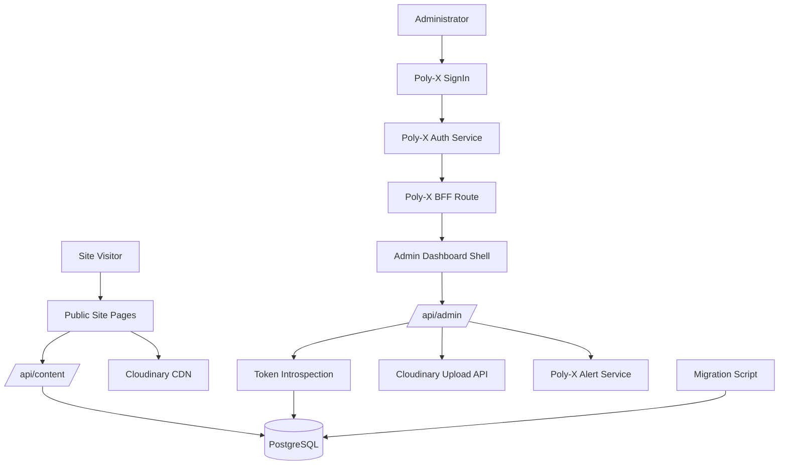
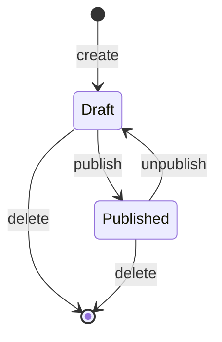
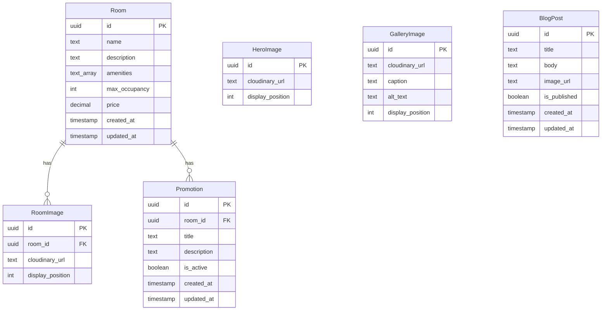
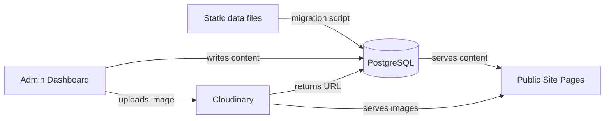
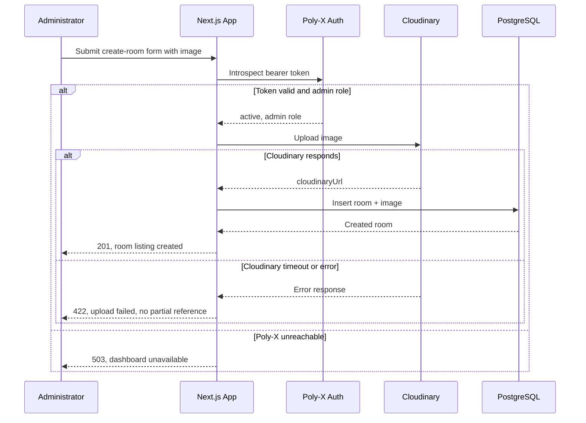
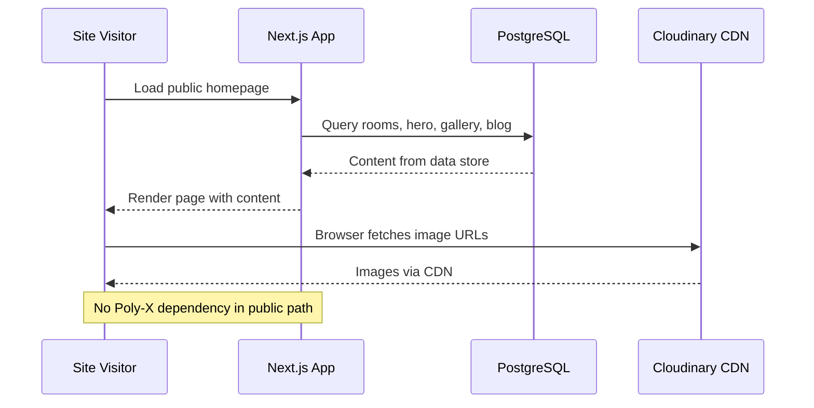
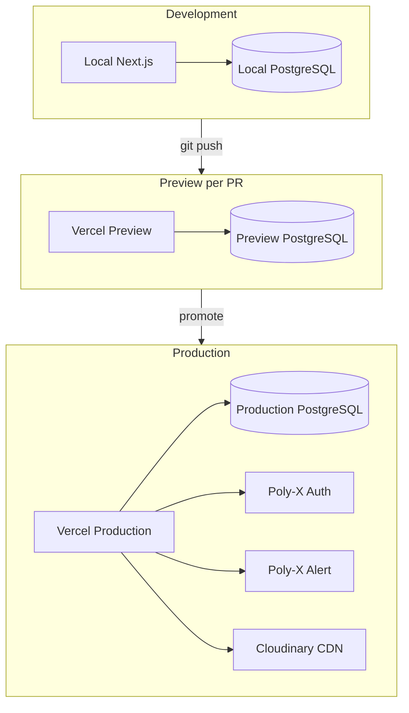

# Software Design Specification

| Project | Client | Version | Date |
| --- | --- | --- | --- |
| Alam Guest house | Abid Alam | 1.0 | 2026-11-01 |

## 1. Architecture Overview

### Design Stakeholders and Concerns

| Stakeholder | Concern | Addressed in |
|---|---|---|
| Abid Alam (client sponsor, owner) | Project meets the need to update site content without a developer; deliverables accepted on his confirmation | §3 Architecture Decisions, §8 Open Questions |
| Administrator (end user) | Can sign in and manage rooms, hero images, prices, promotions, gallery, and blog posts without technical assistance | §2 Design Components (DC-001 through DC-011) |
| Site visitors (guests) | See current room listings, prices, promotions, gallery images, and blog posts; public site available during Poly-X outages | §2 DC-009, §6 Deployment |
| Security officer | Data protection, MFA, RBAC, fail-closed authentication, no credential custody by the product | §2 DC-001, §7 Security Design |
| Developers (build team) | Build order, local setup, Poly-X SDK integration, migration script | §2 Design Components, §6 Deployment |
| Operations team | Deployment guide, environment variables, monitoring, recovery procedures | §6 Deployment |
| Auditors | Traceability of access control, MFA enforcement, business continuity | §7 Security Design |

The architecture is a modular monolith: a single Next.js App Router application with two logical boundaries (public site and admin dashboard) separated by route-level authorization. This fits the requirements because the admin dashboard must be built within the existing Next.js application (SCOPE-001), the public site must remain available during Poly-X outages while the admin dashboard fails closed (REQ-FUNC-003, REQ-NFUNC-007), and the request volume is low (one administrator plus public site visitors). A single deployable unit avoids the operational complexity of separate services for a guest house website.

The diagram shows every design component: DC-001 (Poly-X Authentication and Authorization Middleware) covers the SignIn, Poly-X Auth Service, BFF, and Token Introspection nodes. DC-002 (Content Data Store) is PostgreSQL. DC-003 (Cloudinary Image Upload Service) is the Cloudinary Upload API. DC-004 through DC-008 are the admin API routes under /api/admin/. DC-009 (Public Content Delivery) is the Public Site Pages and /api/content/ endpoints. DC-010 (Static Content Migration) is the Migration Script. DC-011 (Admin Dashboard Shell and Accessibility) is the Admin Dashboard Shell. DC-012 (Notification Dispatcher) calls the Poly-X Alert Service.

## 2. Design Components

### DC-001 - Poly-X Authentication and Authorization Middleware

**Purpose.** This component protects every admin dashboard route by verifying the Poly-X access token, enforcing the admin role grant, checking organization-id matching, and failing closed with 401, 403, or 503. It exists because REQ-FUNC-001, REQ-FUNC-002, REQ-FUNC-003, and REQ-NFUNC-003 require authenticated admin sessions with MFA and fail-closed behaviour, and the TAD mandates Poly-X for identity rather than building authentication.

**Responsibilities.**
- Mount the Poly-X BFF catch-all route for sign-in, callback, refresh, signout, and MFA flows.
- Apply the `proxy()` edge middleware to gate admin routes.
- Introspect the Poly-X token on every admin API request and extract `userId`, `organizationId`, and `roles`.
- Enforce the admin role grant on every admin operation.
- Return 401 when unauthenticated, 403 when the admin role is absent, 503 when Poly-X is unreachable within 5 seconds.

**Interfaces.**
- `app/api/polyx/[...polyx]/route.ts` (api): Poly-X BFF catch-all handler mounting `createPolyXHandler()` for sign-in, callback, refresh, signout, MFA, and session actions.
- `proxy.ts` edge middleware (other): `proxy({ protectedRoutes })` from `@poly-x/next/proxy` gating `/admin/*` routes, excluding `/api/polyx`, `/sign-in`, `/forgot-password`, `/reset-password`, `/claim`.
- `polyx.auth.introspect(token)` (other): Token introspection call to `POST /v1/auth/authz/introspect` returning `active`, `userId`, `organizationId`, `sessionId`, `roles`, `permissions`.

**Data stores.** None.

**Requirements implemented.** REQ-FUNC-001, REQ-FUNC-002, REQ-FUNC-003, REQ-NFUNC-002, REQ-NFUNC-003.

**Depends on.** None (foundational component; other DCs depend on this).

**Error handling and resilience.**
- Introspection call has a 5-second timeout; if Poly-X is unreachable, the middleware returns 503 immediately (fail closed).
- No retries on introspection: a failed check must not let a request through.
- Introspection results cached briefly (max 60 seconds) keyed by user, session, and `permVersion`; re-introspect when `permVersion` changes or the cache expires.
- No circuit breaker needed: introspection is a per-request authorization decision, not a retryable data fetch.

**Configuration and secrets per environment.**
- `NEXT_PUBLIC_POLYX_PUBLISHABLE_KEY` (pk_ key, browser-safe).
- `POLYX_SESSION_SECRET` (server-only, AES-GCM session sealing).
- `POLYX_BASE_URL` (Poly-X auth backend URL).
- `POLYX_COOKIE_SECURE` (false in local http, true in production https).
- `POLYX_SECRET_KEY` (sk_ key, server-only, for `@poly-x/sdk`).
- `POLYX_PUBLIC_ORIGIN` or `trustForwardedOrigin` (behind a reverse proxy).

**Caching.** Introspection results cached keyed by user, session, and `permVersion` for up to 60 seconds. Cache invalidated on `permVersion` change or expiry.

**Implementation units.**

| Unit | Type | Title | Contract |
|---|---|---|---|
| DC-001-01 | module | Poly-X BFF catch-all route | `createPolyXHandler()` at `app/api/polyx/[...polyx]/route.ts`; env: `NEXT_PUBLIC_POLYX_PUBLISHABLE_KEY` (pk_), `POLYX_SESSION_SECRET`, `POLYX_BASE_URL`, `POLYX_COOKIE_SECURE`; handles sign-in, callback, refresh, signout, MFA, claiming; 404 unknown segments, 405 wrong methods |
| DC-001-02 | module | Edge gate middleware | `proxy({ protectedRoutes: ['/admin/*'], signInPath: '/sign-in', redirectParam: 'redirect' })` in `proxy.ts`; matcher excludes `/api/polyx`; `/sign-in`, `/forgot-password`, `/reset-password`, `/claim` stay public; `/claim` reachable while signed in |
| DC-001-03 | module | Token introspection and admin role enforcement middleware | `polyx.auth.introspect(bearerToken)` -> `{ active, userId, organizationId, sessionId, permissions }`; check admin role in `permissions.modulePermissions`; 401 inactive token, 403 missing admin role or org-id mismatch, 503 Poly-X unreachable within 5s timeout; cache keyed by user+session+permVersion, max-age 60s |
| DC-001-04 | ui-component | Admin sign-in page | `<SignIn forgotPasswordUrl='/forgot-password' onRecoveryCodes={showOnce} />` at `/sign-in`; import `@poly-x/next/styles.css`; MFA steps inline; redirects to `/admin` on success |
| DC-001-05 | ui-component | Account lifecycle pages | `/forgot-password` -> `<ForgotPassword signInPath='/sign-in' />`; `/reset-password` -> `<ResetPassword token={token} signInPath='/sign-in' forgotPasswordPath='/forgot-password' />`; `/claim` -> `<ClaimAccount token={token} signInPath='/sign-in' />`; token from `searchParams` in RSC |

### DC-002 - Content Data Store

**Purpose.** This component provides the PostgreSQL database schema and Prisma ORM layer that persists all managed content (rooms, room images, promotions, hero images, gallery images, blog posts). It exists because REQ-FUNC-020 and REQ-NFUNC-006 require content to persist across restarts and deployments, and the TAD selects PostgreSQL 16 managed with Prisma 6.

**Responsibilities.**
- Define the Prisma schema for Room, RoomImage, Promotion, HeroImage, GalleryImage, and BlogPost tables.
- Provide type-safe database access via Prisma client for all content operations.
- Ensure content survives application restarts and deployments.
- Enforce referential integrity (RoomImage and Promotion reference Room).
- Support content volumes of tens of rooms and hundreds of images and posts without performance degradation.

**Interfaces.**
- `prisma.room.*` (db): Prisma client access to Room table for CRUD operations.
- `prisma.roomImage.*` (db): Prisma client access to RoomImage table.
- `prisma.promotion.*` (db): Prisma client access to Promotion table.
- `prisma.heroImage.*` (db): Prisma client access to HeroImage table.
- `prisma.galleryImage.*` (db): Prisma client access to GalleryImage table.
- `prisma.blogPost.*` (db): Prisma client access to BlogPost table.

**Data stores.** PostgreSQL managed database (Room, RoomImage, Promotion, HeroImage, GalleryImage, BlogPost tables).

**Requirements implemented.** REQ-FUNC-020, REQ-NFUNC-006, REQ-NFUNC-004.

**Depends on.** None (foundational data layer; other DCs depend on this).

**Error handling and resilience.**
- Prisma client connection errors surface as 500 on public endpoints and 503 on admin endpoints (after auth passes).
- Connection pooling managed by Prisma with a configurable pool size per environment.
- No retries on write operations: content management requires immediate consistency feedback.

**Configuration and secrets per environment.**
- `DATABASE_URL` (PostgreSQL connection string, server-only).

**Caching.** Not applicable at the data store layer. Caching of reads is handled by DC-009 (public content delivery) at the Next.js level.

**Implementation units.**

| Unit | Type | Title | Contract |
|---|---|---|---|
| DC-002-01 | table | Room table | `Room { id UUID PK, name text not null, description text, amenities text[], max_occupancy int not null, price decimal(10,2) not null, created_at timestamp not null, updated_at timestamp not null }` |
| DC-002-02 | table | RoomImage table | `RoomImage { id UUID PK, room_id UUID FK->Room not null, cloudinary_url text not null, display_position int not null }` |
| DC-002-03 | table | Promotion table | `Promotion { id UUID PK, room_id UUID FK->Room not null, title text not null, description text, is_active boolean not null default true, created_at timestamp not null, updated_at timestamp not null }` |
| DC-002-04 | table | HeroImage table | `HeroImage { id UUID PK, cloudinary_url text not null, display_position int not null }` |
| DC-002-05 | table | GalleryImage table | `GalleryImage { id UUID PK, cloudinary_url text not null, caption text, alt_text text, display_position int not null }` |
| DC-002-06 | table | BlogPost table | `BlogPost { id UUID PK, title text not null, body text not null, image_url text nullable, is_published boolean not null default false, created_at timestamp not null, updated_at timestamp not null }` |
| DC-002-07 | module | Prisma client and schema configuration | `prisma/schema.prisma` defining all tables; Prisma client generated; env `DATABASE_URL`; indexes on PKs and FKs; supports tens of rooms, hundreds of images and posts |

### DC-003 - Cloudinary Image Upload Service

**Purpose.** This component provides the image upload endpoint that sends images from the admin dashboard to Cloudinary and returns the Cloudinary URL for storage in the data store. It exists because REQ-FUNC-010 requires all dashboard images to be uploaded to Cloudinary with the returned URL stored as the image reference, and the TAD mandates Cloudinary.

**Responsibilities.**
- Accept image file uploads from admin dashboard forms.
- Send images to Cloudinary via the `cloudinary` npm package.
- Return the Cloudinary URL to the calling form for storage in PostgreSQL.
- Reject the submission with an error message if Cloudinary upload fails, without storing a partial image reference.

**Interfaces.**
- `POST /api/admin/upload` (api): Accepts a multipart image file, uploads to Cloudinary, returns the Cloudinary URL.

**Data stores.** None (stores the returned URL via the calling component's data store access).

**Requirements implemented.** REQ-FUNC-010.

**Depends on.** DC-001 (token introspection middleware for admin auth).

**Error handling and resilience.**
- 10-second timeout on the Cloudinary upload call.
- No retries: image upload is a user-initiated action with an immediate success or failure response displayed in the form.
- On failure, returns 422 with an error message and does not store a partial image reference.
- Existing images already stored in the data store remain available from the Cloudinary CDN during upload outages.

**Configuration and secrets per environment.**
- `CLOUDINARY_API_KEY` (server-only).
- `CLOUDINARY_API_SECRET` (server-only).
- `CLOUDINARY_CLOUD_NAME`.

**Implementation units.**

| Unit | Type | Title | Contract |
|---|---|---|---|
| DC-003-01 | endpoint | POST /api/admin/upload | `POST /api/admin/upload` (multipart file) -> 200 `{ url: cloudinaryUrl }` | 401 | 403 | 422 upload failed | 503 Poly-X unreachable; 10s timeout on Cloudinary call; no partial reference stored on failure |

### DC-004 - Room Listing Management

**Purpose.** This component provides admin dashboard UI and API endpoints for creating, editing, and deleting room listings with name, description, amenities, images, maximum occupancy, and price. It exists because REQ-FUNC-004, REQ-FUNC-005, REQ-FUNC-006, and REQ-FUNC-011 require full CRUD on room listings and price updates through the dashboard.

**Responsibilities.**
- Provide create-room form with fields for name, description, amenities, images, max occupancy, and price.
- Provide edit-room form populated with existing values.
- Validate room submissions with zod (name required, price numeric and positive, max occupancy positive).
- Store room listings in PostgreSQL via Prisma.
- Delete room listings and cascade-delete associated images and promotions from the data store.
- Update room price field specifically.

**Interfaces.**
- `POST /api/admin/rooms` (api): Create a new room listing.
- `PUT /api/admin/rooms/:id` (api): Edit an existing room listing.
- `DELETE /api/admin/rooms/:id` (api): Delete a room listing.
- `PUT /api/admin/rooms/:id/price` (api): Update a room price.

**Data stores.** PostgreSQL Room and RoomImage tables.

**Requirements implemented.** REQ-FUNC-004, REQ-FUNC-005, REQ-FUNC-006, REQ-FUNC-011.

**Depends on.** DC-001 (auth middleware), DC-002 (data store), DC-003 (image upload for form image fields).

**Error handling and resilience.**
- Zod validation on every request; 422 returned for invalid input with a field-specific error message.
- 404 returned when the requested room ID does not exist.
- Deleting a room cascades to RoomImage and Promotion records in a single Prisma transaction.
- No retries on write operations: the admin form displays the result immediately.

**Implementation units.**

| Unit | Type | Title | Contract |
|---|---|---|---|
| DC-004-01 | endpoint | POST /api/admin/rooms | `POST /api/admin/rooms { name, description, amenities[], imageUrls[], maxOccupancy, price }` -> 201 `{ room }` | 401 | 403 | 422 validation error | 503 |
| DC-004-02 | endpoint | PUT /api/admin/rooms/:id | `PUT /api/admin/rooms/:id { name?, description?, amenities?, imageUrls?, maxOccupancy?, price? }` -> 200 `{ room }` | 401 | 403 | 404 | 422 | 503 |
| DC-004-03 | endpoint | DELETE /api/admin/rooms/:id | `DELETE /api/admin/rooms/:id` -> 204 | 401 | 403 | 404 | 503; cascade-delete RoomImage and Promotion |
| DC-004-04 | endpoint | PUT /api/admin/rooms/:id/price | `PUT /api/admin/rooms/:id/price { price }` -> 200 `{ room }` | 401 | 403 | 404 | 422 price invalid | 503 |
| DC-004-05 | ui-component | Room listings management UI | Pages at `/admin/rooms`, `/admin/rooms/new`, `/admin/rooms/:id/edit`; forms with name, description, amenities, images, maxOccupancy, price fields; image upload calls `/api/admin/upload`; zod validation; WCAG 2.2 AA |

### DC-005 - Hero Section Image Management

**Purpose.** This component provides admin dashboard UI and API endpoints for adding, removing, and reordering hero section images on the homepage carousel. It exists because REQ-FUNC-007, REQ-FUNC-008, and REQ-FUNC-009 require hero image management through the dashboard.

**Responsibilities.**
- Provide hero image management interface showing current carousel images and positions.
- Add a hero image by uploading to Cloudinary and storing the URL and display position.
- Remove a hero image from the data store.
- Reorder hero images by updating display positions.

**Interfaces.**
- `POST /api/admin/hero-images` (api): Add a hero image with display position.
- `DELETE /api/admin/hero-images/:id` (api): Remove a hero image.
- `PUT /api/admin/hero-images/reorder` (api): Reorder hero images by updating display positions.

**Data stores.** PostgreSQL HeroImage table.

**Requirements implemented.** REQ-FUNC-007, REQ-FUNC-008, REQ-FUNC-009.

**Depends on.** DC-001 (auth middleware), DC-002 (data store), DC-003 (image upload).

**Error handling and resilience.**
- 404 returned when the requested hero image ID does not exist.
- Reorder operation updates all display positions in a single Prisma transaction.
- No retries on write operations.

**Implementation units.**

| Unit | Type | Title | Contract |
|---|---|---|---|
| DC-005-01 | endpoint | POST /api/admin/hero-images | `POST /api/admin/hero-images { cloudinaryUrl, displayPosition }` -> 201 `{ heroImage }` | 401 | 403 | 422 | 503 |
| DC-005-02 | endpoint | DELETE /api/admin/hero-images/:id | `DELETE /api/admin/hero-images/:id` -> 204 | 401 | 403 | 404 | 503 |
| DC-005-03 | endpoint | PUT /api/admin/hero-images/reorder | `PUT /api/admin/hero-images/reorder { orderedIds: string[] }` -> 200 `{ heroImages[] }` | 401 | 403 | 422 | 503 |
| DC-005-04 | ui-component | Hero images management UI | Page at `/admin/hero`; list of hero images with positions; add button calls `/api/admin/upload` then `POST /api/admin/hero-images`; remove button calls DELETE; reorder calls PUT reorder; WCAG 2.2 AA |

### DC-006 - Promotion Management

**Purpose.** This component provides admin dashboard UI and API endpoints for creating, editing, and removing promotions associated with rooms, and for displaying active promotions on the public site. It exists because REQ-FUNC-012, REQ-FUNC-013, REQ-FUNC-014, and REQ-FUNC-015 require promotion management through the dashboard and public display of active promotions.

**Responsibilities.**
- Provide promotions management interface with create, edit, and remove forms.
- Create a promotion associated with a room.
- Edit promotion details (title, description, active status).
- Remove a promotion from the data store.
- Display active promotions on the public site for their associated rooms.

**Interfaces.**
- `POST /api/admin/promotions` (api): Create a promotion for a room.
- `PUT /api/admin/promotions/:id` (api): Edit a promotion.
- `DELETE /api/admin/promotions/:id` (api): Remove a promotion.
- `GET /api/content/rooms` (promotions subset) (api): Public endpoint includes active promotions for rooms.

**Data stores.** PostgreSQL Promotion table.

**Requirements implemented.** REQ-FUNC-012, REQ-FUNC-013, REQ-FUNC-014, REQ-FUNC-015.

**Depends on.** DC-001 (auth middleware), DC-002 (data store).

**Error handling and resilience.**
- Zod validation: `roomId` must reference an existing room, `title` non-blank.
- 404 returned when the requested promotion ID does not exist.
- No retries on write operations.

**Implementation units.**

| Unit | Type | Title | Contract |
|---|---|---|---|
| DC-006-01 | endpoint | POST /api/admin/promotions | `POST /api/admin/promotions { roomId, title, description?, isActive }` -> 201 `{ promotion }` | 401 | 403 | 422 | 503 |
| DC-006-02 | endpoint | PUT /api/admin/promotions/:id | `PUT /api/admin/promotions/:id { title?, description?, isActive? }` -> 200 `{ promotion }` | 401 | 403 | 404 | 422 | 503 |
| DC-006-03 | endpoint | DELETE /api/admin/promotions/:id | `DELETE /api/admin/promotions/:id` -> 204 | 401 | 403 | 404 | 503 |
| DC-006-04 | ui-component | Promotions management UI | Page at `/admin/promotions`; list of promotions with room name, title, active status; create/edit form with room selector, title, description, isActive; WCAG 2.2 AA |
| DC-006-05 | module | Active promotions public display | Public content query includes promotions where `is_active = true`, joined to Room; removed or inactive promotions excluded from public response |

### DC-007 - Gallery Management

**Purpose.** This component provides admin dashboard UI and API endpoints for adding, editing, and removing gallery images with caption and alt text. It exists because REQ-FUNC-016, REQ-FUNC-017, and REQ-FUNC-018 require gallery image management through the dashboard.

**Responsibilities.**
- Provide gallery management interface showing current images with captions and alt text.
- Add a gallery image by uploading to Cloudinary and storing URL, caption, alt text, and display position.
- Edit caption and alt text of existing gallery images.
- Remove a gallery image from the data store.

**Interfaces.**
- `POST /api/admin/gallery` (api): Add a gallery image.
- `PUT /api/admin/gallery/:id` (api): Edit gallery image caption and alt text.
- `DELETE /api/admin/gallery/:id` (api): Remove a gallery image.

**Data stores.** PostgreSQL GalleryImage table.

**Requirements implemented.** REQ-FUNC-016, REQ-FUNC-017, REQ-FUNC-018.

**Depends on.** DC-001 (auth middleware), DC-002 (data store), DC-003 (image upload).

**Error handling and resilience.**
- 404 returned when the requested gallery image ID does not exist.
- No retries on write operations.

**Implementation units.**

| Unit | Type | Title | Contract |
|---|---|---|---|
| DC-007-01 | endpoint | POST /api/admin/gallery | `POST /api/admin/gallery { cloudinaryUrl, caption?, altText?, displayPosition }` -> 201 `{ galleryImage }` | 401 | 403 | 422 | 503 |
| DC-007-02 | endpoint | PUT /api/admin/gallery/:id | `PUT /api/admin/gallery/:id { caption?, altText? }` -> 200 `{ galleryImage }` | 401 | 403 | 404 | 422 | 503 |
| DC-007-03 | endpoint | DELETE /api/admin/gallery/:id | `DELETE /api/admin/gallery/:id` -> 204 | 401 | 403 | 404 | 503 |
| DC-007-04 | ui-component | Gallery management UI | Page at `/admin/gallery`; grid of gallery images with caption and alt text; add form with image upload, caption, alt text; edit form for caption and alt text; remove button; WCAG 2.2 AA |

### DC-008 - Blog Post Management

**Purpose.** This component provides admin dashboard UI and API endpoints for creating, editing, publishing, and deleting blog posts with title, body content, and image. It exists because REQ-FUNC-022, REQ-FUNC-023, REQ-FUNC-024, and REQ-FUNC-025 require blog post management through the dashboard.

**Responsibilities.**
- Provide blog posts management interface with create, edit, publish, and delete controls.
- Create a blog post with title, body content, and image.
- Edit blog post title, body content, or image.
- Publish a blog post by setting `is_published` to true.
- Delete a blog post from the data store.

**Interfaces.**
- `POST /api/admin/blog-posts` (api): Create a blog post.
- `PUT /api/admin/blog-posts/:id` (api): Edit a blog post.
- `PUT /api/admin/blog-posts/:id/publish` (api): Publish a blog post.
- `DELETE /api/admin/blog-posts/:id` (api): Delete a blog post.

**Data stores.** PostgreSQL BlogPost table.

**Requirements implemented.** REQ-FUNC-022, REQ-FUNC-023, REQ-FUNC-024, REQ-FUNC-025.

**Depends on.** DC-001 (auth middleware), DC-002 (data store), DC-003 (image upload).

**Error handling and resilience.**
- Zod validation: `title` non-blank, `body` non-blank before create or publish.
- 404 returned when the requested blog post ID does not exist.
- No retries on write operations.

**Blog post state machine.**

The administrator creates a blog post in the Draft state. Publishing moves it to Published, where it appears on the public site. Unpublishing returns it to Draft. Deleting from either state removes it from the data store and the public site.

**Implementation units.**

| Unit | Type | Title | Contract |
|---|---|---|---|
| DC-008-01 | endpoint | POST /api/admin/blog-posts | `POST /api/admin/blog-posts { title, body, imageUrl? }` -> 201 `{ blogPost }` | 401 | 403 | 422 title or body blank | 503 |
| DC-008-02 | endpoint | PUT /api/admin/blog-posts/:id | `PUT /api/admin/blog-posts/:id { title?, body?, imageUrl? }` -> 200 `{ blogPost }` | 401 | 403 | 404 | 422 | 503 |
| DC-008-03 | endpoint | PUT /api/admin/blog-posts/:id/publish | `PUT /api/admin/blog-posts/:id/publish` -> 200 `{ blogPost, is_published: true }` | 401 | 403 | 404 | 503 |
| DC-008-04 | endpoint | DELETE /api/admin/blog-posts/:id | `DELETE /api/admin/blog-posts/:id` -> 204 | 401 | 403 | 404 | 503 |
| DC-008-05 | ui-component | Blog posts management UI | Pages at `/admin/blog-posts`, `/admin/blog-posts/new`, `/admin/blog-posts/:id/edit`; list with title and published status; form with title, body, image upload; publish button; delete with confirmation; WCAG 2.2 AA |

### DC-009 - Public Content Delivery

**Purpose.** This component provides the public content API endpoints and modifies existing public-facing components to read content from PostgreSQL instead of static TypeScript data files, preserving the existing visual design. It exists because REQ-FUNC-019, REQ-FUNC-026, REQ-NFUNC-001, and REQ-NFUNC-007 require the public site to serve managed content from the data store without degrading the visitor experience and to remain available during Poly-X outages.

**Responsibilities.**
- Provide unauthenticated public content endpoints for rooms, hero images, gallery, and published blog posts.
- Modify existing Hero, RoomsSection, and GallerySection components to read from PostgreSQL via Prisma instead of static data files.
- Preserve the existing visual design and page structure of the public website.
- Ensure the public site has no runtime dependency on Poly-X.
- Cache data store reads where appropriate to maintain response time comparable to the static version.

**Interfaces.**
- `GET /api/content/rooms` (api): List room listings with prices and active promotions, no auth required.
- `GET /api/content/hero-images` (api): List hero images in display order, no auth required.
- `GET /api/content/gallery` (api): List gallery images in display order, no auth required.
- `GET /api/content/blog-posts` (api): List published blog posts, no auth required.

**Data stores.** PostgreSQL (reads from Room, RoomImage, Promotion, HeroImage, GalleryImage, BlogPost tables).

**Requirements implemented.** REQ-FUNC-019, REQ-FUNC-026, REQ-NFUNC-001, REQ-NFUNC-007.

**Depends on.** DC-002 (data store), DC-006 (active promotions public display logic).

**Error handling and resilience.**
- No Poly-X dependency in the public code path: public endpoints and pages never call Poly-X, ensuring availability during Poly-X outages (REQ-NFUNC-007).
- 500 returned if the data store is unavailable; handling of this scenario (error page or fallback content) is an open question.
- No retries on public reads: the page renders or returns an error.

**Caching.** Next.js server component data fetching with caching at the framework level (e.g., `fetch` with `cache: 'force-cache'` or Next.js `revalidate` directives) to maintain response time comparable to the static version (REQ-NFUNC-001). Cache invalidated on revalidation interval or manual revalidation after admin content changes.

**Implementation units.**

| Unit | Type | Title | Contract |
|---|---|---|---|
| DC-009-01 | endpoint | GET /api/content/rooms | `GET /api/content/rooms` -> 200 `{ rooms: [{ id, name, description, amenities, maxOccupancy, price, images, promotions }] }` | 500; no auth required; active promotions only |
| DC-009-02 | endpoint | GET /api/content/hero-images | `GET /api/content/hero-images` -> 200 `{ heroImages: [{ id, cloudinaryUrl, displayPosition }] }` | 500; ordered by display_position |
| DC-009-03 | endpoint | GET /api/content/gallery | `GET /api/content/gallery` -> 200 `{ galleryImages: [{ id, cloudinaryUrl, caption, altText, displayPosition }] }` | 500; ordered by display_position |
| DC-009-04 | endpoint | GET /api/content/blog-posts | `GET /api/content/blog-posts` -> 200 `{ blogPosts: [{ id, title, body, imageUrl, createdAt }] }` | 500; `is_published = true` only |
| DC-009-05 | module | Public component modification | Hero, RoomsSection, GallerySection components: replace imports from `data/` with Prisma queries; same JSX structure and styling; no Poly-X dependency in public code path; Next.js server component data fetching with caching |

### DC-010 - Static Content Migration

**Purpose.** This component provides the migration script that reads existing static content from `data/rooms.ts`, `data/hero.ts`, `data/gallery.ts`, and related files and writes it into PostgreSQL as initial content. It exists because REQ-FUNC-021 requires existing static content to be migrated to the data store as initial content, and the TAD specifies a migration script with an idempotent upsert approach.

**Responsibilities.**
- Read existing static content from `data/rooms.ts`, `data/hero.ts`, `data/gallery.ts`, and related files.
- Transform static data into the PostgreSQL schema format.
- Write migrated content into PostgreSQL via Prisma.
- Be idempotent: upsert content by matching existing IDs from static files.
- Report specific file and field errors if a static data file is missing or has unexpected structure.

**Interfaces.**
- `scripts/migrate-static-content.ts` (job): Migration script that reads static data files and writes to PostgreSQL.

**Data stores.** PostgreSQL (writes to Room, RoomImage, HeroImage, GalleryImage tables).

**Requirements implemented.** REQ-FUNC-021.

**Depends on.** DC-002 (data store and Prisma client).

**Error handling and resilience.**
- If a static data file is missing or has unexpected structure, the script reports the specific file and field that caused the error and halts.
- If the data store is unavailable, the script reports the connection error and halts; no partial data is written.
- The script is idempotent: running it multiple times upserts by matching existing IDs, so re-runs are safe.
- The script does not modify or delete the static data files, enabling rollback.

**Implementation units.**

| Unit | Type | Title | Contract |
|---|---|---|---|
| DC-010-01 | worker | Static content migration script | `npx tsx scripts/migrate-static-content.ts`; reads `data/rooms.ts` -> Room + RoomImage upsert; `data/hero.ts` -> HeroImage upsert; `data/gallery.ts` -> GalleryImage upsert; idempotent by ID match; reports file/field errors and halts; does not delete or modify static files |

### DC-011 - Admin Dashboard Shell and Accessibility

**Purpose.** This component provides the admin dashboard layout shell, navigation, and accessibility conformance across all admin dashboard screens. It exists because REQ-NFUNC-005 requires the admin dashboard to conform to WCAG 2.2 AA, and a consistent shell with navigation, header, and Poly-X UserButton ties the dashboard sections together.

**Responsibilities.**
- Provide the admin dashboard layout at `/admin/layout.tsx` with navigation to rooms, hero, promotions, gallery, and blog posts sections.
- Include Poly-X UserButton with profile editing and MFA self-service in the header.
- Ensure all dashboard screens conform to WCAG 2.2 AA.
- Provide consistent navigation, breadcrumbs, and error states across dashboard sections.

**Interfaces.**
- `/admin/layout.tsx` (ui): Admin dashboard layout shell with navigation and UserButton.

**Data stores.** None.

**Requirements implemented.** REQ-NFUNC-005.

**Depends on.** DC-001 (sign-in page and UserButton from Poly-X).

**Error handling and resilience.**
- Navigation and layout errors surface as error boundaries within the admin shell.
- No outbound calls: the layout shell is a static UI structure.

**Implementation units.**

| Unit | Type | Title | Contract |
|---|---|---|---|
| DC-011-01 | ui-component | Admin dashboard layout and navigation | `/admin/layout.tsx`; nav links to rooms, hero, promotions, gallery, blog-posts; `<UserButton showUserProfile>` in header; semantic HTML, ARIA labels, keyboard nav; WCAG 2.2 AA; 0 violations on automated audit |

### DC-012 - Notification Dispatcher

**Purpose.** This component provides the notification dispatcher unit that calls Poly-X poly-alert for email and in-app notifications when content events occur. It exists because the scope constraints mandate Poly-X for notifications rather than building a product-owned mailer, and the TAD (TAD-006) selects poly-alert. Which content events trigger notifications is an open question.

**Responsibilities.**
- Call poly-alert email endpoint (`POST /v1/email/send`) for email notifications.
- Call poly-alert push endpoint (`POST /v1/push`) for in-app notifications.
- Retry on transient failures with exponential backoff and jitter.
- Record delivery status for each notification.
- Route messages that keep failing to a dead-letter path.
- Do not block content management operations if a notification cannot be sent.

**Interfaces.**
- `POST /v1/email/send` (poly-alert) (api): Send email notification via Poly-X alert service.
- `POST /v1/push` (poly-alert) (api): Send in-app push notification via Poly-X alert service.

**Data stores.** None.

**Requirements implemented.** REQ-FUNC-001.

**Depends on.** DC-001 (auth middleware for the admin context in which notifications are dispatched).

**Error handling and resilience.**
- 10-second timeout per poly-alert call.
- Retries on transient failures with exponential backoff and jitter (max 3 retries, base 1 second).
- Messages that fail after max retries are routed to a dead-letter path for manual inspection.
- Delivery status recorded for each notification attempt.
- Content management operations are not blocked if a notification cannot be sent: the dispatcher runs after the content write completes.

**Configuration and secrets per environment.**
- `POLY_ALERT_BASE_URL` (Poly-X alert service base URL, per environment).
- `POLYX_SECRET_KEY` (sk_ key, shared with DC-001 for `@poly-x/sdk` calls).

**Implementation units.**

| Unit | Type | Title | Contract |
|---|---|---|---|
| DC-012-01 | module | Notification dispatcher unit | `dispatchNotification({ type, recipient, channel, content })` -> calls poly-alert `POST /v1/email/send` or `POST /v1/push`; 10s timeout; retry x3 with backoff+jitter; dead-letter on max retries; delivery status recorded; non-blocking |

## 3. Architecture Decisions

### Poly-X for identity, authentication, and authorization

**Context:** The admin dashboard requires authenticated access with MFA and the admin role (REQ-FUNC-001, REQ-FUNC-002, REQ-NFUNC-003). The scope constraints mandate Poly-X for identity rather than building authentication, session management, or password handling. The system must fail closed when Poly-X is unreachable (REQ-FUNC-003).

**Decision criteria:** No credential custody by the product; MFA and RBAC handled by the platform; minimal integration effort within the existing Next.js application; fail-closed behaviour with 401, 403, and 503 responses.

| Option | Selected | Why rejected |
|---|---|---|
| Poly-X auth service via @poly-x/next and @poly-x/sdk | Yes | - |
| Auth0 with custom Next.js integration | No | Client constraints mandate Poly-X; Poly-X provides existing tenancy and RBAC without credential custody by the product |
| Keycloak self-hosted | No | Adds operational burden for a single-admin guest house site; Poly-X is the mandated platform |

**Decision:** Use Poly-X auth service (poly-auth) with @poly-x/next 0.18.3 on the frontend and @poly-x/sdk 0.18.3 on the back end. `createPolyXHandler()` catch-all is mounted at `app/api/polyx/[...polyx]/route.ts`. `proxy({ protectedRoutes })` edge middleware gates admin routes. The back end calls `polyx.auth.introspect(token)` to verify each admin request. The session is an AES-GCM sealed httpOnly cookie. MFA is enforced by Poly-X for the admin role. Fail closed: 401 unauthenticated, 403 no admin role, 503 Poly-X unreachable.

**Consequences:**
- Positive: no credential custody by the product; MFA, sessions, and RBAC handled by the platform; single SDK integration for frontend and back end; no local password store or token signing.
- Negative: the admin dashboard is unavailable when Poly-X is unreachable (mitigated by REQ-NFUNC-007: the public site remains available). The product depends on Poly-X availability for admin operations.

### Fail-closed authentication with public site isolation

**Context:** When Poly-X is unreachable, the admin dashboard must return 503 within 5 seconds (REQ-FUNC-003, REQ-NFUNC-002) and the public site must continue serving content from the data store (REQ-NFUNC-007).

**Decision criteria:** Security is never bypassed; the 5-second response time is met; the public site has no runtime dependency on Poly-X; minimal complexity.

| Option | Selected | Why rejected |
|---|---|---|
| Fail closed with public and admin code path separation | Yes | - |
| Fail open with cached admin session | No | Violates REQ-FUNC-003 and REQ-NFUNC-003; security cannot be bypassed when the identity provider is unavailable |
| Poly-X availability probe with graceful degradation | No | Adds complexity; the fail-closed pattern is simpler and meets the 5-second response time requirement |

**Decision:** Admin API routes call `polyx.auth.introspect(token)` on every request. If Poly-X is unreachable, the middleware returns 503 immediately. Public site pages and `/api/content/*` endpoints do not call Poly-X; they read directly from PostgreSQL. This separation ensures the public site has no runtime dependency on Poly-X.

**Consequences:**
- Positive: the public site is fully available during Poly-X outages; admin security is never bypassed; the 5-second 503 response time is met by the introspection call timeout.
- Negative: the admin dashboard is completely unavailable during Poly-X outages; the administrator cannot manage content until Poly-X recovers.

### PostgreSQL (managed) as the content data store

**Context:** All managed content must persist across application restarts and deployments (REQ-FUNC-020, REQ-NFUNC-006) and be served to the public site without performance degradation (REQ-NFUNC-001, REQ-NFUNC-004). The preferred data store is an open question (RISK-001).

**Decision criteria:** Strong consistency for content management; survives restarts and deployments; type-safe database access within Next.js; schema-first migration workflow for the initial data migration; automatic backups and HA.

| Option | Selected | Why rejected |
|---|---|---|
| PostgreSQL 16 managed service with Prisma 6 ORM | Yes | - |
| MongoDB | No | Content is structured and relational; PostgreSQL provides stronger consistency and simpler schema for room listings, promotions, and blog posts with foreign key relationships |
| SQLite | No | Not suitable for a managed deployment with automatic backups and HA |

**Decision:** Use PostgreSQL 16 as a managed database service with Prisma 6 as the ORM. Prisma manages the schema, migrations, and the initial data migration script. The schema includes Room, RoomImage, Promotion, HeroImage, GalleryImage, and BlogPost tables.

**Consequences:**
- Positive: strong consistency, ACID transactions, automatic backups, type-safe database access via Prisma, schema-first migration workflow.
- Negative: a managed PostgreSQL instance adds hosting cost. The client must confirm the data store preference and hosting platform.

### Cloudinary for image upload and delivery

**Context:** All dashboard images must be uploaded to Cloudinary and the returned URL stored as the image reference (REQ-FUNC-010, SCOPE-007). The client mandates Cloudinary.

**Decision criteria:** Client mandate; managed image storage with CDN delivery; automatic image optimization; no image binaries in the data store.

| Option | Selected | Why rejected |
|---|---|---|
| Cloudinary via the cloudinary npm package | Yes | - |
| AWS S3 with CloudFront | No | Client mandates Cloudinary |
| ImageKit | No | Client mandates Cloudinary |

**Decision:** Use Cloudinary for image upload and delivery. The admin upload endpoint (`/api/admin/upload`) sends images to Cloudinary via the Cloudinary SDK and stores the returned URL in PostgreSQL. If Cloudinary returns an error, the endpoint rejects the submission and does not store a partial reference. The public site serves images from the Cloudinary CDN.

**Consequences:**
- Positive: managed image storage with CDN delivery, automatic image optimization, no image binaries in the data store.
- Negative: the product depends on Cloudinary availability for image uploads. Existing images remain available from the CDN during upload outages.

### Modular monolith within the existing Next.js application

**Context:** The admin dashboard and content management layer must be built within the existing Next.js application (SCOPE-001, SCOPE-008). The public site design must be preserved (REQ-FUNC-026).

**Decision criteria:** Single deployable unit; no additional infrastructure; existing design preserved; public and admin code paths isolated by authorization.

| Option | Selected | Why rejected |
|---|---|---|
| Modular monolith: single Next.js app with public and admin boundaries separated by route-level authorization | Yes | - |
| Separate admin SPA with dedicated API server | No | Violates the constraint to build within the existing Next.js application; adds a second build and deployment |
| Microservices with separate admin and content services | No | Disproportionate complexity for a single-admin guest house site with low request volume |

**Decision:** Build the admin dashboard within the existing Next.js App Router application. Public pages and `/api/content/*` endpoints are unauthenticated. Admin pages under `/admin/*` and `/api/admin/*` endpoints are protected by Poly-X `proxy()` middleware and token introspection. Existing public components are modified to read from PostgreSQL instead of static data files, preserving their visual design.

**Consequences:**
- Positive: single deployable unit, single build, no additional infrastructure, existing design preserved, public and admin code paths share the same codebase but are isolated by authorization.
- Negative: admin and public code share the same deployment; a deployment affects both. Mitigated by Vercel preview deployments for testing before production.

### Poly-X for notifications

**Context:** The scope constraints mandate Poly-X for notifications (email, in-app) rather than building a product-owned mailer. Which content events should notify the administrator and through which channel is an open question.

**Decision criteria:** No product-owned mailer; unified platform for identity and notifications; retries and dead-letter path for failed deliveries; content operations not blocked by notification failures.

| Option | Selected | Why rejected |
|---|---|---|
| Poly-X alert service (poly-alert) via @poly-x/sdk 0.18.3 | Yes | - |
| SendGrid used directly | No | Client constraints mandate Poly-X for notifications; Poly-X provides a unified platform for identity and notifications without a product-owned mailer |
| No notifications | No | The scope lists notifications as a constraint, and the dashboard may need to notify the administrator of content events |

**Decision:** Use Poly-X alert service for email and in-app notifications. Email via `POST /v1/email/send` with the `organization-id` header. In-app notifications via `POST /v1/push`. Base URLs from configuration (`POLY_ALERT_BASE_URL`). The notification dispatcher (DC-012) calls poly-alert with retries, delivery status, and a dead-letter path. Content management operations are not blocked if a notification cannot be sent.

**Consequences:**
- Positive: no product-owned mailer; unified platform for identity and notifications; existing templates and sender identity from Poly-X.
- Negative: notification delivery depends on Poly-X alert service availability. Which events trigger notifications is an open question.

## 4. Data Design

The data store replaces the static TypeScript files under `data/` as the source of truth for all managed content. PostgreSQL 16 managed by Prisma 6 holds the entities below. All writes require a Poly-X authenticated session with the admin role; public reads require no authentication.

| Table | Primary key | Fields | Relationships |
|---|---|---|---|
| Room | id (UUID) | id, name, description, amenities, max_occupancy, price, created_at, updated_at | 1:N RoomImage, 1:N Promotion |
| RoomImage | id (UUID) | id, room_id, cloudinary_url, display_position | N:1 Room |
| Promotion | id (UUID) | id, room_id, title, description, is_active, created_at, updated_at | N:1 Room |
| HeroImage | id (UUID) | id, cloudinary_url, display_position | None |
| GalleryImage | id (UUID) | id, cloudinary_url, caption, alt_text, display_position | None |
| BlogPost | id (UUID) | id, title, body, image_url, is_published, created_at, updated_at | None |

**Data integrity rules.**
- `Room.name` is non-blank (REQ-FUNC-004 validation). `Room.price` is a positive decimal. `Room.max_occupancy` is a positive integer.
- `RoomImage.room_id` and `Promotion.room_id` are foreign keys to `Room.id`, non-null. Deleting a Room cascades to its RoomImage and Promotion records.
- `BlogPost.title` and `BlogPost.body` are non-blank (REQ-FUNC-022 validation). `BlogPost.is_published` defaults to false.
- `HeroImage.display_position` and `GalleryImage.display_position` are non-negative integers defining render order on the public site.
- Only blog posts where `is_published` is true appear on the public site (REQ-FUNC-024, REQ-FUNC-025). Only promotions where `is_active` is true appear on the public site (REQ-FUNC-015).

**Concurrency and transactions.** Each admin write operation (create, edit, delete, publish) runs in a single Prisma transaction. The single-admin model means concurrent edits are unlikely; optimistic locking is not required at this scale. The `Idempotency-Key` header is not needed because the admin operates through forms, not retried API calls. Unique constraints on `Room.id`, `RoomImage.id`, `Promotion.id`, `HeroImage.id`, `GalleryImage.id`, and `BlogPost.id` (UUID primary keys) prevent duplicate records.

**Tenancy.** The product is single-tenant for content: one guest house, one admin. The `organization-id` header from Poly-X is checked on admin API routes for authorization (DC-001-03), but content tables do not carry an `organization_id` column because there is a single organization. If the product later serves multiple guest houses, an `organization_id` column would be added to every table and every query scoped by it.

**Retention, archival, and purge.** All content is retained until the administrator explicitly deletes it. No personal data is stored in the content data store. Image binaries are retained in Cloudinary; the data store holds only URL references. A retention and purge policy for managed content is an open question to be confirmed by the client.

**Data migration and seeding.** The migration script (`scripts/migrate-static-content.ts`, DC-010-01) reads existing static content from `data/rooms.ts`, `data/hero.ts`, `data/gallery.ts`, and related files and upserts it into PostgreSQL. The mapping is: `data/rooms.ts` to Room and RoomImage tables, `data/hero.ts` to HeroImage, `data/gallery.ts` to GalleryImage. The script is idempotent (upsert by ID match) and does not modify the static files. Local image paths (for example `/images/rooms/S-room.jpeg`) are stored as-is; new images use Cloudinary URLs. Validation: the script reports the specific file and field on a structure mismatch and halts. Reconciliation counts: the script logs the number of records upserted per table. A failed migration is rolled back by reverting the deployment to the previous version (which reads from static files); the static files remain in the repository as a fallback. Reference data (site config, halls, services) is not migrated in this phase (out of scope).

**Backup and restore.** Daily automated backups with point-in-time recovery (Assumed: managed PostgreSQL default). Restore from backup via the hosting platform's database restore feature. RPO of 24 hours, RTO of 1 hour (Assumed, pending client confirmation). The public site has no dependency on Poly-X for serving content, so a Poly-X outage does not affect the RTO for public site availability.

**Capacity.**
- Initial volume: 3 rooms, 6 hero images, 10 gallery images, 0 blog posts (from the existing static data files).
- Growth per year: estimated tens of room listings, hundreds of gallery images and blog posts (to be confirmed by client, RISK-005).
- Indexes: primary key indexes on all `id` columns; foreign key indexes on `RoomImage.room_id` and `Promotion.room_id`; index on `BlogPost.is_published` for the public query filtering published posts; index on `HeroImage.display_position` and `GalleryImage.display_position` for ordered public reads. These indexes are sufficient for the expected volumes.

## 5. Interface Design

### API Endpoints

**Admin content endpoints (all under `/api/admin/`, require Poly-X bearer token with admin role):**

| Method | Path | Description | Request | Response |
|---|---|---|---|---|
| POST | /api/admin/rooms | Create a room listing | name, description, amenities[], imageUrls[], maxOccupancy, price; Poly-X bearer token | 201 { room } | 401 | 403 | 422 validation error | 503 |
| PUT | /api/admin/rooms/:id | Edit a room listing | name?, description?, amenities?, imageUrls?, maxOccupancy?, price?; Poly-X bearer token | 200 { room } | 401 | 403 | 404 | 422 | 503 |
| DELETE | /api/admin/rooms/:id | Delete a room listing | Poly-X bearer token | 204 | 401 | 403 | 404 | 503 |
| PUT | /api/admin/rooms/:id/price | Update a room price | price; Poly-X bearer token | 200 { room } | 401 | 403 | 404 | 422 | 503 |
| POST | /api/admin/hero-images | Add a hero image | cloudinaryUrl, displayPosition; Poly-X bearer token | 201 { heroImage } | 401 | 403 | 422 | 503 |
| DELETE | /api/admin/hero-images/:id | Remove a hero image | Poly-X bearer token | 204 | 401 | 403 | 404 | 503 |
| PUT | /api/admin/hero-images/reorder | Reorder hero images | orderedIds[]; Poly-X bearer token | 200 { heroImages[] } | 401 | 403 | 422 | 503 |
| POST | /api/admin/promotions | Create a promotion | roomId, title, description?, isActive; Poly-X bearer token | 201 { promotion } | 401 | 403 | 422 | 503 |
| PUT | /api/admin/promotions/:id | Edit a promotion | title?, description?, isActive?; Poly-X bearer token | 200 { promotion } | 401 | 403 | 404 | 422 | 503 |
| DELETE | /api/admin/promotions/:id | Remove a promotion | Poly-X bearer token | 204 | 401 | 403 | 404 | 503 |
| POST | /api/admin/gallery | Add a gallery image | cloudinaryUrl, caption?, altText?, displayPosition; Poly-X bearer token | 201 { galleryImage } | 401 | 403 | 422 | 503 |
| PUT | /api/admin/gallery/:id | Edit gallery image caption and alt text | caption?, altText?; Poly-X bearer token | 200 { galleryImage } | 401 | 403 | 404 | 422 | 503 |
| DELETE | /api/admin/gallery/:id | Remove a gallery image | Poly-X bearer token | 204 | 401 | 403 | 404 | 503 |
| POST | /api/admin/blog-posts | Create a blog post | title, body, imageUrl?; Poly-X bearer token | 201 { blogPost } | 401 | 403 | 422 | 503 |
| PUT | /api/admin/blog-posts/:id | Edit a blog post | title?, body?, imageUrl?; Poly-X bearer token | 200 { blogPost } | 401 | 403 | 404 | 422 | 503 |
| PUT | /api/admin/blog-posts/:id/publish | Publish a blog post | Poly-X bearer token | 200 { blogPost, is_published: true } | 401 | 403 | 404 | 503 |
| DELETE | /api/admin/blog-posts/:id | Delete a blog post | Poly-X bearer token | 204 | 401 | 403 | 404 | 503 |
| POST | /api/admin/upload | Upload an image to Cloudinary | multipart file; Poly-X bearer token | 200 { url } | 401 | 403 | 422 upload failed | 503 |

**Public content endpoints (no authentication required):**

| Method | Path | Description | Request | Response |
|---|---|---|---|---|
| GET | /api/content/rooms | List room listings with prices and active promotions | No auth required | 200 { rooms[] } | 500 |
| GET | /api/content/hero-images | List hero images in display order | No auth required | 200 { heroImages[] } | 500 |
| GET | /api/content/gallery | List gallery images in display order | No auth required | 200 { galleryImages[] } | 500 |
| GET | /api/content/blog-posts | List published blog posts | No auth required | 200 { blogPosts[] } | 500 |

### Error responses and status codes

| Status | Meaning | When returned |
|---|---|---|
| 200 | Success | Successful GET, PUT operations |
| 201 | Created | Successful POST create operations |
| 204 | No content | Successful DELETE operations |
| 401 | Unauthenticated | No Poly-X session or inactive token (all admin endpoints) |
| 403 | Forbidden | Authenticated but lacks admin role, or organization-id mismatch (all admin endpoints) |
| 404 | Not found | Entity with the given id does not exist (PUT, DELETE on specific resources) |
| 422 | Validation error | Invalid input (blank name or title, non-positive price, etc.) or Cloudinary upload failure |
| 500 | Internal server error | Data store error on public content endpoints |
| 503 | Service unavailable | Poly-X auth service unreachable (all admin endpoints) |

### Key interactions

### Integrations with external systems

| System | Protocol | Direction | Data | Timeout | Retry policy | Failure handling |
|---|---|---|---|---|---|---|
| Poly-X auth (poly-auth) | REST over HTTPS | Outbound | Bearer token for introspection; response with active, userId, organizationId, roles, permissions | 5 seconds | None (fail closed immediately) | 503 returned to caller; public site unaffected |
| Poly-X alert (poly-alert) | REST over HTTPS | Outbound | Email: to, subject, message; Push: user, title, body, type, severity | 10 seconds | 3 retries with exponential backoff and jitter (base 1s) | Dead-letter path after max retries; content operations not blocked |
| Cloudinary | REST over HTTPS | Outbound | Image file for upload; URL returned | 10 seconds | None | 422 returned to admin form; no partial reference stored; existing images remain on CDN |
| PostgreSQL | TCP (Prisma) | Outbound | SQL queries for content CRUD | Connection-level timeout | None | 500 on public endpoints; error message on admin forms |

### Notification design

The notification dispatcher (DC-012) sends notifications through Poly-X poly-alert when content events occur. Which content events trigger notifications and through which channel is an open question to be confirmed by the client before UAT.

| Trigger | Recipient | Channel | Content | Locale |
|---|---|---|---|---|
| Content event (TBD) | Administrator | Email or in-app (TBD) | Event-specific title and body (TBD) | Default locale (TBD) |

The dispatcher calls `POST /v1/email/send` (with `organization-id` header) for email and `POST /v1/push` for in-app notifications. Delivery status is recorded for each notification. Retries use exponential backoff with jitter (max 3 retries, base 1s). Messages that keep failing are routed to a dead-letter path. Content management operations are not blocked if a notification cannot be sent.

### i18n and accessibility

**i18n:** The existing public website language and locale are not specified. Localisation requirements (languages, right-to-left scripts, locale formats, time zones) are open questions. The admin dashboard is built in English. No right-to-left layout is required unless a required language needs it.

**Accessibility:** The admin dashboard conforms to WCAG 2.2 AA (REQ-NFUNC-005). All dashboard screens use semantic HTML, ARIA labels, keyboard navigation, and sufficient colour contrast. An automated WCAG 2.2 AA audit is run against each dashboard screen before release, with 0 violations as the target.

## 6. Deployment

### Environments

| Environment | Hosted on | What differs |
|---|---|---|
| Local development | Developer machine | Local PostgreSQL (or Docker), Poly-X test organization, Cloudinary cloud name from `.env.local`, `NEXT_PUBLIC_POLYX_PUBLISHABLE_KEY` and `POLYX_SESSION_SECRET` from `.env.local`, `POLYX_COOKIE_SECURE=false` for localhost |
| Preview (per pull request) | Vercel preview deployment | Separate `POLYX_SECRET_KEY`, `POLYX_SESSION_SECRET`, `CLOUDINARY_API_KEY`, `CLOUDINARY_API_SECRET`, `DATABASE_URL` from Vercel environment variables; preview PostgreSQL database |
| Production | Vercel production deployment | Production `POLYX_SECRET_KEY`, `POLYX_SESSION_SECRET`, `CLOUDINARY_API_KEY`, `CLOUDINARY_API_SECRET`, `DATABASE_URL` from Vercel environment variables; production PostgreSQL database |

All environments use the same Next.js application codebase. The hosting platform (Vercel) is an assumption pending client confirmation (RISK-002).

### Hosting, scaling, and availability

The application is a single Next.js deployable unit on Vercel (Assumed). Vercel provides automatic redundancy with multiple serverless function instances. Managed PostgreSQL provides automatic failover to a standby instance (Assumed). Cloudinary provides built-in CDN redundancy. Poly-X is a managed service; the product fails closed (503) when Poly-X is unreachable.

Sizing from NFRs: peak concurrent users are one administrator (dashboard) plus an unspecified number of public site visitors. The public site is read-only and served by Next.js server components reading from PostgreSQL. Estimated at tens of requests per second for the public site, negligible for admin. The schema accommodates tens of rooms and hundreds of images and blog posts with headroom.

### Observability

- **Structured logs:** Vercel build and runtime logs with a correlation id per request. Application-level errors sent to Sentry.
- **Metrics:** Vercel Analytics provides Core Web Vitals for the public site. Sentry provides performance metrics for API routes.
- **Distributed traces:** Sentry transaction tracing covers request flows through Next.js Route Handlers.
- **Health checks:** The public content endpoints (`/api/content/*`) serve as implicit health checks; a 500 response indicates a data store issue. Admin endpoints return 503 when Poly-X is unreachable, serving as an auth health signal.
- **Alerts:** Sentry alerts on new errors and performance regressions. Alerts are sent to the development team (Assumed: the development team is the alert recipient during the warranty period; the client must confirm who is paged).

### Release and rollback

- **Deployment:** Automatic deployment on git push via Vercel Git integration. Preview deployments per pull request for testing before production.
- **Feature flags:** The `NEXT_PUBLIC_AUTH_MODE` environment variable is not needed for this greenfield Poly-X integration. Risky changes (component modification to read from PostgreSQL) are tested in preview deployments before promotion.
- **Database migrations:** Prisma migrations are backward compatible. The migration script (`scripts/migrate-static-content.ts`) is idempotent and does not modify static files. The previous version can still run because the static data files remain in the repository.
- **Rollback steps:**
  1. Before cutover: revert component changes to import from `data/` instead of reading from PostgreSQL. No data loss; static files are unchanged.
  2. After cutover: revert the Vercel deployment to the previous version (which reads from static files). The static files remain as a fallback until the client confirms the migration is stable.

## 7. Security Design

### Authentication (REQ-FUNC-001, REQ-FUNC-002, REQ-NFUNC-003)

Authentication is provided by the Poly-X platform (poly-auth). The product does not build a local password store, login endpoint, registration endpoint, password-reset endpoint, or token signing. The Next.js frontend uses `@poly-x/next` 0.18.3: `createPolyXHandler()` mounted at `app/api/polyx/[...polyx]/route.ts` handles sign-in, callback, refresh, signout, MFA, and claiming. The `proxy({ protectedRoutes })` edge middleware gates `/admin/*` routes. The session is an AES-GCM sealed httpOnly cookie; the browser never holds a token. The back end uses `@poly-x/sdk` 0.18.3 with `polyx.auth.introspect(token)` to verify each admin request. Tokens are verified by introspection (`POST /v1/auth/authz/introspect`), not by local JWT verification. MFA is required for the admin role during sign-in (REQ-FUNC-002). Introspection results are cached briefly (max 60 seconds, keyed by user, session, and `permVersion`).

### Authorization (REQ-NFUNC-003)

Poly-X module RBAC is enforced on every admin API route. The product registers its modules (`alam_rooms`, `alam_hero`, `alam_gallery`, `alam_blog`, `alam_promotions`) and checks a grant of module and action (read, create, update, delete, manage) on each route. A single admin role is sufficient (SRS assumption). Client-side permission checks are cosmetic only; authorization is enforced on the server.

### Tenant isolation

The `organization-id` header is checked against the token's organization on admin API routes, with 403 on a mismatch. The product is single-tenant for content (one guest house, one organization). Content tables do not carry an `organization_id` column because there is a single organization.

### Data protection in transit and at rest

All API calls use HTTPS. Poly-X introspection, Cloudinary uploads, and database connections are over TLS. Managed PostgreSQL provides encryption at rest (Assumed: managed PostgreSQL default). Cloudinary provides encryption at rest for stored images. The session cookie is sealed with AES-GCM using `POLYX_SESSION_SECRET`.

### Input validation

All admin form submissions are validated with zod schemas before processing: room name non-blank, price positive numeric, max occupancy positive integer, blog post title and body non-blank. Invalid submissions return 422 with a validation error message naming the field. Image uploads are validated for file type and size before sending to Cloudinary.

### Secrets handling

Secrets are stored as Vercel environment variables, never in code or images: `POLYX_SECRET_KEY` (the App's `sk_` key, server-side only, never in a browser bundle), `POLYX_SESSION_SECRET`, `POLYX_BASE_URL`, `POLY_ALERT_BASE_URL`, `CLOUDINARY_API_KEY`, `CLOUDINARY_API_SECRET`, `CLOUDINARY_CLOUD_NAME`, `DATABASE_URL`. The publishable key `NEXT_PUBLIC_POLYX_PUBLISHABLE_KEY` (a `pk_` key) is the only Poly-X key exposed to the browser. Poly-X secret keys are rotated by creating a new `sk_` key in the Poly-X dashboard and updating the environment variable. Cloudinary API keys are rotated in the Cloudinary console.

### Audit logging

Whether an audit trail of admin actions is required is an open question. If required, admin write operations (create, edit, delete, publish) would log the userId from the Poly-X token, the action, the entity type and id, and the timestamp. The log would live in the application's structured logs (Vercel runtime logs or Sentry) and be retained per the hosting platform's log retention policy.

### Fail-closed behaviour (REQ-FUNC-003, REQ-NFUNC-002)

When Poly-X is unreachable, the introspection middleware returns 503 within 5 seconds. No admin request is allowed through because the check could not run. The public site continues serving content from PostgreSQL with no Poly-X dependency (REQ-NFUNC-007).

## 8. Open Questions

1. Preferred data store (PostgreSQL, MongoDB, or managed database service) to be confirmed by the client before design begins (RISK-001, REQ-FUNC-020, REQ-NFUNC-004).
2. Existing hosting and deployment platform (Vercel, self-hosted Node, or other) to be confirmed during kickoff (RISK-002, REQ-NFUNC-006).
3. Expected content volumes (blog posts, gallery images, room listings) to be confirmed during kickoff (RISK-005, REQ-NFUNC-004).
4. Whether a draft or approval step is needed before content goes public to be confirmed before UAT (REQ-FUNC-024).
5. Which content events should notify the administrator and through which channel (email, in-app) to be confirmed before UAT (REQ-FUNC-001).
6. Any regulatory or data-protection requirements beyond what Poly-X provides for identity to be confirmed before design begins (REQ-NFUNC-003).
7. Target value for public site response time (REQ-NFUNC-001) to be confirmed by the client before UAT.
8. Support, warranty, and maintenance expectations after handover (support hours, response times) to be confirmed before handover.
9. Sign-off authority of Abid Alam for the scope and all deliverables to be confirmed during kickoff.
10. Backup and recovery requirements (RPO and RTO) to be confirmed by the client; architecture assumes 24-hour RPO and 1-hour RTO.
11. Handling of public site when the data store is unavailable (error page or fallback content) to be confirmed.
12. Retention and purge policy for managed content to be confirmed by the client.

## Design Component Catalogue

| ID | Component | Type | Interfaces | Requirements | Units |
| --- | --- | --- | --- | --- | --- |
| DC-001 | Poly-X Authentication and Authorization Middleware | module | app/api/polyx/[...polyx]/route.ts, proxy.ts edge middleware, polyx.auth.introspect(token) | REQ-FUNC-001, REQ-FUNC-002, REQ-FUNC-003, REQ-NFUNC-002, REQ-NFUNC-003 | 5 |
| DC-002 | Content Data Store | database | prisma.room.*, prisma.roomImage.*, prisma.promotion.*, prisma.heroImage.*, prisma.galleryImage.*, prisma.blogPost.* | REQ-FUNC-020, REQ-NFUNC-006, REQ-NFUNC-004 | 7 |
| DC-003 | Cloudinary Image Upload Service | integration | POST /api/admin/upload | REQ-FUNC-010 | 1 |
| DC-004 | Room Listing Management | service | POST /api/admin/rooms, PUT /api/admin/rooms/:id, DELETE /api/admin/rooms/:id, PUT /api/admin/rooms/:id/price | REQ-FUNC-004, REQ-FUNC-005, REQ-FUNC-006, REQ-FUNC-011 | 5 |
| DC-005 | Hero Section Image Management | service | POST /api/admin/hero-images, DELETE /api/admin/hero-images/:id, PUT /api/admin/hero-images/reorder | REQ-FUNC-007, REQ-FUNC-008, REQ-FUNC-009 | 4 |
| DC-006 | Promotion Management | service | POST /api/admin/promotions, PUT /api/admin/promotions/:id, DELETE /api/admin/promotions/:id, GET /api/content/rooms (promotions subset) | REQ-FUNC-012, REQ-FUNC-013, REQ-FUNC-014, REQ-FUNC-015 | 5 |
| DC-007 | Gallery Management | service | POST /api/admin/gallery, PUT /api/admin/gallery/:id, DELETE /api/admin/gallery/:id | REQ-FUNC-016, REQ-FUNC-017, REQ-FUNC-018 | 4 |
| DC-008 | Blog Post Management | service | POST /api/admin/blog-posts, PUT /api/admin/blog-posts/:id, PUT /api/admin/blog-posts/:id/publish, DELETE /api/admin/blog-posts/:id | REQ-FUNC-022, REQ-FUNC-023, REQ-FUNC-024, REQ-FUNC-025 | 5 |
| DC-009 | Public Content Delivery | service | GET /api/content/rooms, GET /api/content/hero-images, GET /api/content/gallery, GET /api/content/blog-posts | REQ-FUNC-019, REQ-FUNC-026, REQ-NFUNC-001, REQ-NFUNC-007 | 5 |
| DC-010 | Static Content Migration | job | scripts/migrate-static-content.ts | REQ-FUNC-021 | 1 |
| DC-011 | Admin Dashboard Shell and Accessibility | ui | /admin/layout.tsx | REQ-NFUNC-005 | 1 |
| DC-012 | Notification Dispatcher | integration | POST /v1/email/send (poly-alert), POST /v1/push (poly-alert) | REQ-FUNC-001 | 1 |

## Requirements Traceability

| Requirement | Title | Priority | Design components | Coverage |
| --- | --- | --- | --- | --- |
| REQ-FUNC-001 | Authenticated admin session required for dashboard access | must | DC-001, DC-012 | covered |
| REQ-FUNC-002 | Multi-factor authentication for admin sign-in | must | DC-001 | covered |
| REQ-FUNC-003 | Fail-closed behaviour when Poly-X is unreachable | must | DC-001 | covered |
| REQ-FUNC-004 | Create a room listing | must | DC-004 | covered |
| REQ-FUNC-005 | Edit a room listing | must | DC-004 | covered |
| REQ-FUNC-006 | Delete a room listing | must | DC-004 | covered |
| REQ-FUNC-007 | Add a hero section image | must | DC-005 | covered |
| REQ-FUNC-008 | Remove a hero section image | must | DC-005 | covered |
| REQ-FUNC-009 | Reorder hero section images | must | DC-005 | covered |
| REQ-FUNC-010 | Image upload to Cloudinary | must | DC-003 | covered |
| REQ-FUNC-011 | Set and update room prices | must | DC-004 | covered |
| REQ-FUNC-012 | Create a promotion | must | DC-006 | covered |
| REQ-FUNC-013 | Edit a promotion | must | DC-006 | covered |
| REQ-FUNC-014 | Remove a promotion | must | DC-006 | covered |
| REQ-FUNC-015 | Display active promotions on the public site | must | DC-006 | covered |
| REQ-FUNC-016 | Add a gallery image | must | DC-007 | covered |
| REQ-FUNC-017 | Edit gallery image caption and alt text | must | DC-007 | covered |
| REQ-FUNC-018 | Remove a gallery image | must | DC-007 | covered |
| REQ-FUNC-019 | Public site reads content from the data store | must | DC-009 | covered |
| REQ-FUNC-020 | Persist managed content in the data store | must | DC-002 | covered |
| REQ-FUNC-021 | Migrate existing static content to the data store | must | DC-010 | covered |
| REQ-FUNC-022 | Create a blog post | must | DC-008 | covered |
| REQ-FUNC-023 | Edit a blog post | must | DC-008 | covered |
| REQ-FUNC-024 | Publish a blog post | must | DC-008 | covered |
| REQ-FUNC-025 | Delete a blog post | must | DC-008 | covered |
| REQ-FUNC-026 | Preserve existing public site design | must | DC-009 | covered |
| REQ-NFUNC-001 | Public site content load time | should | DC-009 | covered |
| REQ-NFUNC-002 | Fail-closed authentication availability | must | DC-001 | covered |
| REQ-NFUNC-003 | Admin role authorization enforcement | must | DC-001 | covered |
| REQ-NFUNC-004 | Data store capacity for managed content | should | DC-002 | covered |
| REQ-NFUNC-005 | Admin dashboard accessibility | should | DC-011 | covered |
| REQ-NFUNC-006 | Content persistence across deployments | must | DC-002 | covered |
| REQ-NFUNC-007 | Public site availability during Poly-X outage | must | DC-009 | covered |

## Version History

| Version | Date | Author | Changes | Status |
| --- | --- | --- | --- | --- |
| 1.0 | 2026-11-01 | Alara Code | Initial SDS - design extracted from validated requirements | Draft |
