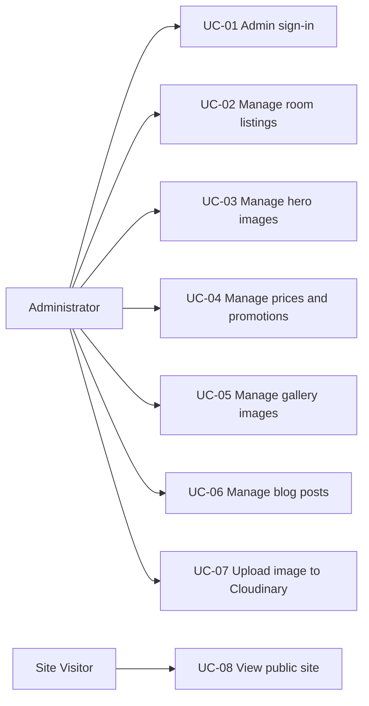
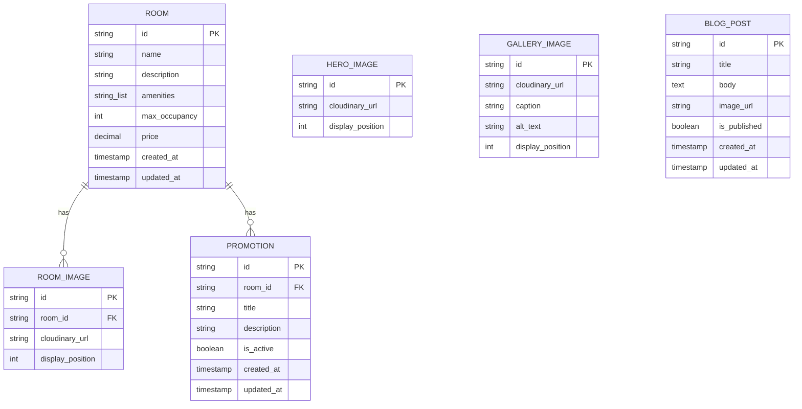
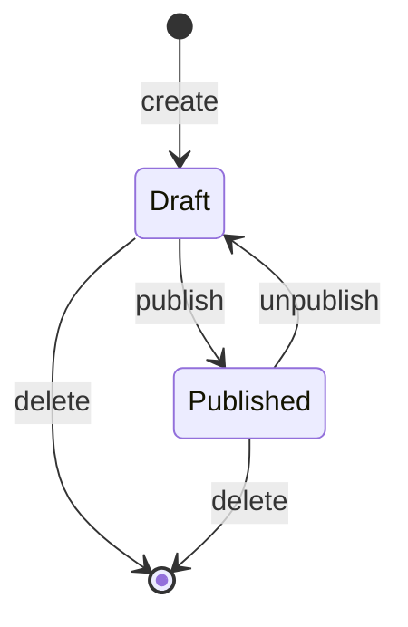
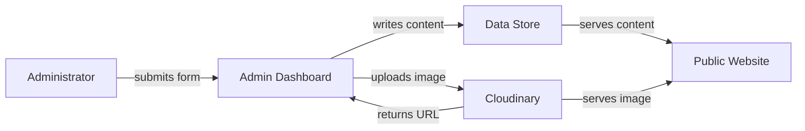
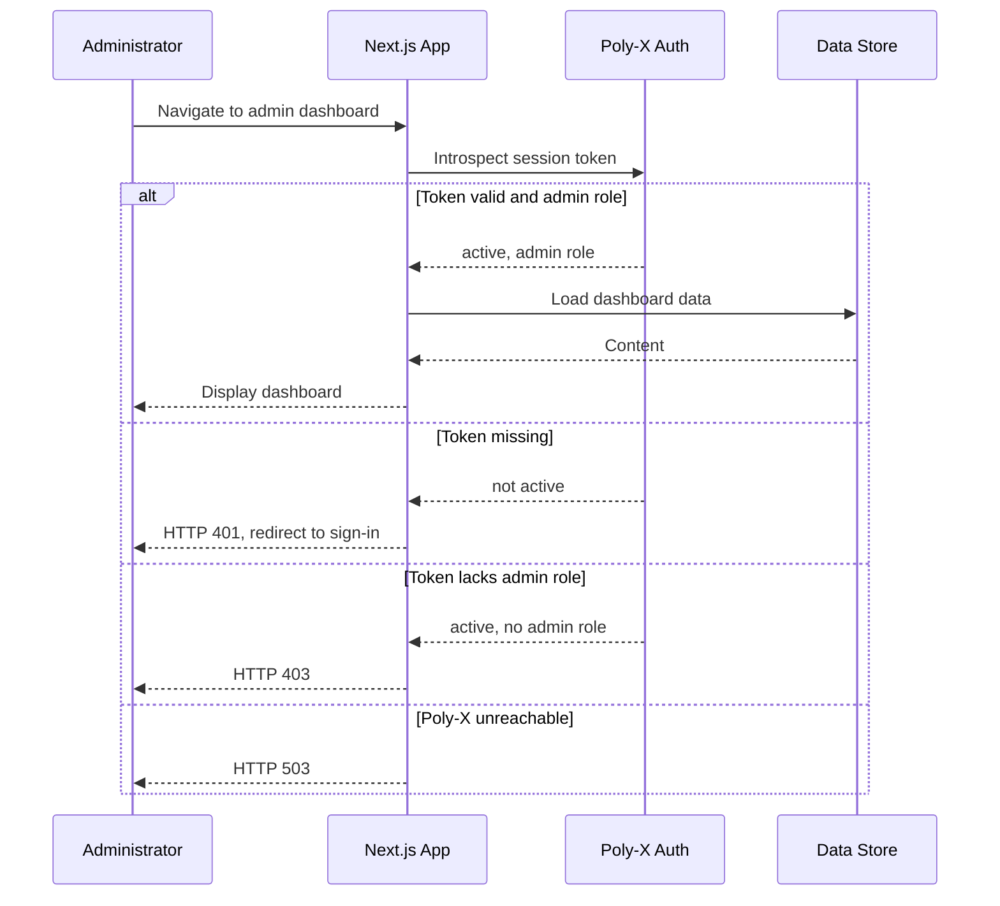

# Software Requirements Specification

| Project | Client | Version | Date |
| --- | --- | --- | --- |
| Alam Guest house | Abid Alam | 1.0 | 2026-11-01 |

## 1. Introduction

### Purpose

This Software Requirements Specification (SRS) defines the requirements for adding an admin dashboard and content management layer to the existing Alam Guest House Next.js marketing website. The system enables a single administrator to manage room listings, hero section images, prices, promotions, gallery images, and blog posts dynamically, without code changes or redeployment. Login, authentication, multi-factor authentication, and the admin role are provided by the Poly-X platform. Image upload and delivery use Cloudinary. The existing public website design and visitor experience are preserved; only the source of content changes from static TypeScript data files to a dynamic data store.

### Document Conventions

The keyword "shall" denotes a binding requirement. The keyword "should" denotes a goal. The keyword "will" denotes a statement of fact. Requirement identifiers follow the scheme REQ-FUNC-NNN for functional requirements and REQ-NFUNC-NNN for non-functional requirements. Feature identifiers follow the scheme FEAT-NN. Use case identifiers follow the scheme UC-NN. Business rule identifiers follow the scheme BR-NN. Priorities use the MoSCoW model: must, should, could, wont.

### Intended Audience

The intended audience is the client sponsor, Abid Alam, who defines requirements and accepts deliverables; the administrator who will use the dashboard to manage content; and the development team responsible for building and deploying the admin dashboard, Poly-X integration, Cloudinary integration, and the content data store.

### Scope

The software will provide an admin dashboard integrated with the Poly-X platform for authentication, session management, multi-factor authentication, and the single admin role. The dashboard will allow the administrator to create, edit, and delete room listings; add, remove, and reorder hero section images; set and update room prices; create, edit, and remove promotions; add, edit, and remove gallery images; and create, edit, publish, and delete blog posts. All images submitted through the dashboard will be uploaded to Cloudinary and the returned URL stored as the image reference. A dynamic data store will persist all managed content, replacing the static TypeScript data files as the source of truth. Existing public-facing components will be modified to read content from the data store, preserving the existing visual design and page structure.

The software will not provide guest login, guest accounts, or guest booking functionality. The software will not provide additional admin roles or permission tiers beyond the single admin role. The software will not provide an online booking or reservation system. The software will not provide payment processing. The software will not redesign the public website layout or visual design. The software will not provide management of the About, Services, Location, or Contact sections through the dashboard. The software will not provide email marketing or newsletter functionality.

### Definitions and Acronyms

| Term | Definition | Source |
|---|---|---|
| Admin dashboard | The administrative interface within the Next.js application for managing dynamic content | SCOPE-001 through SCOPE-009 |
| Administrator | The single user role with the admin grant in Poly-X, who manages all dynamic content | Source Document Scope, Stakeholders |
| App Router | The Next.js file-based routing system used by the existing application | Source Document Scope, Tech Stack |
| Cloudinary | The cloud-based image upload and content delivery network service used for image storage and delivery | SCOPE-007 |
| Content data store | The persistent data store that replaces static TypeScript data files as the source of truth for managed content | SCOPE-008 |
| Data store | See Content data store | SCOPE-008 |
| MFA | Multi-factor authentication, provided by the Poly-X platform during admin sign-in | SCOPE-001 |
| Next.js | The React framework used by the existing application, using the App Router with TypeScript | Source Document Scope, Tech Stack |
| Poly-X | The platform providing identity (poly-auth) and notification (poly-alert) services | SCOPE-001, poly-x-platform.md |
| poly-auth | The Poly-X authentication service providing sign-in, sessions, MFA, roles, and organizations | poly-x-platform.md |
| poly-alert | The Poly-X notification service providing email and in-app notifications | poly-x-platform.md |
| Public site | The existing Next.js front end that site visitors view without login | Source Document Scope, Delivery Model |
| Site visitor | A member of the public who views the website without logging in | Source Document Scope, Stakeholders |
| SRS | Software Requirements Specification | ISO/IEC/IEEE 29148:2018 |
| Token introspection | The process of validating a Poly-X access token by calling the Poly-X introspection endpoint | poly-x-platform.md |
| TypeScript | The typed programming language used by the existing Next.js application | Source Document Scope, Tech Stack |

### References

| Document | Version or date |
|---|---|
| Project Scope (Source Document) | Version 1 |
| poly-x-platform.md (Poly-X platform services reference) | Attached |
| ISO/IEC/IEEE 29148:2018 (SRS content) | 2018 |

## 2. Overall Description

### Product Perspective

Alam Guest House currently operates a static Next.js marketing website. All content is hard-coded in TypeScript data files under the `data/` directory (including `data/rooms.ts`, `data/hero.ts`, `data/gallery.ts`, `data/halls.ts`, `data/services.ts`, and `data/siteConfig.ts`). Every change to rooms, prices, images, promotions, or blog posts requires a developer to edit source code and redeploy the site.

This project adds an admin dashboard and content management layer within the existing Next.js application. The dashboard consumes the Poly-X platform for identity (sign-in, sessions, MFA, and the admin role) and for notifications if needed. The dashboard uploads images to Cloudinary and stores the returned Cloudinary URLs in a content data store. The existing public-facing components (Hero, RoomsSection, GallerySection, and related components) are modified to read content from the data store instead of static files, preserving the existing visual design and page structure.

The system connects to three external services: the Poly-X auth service (poly-auth) for authentication and authorization, the Poly-X alert service (poly-alert) for notifications if required, and Cloudinary for image upload and delivery.

### Product Functions

The system provides the following major functions:

- Admin login and authentication through Poly-X with multi-factor authentication and the single admin role.
- Room listing management: create, edit, and delete room listings with name, description, amenities, images, maximum occupancy, and price.
- Hero section image management: add, remove, and reorder hero section images on the homepage carousel.
- Price and promotion management: set and update room prices; create, edit, and remove promotions with active promotions displayed on the public site.
- Gallery management: add gallery images, edit captions and alt text, and remove gallery images.
- Blog post management: create, edit, publish, and delete blog posts with title, body content, and an image.
- Image upload to Cloudinary: all dashboard images uploaded to Cloudinary with returned URLs stored as image references.
- Dynamic content persistence: a data store replaces static TypeScript data files as the source of truth, surviving application restarts and deployments.
- Static content migration: existing static content is migrated to the data store as initial content.
- Public site content delivery: existing components read content from the data store, preserving the existing design.

### User Classes

| Role | Description | Access level | Frequency |
|---|---|---|---|
| Administrator | Single admin role; signs in through Poly-X with MFA, manages all dynamic content, publishes changes to the live site | Full access to all admin dashboard operations | Daily or as needed |
| Site visitor (guest) | Views the public website with up-to-date content; no login required | Read-only access to the public site | As needed |
| Client sponsor (Abid Alam) | Owner and client; defines requirements, accepts deliverables, owns source code and data | No direct dashboard access unless assigned the admin role | At milestones and for acceptance |

### Operating Environment

The system operates within the existing Next.js application using the App Router with TypeScript. The admin dashboard runs as part of the same application. The hosting and deployment platform is an open question (candidates include Vercel or self-hosted Node).

**Normal mode:** The administrator signs in through Poly-X, manages content through the dashboard, and changes appear on the public site. Site visitors view the public site with up-to-date content. The system operates continuously, as the public website must be available to visitors at all times.

**Maintenance mode:** During application deployment or restart, the data store retains all managed content (REQ-NFUNC-006). The public site may be briefly unavailable during redeployment. The administrator cannot access the dashboard during deployment.

**Degraded mode (Poly-X unavailable):** When the Poly-X auth service cannot be reached, the system returns HTTP 503 for admin dashboard requests and the administrator cannot access the dashboard (REQ-FUNC-003, REQ-NFUNC-002). The public website continues serving existing content from the data store with no dependency on Poly-X (REQ-NFUNC-007). Site visitors are unaffected.

### Design and Implementation Constraints

- The admin dashboard and content management layer shall be built within the existing Next.js application using the App Router with TypeScript.
- Identity (sign-in, sessions, multi-factor authentication, roles, organizations) is provided by the Poly-X platform; the vendor shall integrate Poly-X rather than building authentication, session management, or password handling.
- Notifications (email, in-app) are provided by the Poly-X platform; the vendor shall integrate Poly-X for any notification needs rather than building a notification sender.
- Image upload and delivery shall use Cloudinary, as mandated by the client.
- The existing static content in `data/rooms.ts`, `data/hero.ts`, `data/gallery.ts`, and related files shall be migrated to the dynamic data store as the initial content.

### User Documentation

The system shall include admin dashboard documentation in Markdown covering how to sign in, manage each content type (room listings, hero images, prices, promotions, gallery images, and blog posts), upload images, and publish blog posts. The client shall confirm the documentation is understandable.

The system shall include a deployment guide in Markdown describing environment variables, Poly-X keys, Cloudinary credentials, and deployment steps. The client shall confirm a deployment can be completed from the guide.

### Assumptions and Dependencies

- The admin dashboard and content management layer are built within the existing Next.js application using the App Router with TypeScript.
- A single admin role is sufficient with no additional roles or permission tiers.
- No guest login, guest accounts, or booking functionality is needed.
- The existing static content in `data/rooms.ts`, `data/hero.ts`, `data/gallery.ts`, and related files can be migrated to the dynamic data store as initial content.
- The client, Abid Alam, holds sign-off authority for the scope and all deliverables (to be confirmed).
- The administrator publishes changes live instantly unless the client later specifies a draft or approval step (open question).
- Poly-X provides identity, session management, MFA, and notifications; the vendor integrates the Poly-X SDK rather than building these capabilities.
- The system depends on the Poly-X platform (poly-auth and poly-alert services) for identity and notifications.
- The system depends on Cloudinary for image upload and delivery.
- The system depends on a data store for content persistence; the preferred data store (PostgreSQL, MongoDB, or a managed database service) is an open question to be confirmed by the client.
- The existing hosting and deployment platform is an open question to be confirmed during kickoff.

**Transition and migration:** The system being replaced is the set of static TypeScript data files under the `data/` directory (`data/rooms.ts`, `data/hero.ts`, `data/gallery.ts`, `data/halls.ts`, `data/services.ts`, `data/siteConfig.ts`). These files are replaced by the dynamic data store as the source of truth for managed content. A migration script loads the existing static content into the data store as initial content. The cutover occurs when the public-facing components are modified to read from the data store instead of the static files. The public site must display migrated content unchanged after migration (REQ-FUNC-021, REQ-FUNC-026).

## 3. External Interface Requirements

### User Interfaces

The admin dashboard provides a web-based user interface within the existing Next.js application. The dashboard includes sections for room listing management, hero section image management, price and promotion management, gallery management, and blog post management. Each section provides forms for creating, editing, and deleting content. Image upload fields submit images to Cloudinary. The dashboard is accessible only to authenticated administrators with the admin role. The interface shall conform to WCAG 2.2 AA (REQ-NFUNC-005).

The public website user interface is the existing Next.js front end, modified to read content from the data store. The existing visual design and page structure are preserved (REQ-FUNC-026). Site visitors interact with the public site without login.

### Hardware Interfaces

No requirement stated.

### Software Interfaces

**Poly-X auth service (poly-auth):**
- Purpose: Admin sign-in, session management, multi-factor authentication, and the admin role.
- Direction: Outbound. The system calls Poly-X for token introspection on protected admin routes.
- Data exchanged: Poly-X access tokens (validated by introspection at `POST /v1/auth/authz/introspect`), session context (userId, organizationId, roles), and the admin role grant.
- Format/protocol: REST over HTTPS. The system uses the `@poly-x/next` package for the Next.js App Router (mounting `createPolyXHandler()` at `app/api/polyx/[...polyx]/route.ts`, using `proxy({ protectedRoutes })` in `proxy.ts`, and calling `auth()` / `getSessionContext()` from `@poly-x/next/server`). The back end uses `@poly-x/sdk` with `createPolyX({ secretKey: process.env.POLYX_SECRET_KEY })` and `polyx.express.requireUser()` middleware. Token introspection returns `{ active, userId, organizationId, sessionId, role, roles }`.
- Behaviour when unavailable: The system fails closed, returning HTTP 503 for admin dashboard requests when Poly-X cannot be reached (REQ-FUNC-003, REQ-NFUNC-002). The public site continues serving existing content from the data store (REQ-NFUNC-007).

**Poly-X alert service (poly-alert):**
- Purpose: Email and in-app notifications to the administrator if the dashboard needs to notify of content events. Which events and channels is an open question.
- Direction: Outbound. The system calls Poly-X alert endpoints.
- Data exchanged: Notification content (recipient, title, body, type, severity), email content (to, subject, message or htmlContent), and delivery status.
- Format/protocol: REST over HTTPS. Email via `POST /v1/email/send`. In-app notifications via `POST /v1/push` (create), `GET /v1/push` (list), and `PUT /v1/push` (update status). Base URLs are per environment from configuration (for example `POLY_AUTH_BASE_URL`, `POLY_ALERT_BASE_URL`).
- Behaviour when unavailable: Notification delivery fails. The system shall not block content management operations if a notification cannot be sent. The specific retry and fallback behaviour is an open question.

**Cloudinary:**
- Purpose: Image upload from the admin dashboard and image delivery to the public site through its content delivery network.
- Direction: Outbound. The system sends images to Cloudinary and receives Cloudinary URLs. The public site serves images from the Cloudinary CDN.
- Data exchanged: Image files (uploaded), Cloudinary URLs (returned and stored as image references in the data store).
- Format/protocol: REST over HTTPS. Cloudinary credentials are configured through environment variables.
- Behaviour when unavailable: Image upload fails. The system rejects the submission with an error message indicating the upload failed and does not store a partial image reference (REQ-FUNC-010). Existing images already stored in the data store continue to be served from the Cloudinary CDN.

### Communications Interfaces

**Poly-X auth communications:**
- Purpose: Token introspection for admin authentication and authorization.
- Direction: Outbound from the Next.js application to the Poly-X auth service.
- Data: Poly-X access token submitted for introspection; response contains `{ active, userId, organizationId, sessionId, role, roles }`.
- Protocol: REST over HTTPS (`POST /v1/auth/authz/introspect`). Introspection results are cached briefly (seconds). The session is an AES-GCM sealed httpOnly cookie. The organization-id header is carried on organization-scoped calls.
- Behaviour when unavailable: Fail closed. HTTP 503 for admin dashboard requests (REQ-FUNC-003, REQ-NFUNC-002). Public site unaffected (REQ-NFUNC-007).

**Poly-X alert communications:**
- Purpose: Sending email and in-app notifications to the administrator.
- Direction: Outbound from the Next.js application to the Poly-X alert service.
- Data: Email messages (to, subject, message or htmlContent, optional attachments) and in-app push notifications (user, title, body, type, severity).
- Protocol: REST over HTTPS. Realtime notifications use Socket.IO with a single-use ticket (`POST /v1/socket-ticket`).
- Behaviour when unavailable: Notification delivery fails. Content management operations are not blocked. Specific retry behaviour is an open question.

**Cloudinary communications:**
- Purpose: Image upload and delivery.
- Direction: Outbound for upload; the public site references Cloudinary CDN URLs for delivery.
- Data: Image files for upload; Cloudinary URLs for storage and delivery.
- Protocol: REST over HTTPS.
- Behaviour when unavailable: Upload fails with an error message (REQ-FUNC-010). Previously stored Cloudinary URLs continue to be served from the CDN.

## 4. Non-Functional Requirements

### Performance

REQ-NFUNC-001: The system shall load public website pages with content from the data store within a response time that does not degrade the existing visitor experience. Metric: page response time. Target: comparable to the static version (specific target value to be confirmed by the client). Conditions: public site serving content from the data store. Verification method: test (measure page load times against the static baseline). Priority: should.

### Safety

No requirement stated.

### Security

REQ-NFUNC-003: The system shall enforce the admin role on every admin dashboard operation by verifying the Poly-X token through introspection. Metric: percentage of admin dashboard operations that enforce role verification. Target: 100 per cent. Conditions: every admin dashboard operation. Verification method: test (submit requests with and without the admin role and verify 401 and 403 responses). Priority: must.

**Authentication and session policy:** Authentication, session management, multi-factor authentication, and password handling are delegated to the Poly-X platform. The system does not build a local password store, login endpoint, or token signing. The session is an AES-GCM sealed httpOnly cookie managed by `@poly-x/next`. Tokens are verified by introspection (`POST /v1/auth/authz/introspect`), not by local JWT verification. MFA is required for the admin role during sign-in (REQ-FUNC-002). The system fails closed: 401 when unauthenticated, 403 when the admin role is absent, 503 when Poly-X cannot be reached.

**Authorization:** Poly-X module RBAC. The product registers its modules and checks a grant of module and action on each admin route. The organization-id header is checked against the token's organization, with 403 on a mismatch.

**Privacy and data protection:** The system stores room listings, hero images, gallery images, blog posts, prices, and promotions. Image references are Cloudinary URLs. The data store does not hold guest personal data (no guest accounts or bookings). Personal data held is limited to the administrator's identity, which is managed by Poly-X. Any regulatory or data-protection requirements beyond what Poly-X provides for identity are an open question. Retention and purge policy for managed content is an open question.

**Audit trail:** No requirement stated. Whether an audit trail of admin actions is required is an open question.

### Reliability and Availability

REQ-NFUNC-002: The system shall return HTTP 503 within 5 seconds when the Poly-X auth service is unreachable during an admin dashboard request. Metric: response time to return 503. Target: within 5 seconds. Conditions: Poly-X auth service unreachable. Verification method: test (simulate Poly-X unavailability and measure response time). Priority: must.

REQ-NFUNC-006: The system shall retain all managed content in the data store across application restarts and deployments with no data loss. Metric: data integrity after restart or deployment. Target: 100 per cent of managed content present and unchanged. Conditions: application restart or deployment. Verification method: inspection (verify data store contents after restart or deployment). Priority: must.

REQ-NFUNC-007: The system shall continue serving existing content to site visitors from the data store when the Poly-X auth service is unavailable. Metric: public site availability during Poly-X outage. Target: public site remains available. Conditions: Poly-X auth service unreachable. Verification method: demonstration (simulate Poly-X outage and verify public site serves content). Priority: must.

**Availability target:** No specific availability target is stated. The public website must be available to visitors at all times; the admin dashboard is available when Poly-X is reachable. A specific availability percentage is an open question.

**Backup and recovery:** No requirement stated for backup and recovery (RPO and RTO). These are open questions.

**Disaster recovery:** No requirement stated. Disaster recovery procedures are an open question.

**Observability (monitoring and alerting):** No requirement stated. Monitoring and alerting for the admin dashboard and data store are open questions.

### Maintainability

No requirement stated. The system is built within the existing Next.js application using the App Router with TypeScript, which supports maintainability through the existing codebase conventions. Specific maintainability metrics or targets are open questions.

### Portability and Scalability

REQ-NFUNC-004: The system shall store and retrieve managed content from the data store without performance degradation at the expected content volumes. Metric: data store read and write performance. Target: no performance degradation at expected content volumes. Conditions: data store contains the expected volume of room listings, gallery images, and blog posts. Verification method: test (measure data store performance at stated volumes). Priority: should.

**Capacity and growth:** The expected content volumes (blog posts, gallery images, room listings) are an open question to be confirmed by the client. The data store schema shall be designed to accommodate the stated volumes with headroom. The number of administrators is one. The number of site visitors is not specified.

### Usability

REQ-NFUNC-005: The system shall provide an admin dashboard interface that conforms to WCAG 2.2 AA. Metric: WCAG 2.2 AA violations. Target: 0 violations. Conditions: automated WCAG 2.2 AA audit against each dashboard screen. Verification method: inspection (run automated WCAG 2.2 AA audit). Priority: should.

**Accessibility:** The admin dashboard shall conform to WCAG 2.2 AA (REQ-NFUNC-005).

**Localisation:** No requirement stated. The existing public website language and locale are not specified. Localisation requirements (languages, right-to-left scripts, locale formats, time zones) are open questions.

### Interoperability

The system interoperates with the Poly-X platform (poly-auth for identity, poly-alert for notifications) and Cloudinary (for image upload and delivery) through REST APIs over HTTPS. These are the only external interoperability interfaces. No additional interoperability requirements are stated.

## 5. System Features

### FEAT-01 - Admin Authentication and Access Control

The system shall authenticate the administrator through the Poly-X platform (poly-auth) and enforce the admin role on every admin dashboard operation. The administrator signs in on the admin login page, completes multi-factor authentication through Poly-X, and receives a session token. The system introspects the token on every protected admin route and grants access only when the token is active and carries the admin role. Session management, MFA, and password handling are delegated to Poly-X; the product does not build or store credentials.

**Primary actors:** Administrator

**Stimulus/response sequences:**

1. The administrator navigates to the admin login page.
2. The administrator enters credentials and submits the sign-in form.
3. Poly-X validates the credentials and prompts for a second factor (MFA).
4. The administrator completes the second-factor verification.
5. Poly-X returns a valid session token with the admin role.
6. The system grants access to the admin dashboard.

*Invalid input:* The administrator enters invalid credentials. Poly-X rejects the sign-in and the system displays an authentication error message without granting access.

*Permission denied:* An authenticated request whose Poly-X token lacks the admin role is submitted to an admin route. The system returns HTTP 403 and does not display the dashboard.

*Unauthenticated access:* A request to an admin dashboard route is submitted without a valid Poly-X session. The system returns HTTP 401 and does not display the dashboard.

*Poly-X unreachable:* The Poly-X auth service cannot be reached during an admin dashboard request. The system returns HTTP 503 and does not grant access. The public website continues serving existing content from the data store.

**Preconditions:**
- The administrator has a Poly-X account with the admin role.
- The Poly-X auth service is reachable (for the happy path).

**Postconditions:**
- The administrator has an active Poly-X session with the admin role.
- Subsequent admin dashboard requests are authorised until the session expires or is revoked.

**Owned requirements:** REQ-FUNC-001, REQ-FUNC-002, REQ-FUNC-003

### FEAT-02 - Room Listing Management

The system shall allow the administrator to create, edit, and delete room listings with name, description, amenities, images, maximum occupancy, and price. Each room listing is persisted in the data store and served to the public website's RoomsSection component. Images submitted with a room listing are uploaded to Cloudinary and the returned Cloudinary URL is stored as the image reference. The administrator can update any field of an existing room listing, including setting an empty amenities list, and can remove a room listing entirely from the data store.

**Primary actors:** Administrator

**Stimulus/response sequences:**

1. The administrator navigates to the room listings section of the dashboard.
2. The administrator opens the create-room form and enters name, description, amenities, images, maximum occupancy, and price.
3. The system uploads any submitted images to Cloudinary and stores the returned URLs.
4. The system stores the room listing in the data store.
5. The room listing appears in the room listings list and on the public site.

*Invalid input:* The administrator submits a create-room form with a blank name. The system rejects the submission with a validation error message naming the name field.

*Cloudinary upload failure:* The administrator submits an image and the Cloudinary upload fails. The system rejects the submission with an error message indicating the upload failed and does not store a partial image reference.

*Edit flow:* The administrator selects an existing room listing, changes one or more fields (for example, price to 4500), and saves. The system updates the stored room listing and the updated values appear in the room listings list.

*Delete flow:* The administrator selects an existing room listing and confirms deletion. The system removes the room listing from the data store; the listing no longer appears in the room listings list or on the public site.

**Preconditions:**
- The administrator has an active Poly-X session with the admin role (FEAT-01).

**Postconditions:**
- The created, edited, or deleted room listing is reflected in the data store.
- The public site displays the current room listings on the next page load.

**Owned requirements:** REQ-FUNC-004, REQ-FUNC-005, REQ-FUNC-006

### FEAT-03 - Hero Section Image Management

The system shall allow the administrator to add, remove, and reorder hero section images displayed on the homepage carousel. When the administrator adds a hero image, the image is uploaded to Cloudinary and the returned URL and a display position are stored in the data store. The administrator can remove a hero image, which removes it from the data store and the public carousel. The administrator can reorder images by changing their display positions, and the public site reflects the new order on the next page load.

**Primary actors:** Administrator

**Stimulus/response sequences:**

1. The administrator navigates to the hero section management interface.
2. The administrator uploads an image and adds it to the hero carousel.
3. The system uploads the image to Cloudinary and stores the returned URL and display position in the data store.
4. The image appears in the hero carousel management list.

*Reorder flow:* The administrator moves the image in position 3 to position 1. The system stores the updated order and the public site displays the carousel images in the new order on the next page load.

*Remove flow:* The administrator removes an existing hero section image. The system removes the image from the data store and the image no longer appears in the hero carousel on the public site.

*Cloudinary upload failure:* The image upload to Cloudinary fails. The system rejects the submission with an error message and does not store a partial image reference.

**Preconditions:**
- The administrator has an active Poly-X session with the admin role (FEAT-01).

**Postconditions:**
- The hero carousel in the data store reflects the added, removed, or reordered images.
- The public site displays the hero carousel in the stored order on the next page load.

**Owned requirements:** REQ-FUNC-007, REQ-FUNC-008, REQ-FUNC-009

### FEAT-04 - Price and Promotion Management

The system shall allow the administrator to set and update room prices and to create, edit, and remove promotions associated with rooms. When the administrator updates a room price, the new price is stored in the data store and displayed on the public site. When the administrator creates a promotion for a room, the promotion is stored in the data store and displayed in the promotions list. The administrator can edit promotion details or remove a promotion. Active promotions are displayed on the public site for their associated rooms; removed promotions are not displayed.

**Primary actors:** Administrator

**Stimulus/response sequences:**

1. The administrator navigates to the promotions management interface (or the room listings section for price edits).
2. The administrator edits a room price or submits a create-promotion form for a room.
3. The system stores the updated price or the new promotion in the data store.
4. The updated price or promotion appears in the management list and on the public site.

*Edit promotion:* The administrator changes the details of an existing promotion and saves. The system updates the stored promotion and the updated promotion appears in the promotions list.

*Remove promotion:* The administrator removes an existing promotion. The system removes the promotion from the data store and the promotion no longer appears on the public site.

*Public display:* A room with an active promotion stored in the data store is loaded by a site visitor. The public site displays the promotion for that room. A room whose promotion has been removed is loaded by a site visitor. The public site does not display a promotion for that room.

**Preconditions:**
- The administrator has an active Poly-X session with the admin role (FEAT-01).
- For price edits, the room listing exists in the data store (FEAT-02).

**Postconditions:**
- The updated price or promotion is reflected in the data store.
- The public site displays active promotions and current prices on the next page load.

**Owned requirements:** REQ-FUNC-011, REQ-FUNC-012, REQ-FUNC-013, REQ-FUNC-014, REQ-FUNC-015

### FEAT-05 - Gallery Management

The system shall allow the administrator to add gallery images with a caption and alt text, edit the caption and alt text of existing gallery images, and remove gallery images. When the administrator adds a gallery image, the image is uploaded to Cloudinary and the returned URL, caption, and alt text are stored in the data store. The public site's GallerySection component reads the gallery from the data store and displays each image with its caption and alt text.

**Primary actors:** Administrator

**Stimulus/response sequences:**

1. The administrator navigates to the gallery management interface.
2. The administrator uploads an image and enters a caption and alt text.
3. The system uploads the image to Cloudinary and stores the returned URL, caption, and alt text in the data store.
4. The image appears in the gallery management list.

*Edit flow:* The administrator selects an existing gallery image, changes the caption to "Poolside view" and the alt text to "Poolside view from room balcony", and saves. The system stores the updated caption and alt text and the gallery management list reflects the changes.

*Remove flow:* The administrator removes an existing gallery image. The system removes the image, caption, and alt text from the data store and the image no longer appears in the gallery on the public site.

*Cloudinary upload failure:* The image upload to Cloudinary fails. The system rejects the submission with an error message and does not store a partial image reference.

**Preconditions:**
- The administrator has an active Poly-X session with the admin role (FEAT-01).

**Postconditions:**
- The gallery in the data store reflects the added, edited, or removed image.
- The public site displays the current gallery on the next page load.

**Owned requirements:** REQ-FUNC-016, REQ-FUNC-017, REQ-FUNC-018

### FEAT-06 - Blog Post Management

The system shall allow the administrator to create, edit, publish, and delete blog posts with a title, body content, and an image. When the administrator creates a blog post, the image is uploaded to Cloudinary and the returned URL is stored. The administrator can edit the title, body content, or image of an existing post. The administrator can publish a post, which marks it as published in the data store and displays it on the public site. The administrator can delete a post, which removes it from the data store and the public site.

**Primary actors:** Administrator

**Stimulus/response sequences:**

1. The administrator navigates to the blog posts section of the dashboard.
2. The administrator submits a create-blog-post form with title, body content, and an image.
3. The system uploads the image to Cloudinary and stores the returned URL.
4. The system stores the blog post in the data store.
5. The blog post appears in the blog posts list.

*Invalid input:* The administrator submits a create-blog-post form with a blank title. The system rejects the submission with a validation error message naming the title field.

*Edit flow:* The administrator selects an existing blog post, changes the body content, and saves. The system updates the stored blog post and the updated content appears in the blog posts list.

*Publish flow:* The administrator selects an existing unpublished blog post and publishes it. The system marks the post as published in the data store and the blog post appears on the public site.

*Delete flow:* The administrator selects an existing blog post and confirms deletion. The system removes the blog post from the data store; the post no longer appears in the blog posts list or on the public site.

*Cloudinary upload failure:* The image upload to Cloudinary fails. The system rejects the submission with an error message and does not store a partial image reference.

**Preconditions:**
- The administrator has an active Poly-X session with the admin role (FEAT-01).

**Postconditions:**
- The created, edited, published, or deleted blog post is reflected in the data store.
- Published blog posts appear on the public site; deleted posts do not.

**Owned requirements:** REQ-FUNC-022, REQ-FUNC-023, REQ-FUNC-024, REQ-FUNC-025

### FEAT-07 - Image Upload and Delivery via Cloudinary

The system shall upload each image submitted through the admin dashboard to Cloudinary and store the returned Cloudinary URL as the image reference in the data store. Images are served to the public website through the Cloudinary content delivery network. This feature supports all image-handling operations across room listings, hero section images, gallery images, and blog posts.

**Primary actors:** Administrator

**Stimulus/response sequences:**

1. The administrator submits an image through any admin dashboard form (room listing, hero image, gallery image, or blog post).
2. The system sends the image to Cloudinary.
3. Cloudinary returns a URL for the uploaded image.
4. The system stores the Cloudinary URL as the image reference in the data store.
5. The public site serves the image through the Cloudinary CDN.

*Upload failure:* The Cloudinary upload fails and returns an error response. The system rejects the submission with an error message indicating the upload failed and does not store a partial image reference.

**Preconditions:**
- The administrator has an active Poly-X session with the admin role (FEAT-01).
- Cloudinary credentials are configured in the deployment environment.

**Postconditions:**
- The Cloudinary URL for the uploaded image is stored in the data store.
- The image is retrievable through the Cloudinary CDN.

**Owned requirements:** REQ-FUNC-010

### FEAT-08 - Dynamic Content Data Store and Public Site Integration

The system shall persist all managed content in a data store that survives application restarts and deployments, replacing the static TypeScript data files as the source of truth. The existing static content in data/rooms.ts, data/hero.ts, data/gallery.ts, and related files shall be migrated to the data store as initial content. The public website's existing components (Hero, RoomsSection, GallerySection, and related components) shall read content from the data store instead of static files, preserving the existing visual design and page structure. The public site displays migrated content unchanged after migration.

**Primary actors:** Administrator, Site visitor

**Stimulus/response sequences:**

1. The migration script reads existing static content from data/rooms.ts, data/hero.ts, data/gallery.ts, and related files.
2. The migration script writes the content into the data store.
3. A site visitor loads the public website.
4. The public site components read content from the data store.
5. The public site displays the content with the existing visual design and page structure.

*Persistence across restarts:* Managed content is stored in the data store. The application is restarted or redeployed. The managed content remains available in the data store unchanged.

*Migration verification:* The migration script has run. A site visitor loads the public website. The public site displays the migrated content unchanged from the previous static version.

*Design preservation:* The public website before migration has a specific layout and visual design. After migration, the public site serves content from the data store. The layout and visual design match the pre-migration version.

**Preconditions:**
- The data store is provisioned and accessible.
- The existing static data files are present in the repository.

**Postconditions:**
- All managed content is persisted in the data store.
- The public site reads content from the data store instead of static files.
- The existing visual design and page structure are preserved.

**Owned requirements:** REQ-FUNC-019, REQ-FUNC-020, REQ-FUNC-021, REQ-FUNC-026

## Requirements Catalogue

### Functional Requirements

| ID | Requirement | Priority | Feature | Acceptance criteria |
| --- | --- | --- | --- | --- |
| REQ-FUNC-001 | Authenticated admin session required for dashboard access | must | FEAT-01 | Given an unauthenticated request to any admin dashboard route, When the system checks the Poly-X session, Then the system returns HTTP 401 and does not display the dashboard / Given an authenticated request whose Poly-X token lacks the admin role, When the system checks the role grant, Then the system returns HTTP 403 and does not display the dashboard / Given an authenticated request with the admin role, When the system checks the Poly-X session, Then the system grants access to the admin dashboard |
| REQ-FUNC-002 | Multi-factor authentication for admin sign-in | must | FEAT-01 | Given an administrator entering valid credentials, When the Poly-X sign-in flow prompts for a second factor, Then the dashboard is accessible only after the second factor is verified |
| REQ-FUNC-003 | Fail-closed behaviour when Poly-X is unreachable | must | FEAT-01 | Given a request to an admin dashboard route, When the Poly-X auth service is unreachable, Then the system returns HTTP 503 and does not grant access to the dashboard / Given Poly-X is unreachable, When a site visitor loads the public website, Then the public site continues serving existing content from the data store |
| REQ-FUNC-004 | Create a room listing | must | FEAT-02 | Given an authenticated admin on the room listings section, When the admin submits a create-room form with name, description, amenities, images, maximum occupancy, and price, Then the system stores the room listing in the data store and displays it in the room listings list / Given an authenticated admin submits a create-room form with a blank name, When the system validates the submission, Then the system rejects the submission with a validation error message naming the name field |
| REQ-FUNC-005 | Edit a room listing | must | FEAT-02 | Given an authenticated admin and an existing room listing, When the admin changes the price field to 4500 and saves, Then the system updates the stored room listing with the new price and the updated price appears in the room listings list / Given an authenticated admin and an existing room listing, When the admin removes all amenities and saves, Then the system stores the room listing with an empty amenities list |
| REQ-FUNC-006 | Delete a room listing | must | FEAT-02 | Given an authenticated admin and an existing room listing, When the admin confirms deletion of that listing, Then the system removes the room listing from the data store and the listing no longer appears in the room listings list or on the public site |
| REQ-FUNC-007 | Add a hero section image | must | FEAT-03 | Given an authenticated admin on the hero section management interface, When the admin uploads an image and adds it to the hero carousel, Then the system stores the image reference and display position in the data store and the image appears in the hero carousel management list |
| REQ-FUNC-008 | Remove a hero section image | must | FEAT-03 | Given an authenticated admin and an existing hero section image, When the admin removes that image, Then the system removes the image from the data store and the image no longer appears in the hero carousel on the public site |
| REQ-FUNC-009 | Reorder hero section images | must | FEAT-03 | Given an authenticated admin and a hero carousel with images in positions 1, 2, and 3, When the admin moves the image in position 3 to position 1, Then the system stores the updated order and the public site displays the carousel images in the new order on the next page load |
| REQ-FUNC-010 | Image upload to Cloudinary | must | FEAT-07 | Given an authenticated admin submitting an image through the dashboard, When the image is uploaded, Then the system sends the image to Cloudinary and stores the returned Cloudinary URL as the image reference in the data store / Given an authenticated admin submitting an image and the Cloudinary upload fails, When the system receives an error response from Cloudinary, Then the system rejects the submission with an error message indicating the upload failed and does not store a partial image reference |
| REQ-FUNC-011 | Set and update room prices | must | FEAT-04 | Given an authenticated admin and an existing room listing priced at 3000, When the admin changes the price to 3500 and saves, Then the system stores the updated price and the public site displays 3500 for that room on the next page load |
| REQ-FUNC-012 | Create a promotion | must | FEAT-04 | Given an authenticated admin on the promotions management interface, When the admin submits a create-promotion form for a room, Then the system stores the promotion in the data store and displays it in the promotions list |
| REQ-FUNC-013 | Edit a promotion | must | FEAT-04 | Given an authenticated admin and an existing promotion, When the admin changes the promotion details and saves, Then the system updates the stored promotion and the updated promotion appears in the promotions list |
| REQ-FUNC-014 | Remove a promotion | must | FEAT-04 | Given an authenticated admin and an existing promotion, When the admin removes that promotion, Then the system removes the promotion from the data store and the promotion no longer appears on the public site |
| REQ-FUNC-015 | Display active promotions on the public site | must | FEAT-04 | Given a room with an active promotion stored in the data store, When a site visitor loads the room listing on the public site, Then the public site displays the promotion for that room / Given a room whose promotion has been removed, When a site visitor loads the room listing on the public site, Then the public site does not display a promotion for that room |
| REQ-FUNC-016 | Add a gallery image | must | FEAT-05 | Given an authenticated admin on the gallery management interface, When the admin uploads an image and enters a caption and alt text, Then the system stores the image reference, caption, and alt text in the data store and the image appears in the gallery management list |
| REQ-FUNC-017 | Edit gallery image caption and alt text | must | FEAT-05 | Given an authenticated admin and an existing gallery image, When the admin changes the caption to 'Poolside view' and the alt text to 'Poolside view from room balcony' and saves, Then the system stores the updated caption and alt text and the gallery management list reflects the changes |
| REQ-FUNC-018 | Remove a gallery image | must | FEAT-05 | Given an authenticated admin and an existing gallery image, When the admin removes that image, Then the system removes the image, caption, and alt text from the data store and the image no longer appears in the gallery on the public site |
| REQ-FUNC-019 | Public site reads content from the data store | must | FEAT-08 | Given room listings, hero images, gallery images, and blog posts stored in the data store, When a site visitor loads the public website, Then the public site displays content read from the data store / Given the data store contains a room priced at 4000, When a site visitor loads the room listing page, Then the public site displays 4000 for that room |
| REQ-FUNC-020 | Persist managed content in the data store | must | FEAT-08 | Given managed content stored in the data store, When the application is restarted or redeployed, Then the managed content remains available in the data store unchanged |
| REQ-FUNC-021 | Migrate existing static content to the data store | must | FEAT-08 | Given the existing static data files contain room listings, hero images, and gallery images, When the migration script runs, Then the data store contains the migrated content matching the static files / Given the migration script has run, When a site visitor loads the public website, Then the public site displays the migrated content unchanged from the previous static version |
| REQ-FUNC-022 | Create a blog post | must | FEAT-06 | Given an authenticated admin on the blog posts section, When the admin submits a create-blog-post form with title, body content, and an image, Then the system stores the blog post in the data store and displays it in the blog posts list / Given an authenticated admin submits a create-blog-post form with a blank title, When the system validates the submission, Then the system rejects the submission with a validation error message naming the title field |
| REQ-FUNC-023 | Edit a blog post | must | FEAT-06 | Given an authenticated admin and an existing blog post, When the admin changes the body content and saves, Then the system updates the stored blog post and the updated content appears in the blog posts list |
| REQ-FUNC-024 | Publish a blog post | must | FEAT-06 | Given an authenticated admin and an existing unpublished blog post, When the admin publishes the post, Then the system marks the post as published in the data store and the blog post appears on the public site |
| REQ-FUNC-025 | Delete a blog post | must | FEAT-06 | Given an authenticated admin and an existing blog post, When the admin confirms deletion of that post, Then the system removes the blog post from the data store and the post no longer appears in the blog posts list or on the public site |
| REQ-FUNC-026 | Preserve existing public site design | must | FEAT-08 | Given the public website before migration with a specific layout and visual design, When the public site serves content from the data store after migration, Then the layout and visual design match the pre-migration version |

### Non-Functional Requirements and Constraints

| ID | Requirement | Priority | Feature | Acceptance criteria |
| --- | --- | --- | --- | --- |
| REQ-NFUNC-001 | Public site content load time | should |  | Given the public site serving content from the data store, When a site visitor loads a page, Then the page renders content within a response time comparable to the static version (target value for response time to be confirmed by the client) |
| REQ-NFUNC-002 | Fail-closed authentication availability | must |  | Given a request to an admin dashboard route and the Poly-X auth service unreachable, When 5 seconds elapse, Then the system returns HTTP 503 |
| REQ-NFUNC-003 | Admin role authorization enforcement | must |  | Given a request to an admin dashboard operation with a Poly-X token that does not have the admin role, When the system introspects the token, Then the system returns HTTP 403 / Given a request to an admin dashboard operation with no Poly-X token, When the system introspects the token, Then the system returns HTTP 401 |
| REQ-NFUNC-004 | Data store capacity for managed content | should |  | Given the data store contains the expected volume of room listings, gallery images, and blog posts, When the admin dashboard or public site reads or writes content, Then the data store responds without performance degradation (target content volumes to be confirmed by the client) |
| REQ-NFUNC-005 | Admin dashboard accessibility | should |  | Given the admin dashboard interface, When an automated WCAG 2.2 AA audit runs against each dashboard screen, Then the audit reports 0 violations |
| REQ-NFUNC-006 | Content persistence across deployments | must |  | Given managed content in the data store, When the application undergoes a restart or deployment, Then an inspection of the data store shows all managed content present and unchanged |
| REQ-NFUNC-007 | Public site availability during Poly-X outage | must |  | Given the Poly-X auth service is unreachable, When a site visitor loads the public website, Then the public site serves existing content from the data store with no dependency on Poly-X |

## 6. Use Cases

### UC-01 - Administrator signs in to the admin dashboard

- **Feature:** FEAT-01
- **Primary actor:** Administrator
- **Secondary actors:** Poly-X auth service
- **Stakeholders:** Abid Alam (owner), Site visitors (unaffected)
- **Trigger:** The administrator navigates to the admin dashboard URL in a browser.
- **Satisfied requirements:** REQ-FUNC-001, REQ-FUNC-002, REQ-FUNC-003
- **Preconditions:** The administrator has an account with the admin role in Poly-X. The Poly-X auth service is reachable.
- **Main flow:**
  1. The administrator navigates to the admin dashboard URL.
  2. The system checks for a valid Poly-X session and finds none.
  3. The system redirects the administrator to the Poly-X sign-in page.
  4. The administrator enters valid credentials and submits the sign-in form.
  5. Poly-X prompts the administrator for a second factor (MFA).
  6. The administrator verifies the second factor.
  7. Poly-X returns a valid session token with the admin role.
  8. The system grants access to the admin dashboard.
- **Alternate flows:**
  - *From step 4:* The administrator selects a federated SSO provider instead of entering credentials. Poly-X completes SSO and proceeds to step 5.
- **Exception flows:**
  - *From step 4:* The administrator enters invalid credentials. Poly-X rejects the submission with an authentication error. The system remains on the sign-in page and displays an error message.
  - *From step 6:* The administrator enters an incorrect second factor. Poly-X rejects the MFA challenge. The system remains on the MFA prompt and displays an error message.
  - *From step 2:* The Poly-X auth service is unreachable. The system returns HTTP 503 and does not display the dashboard (REQ-FUNC-003).
- **Postconditions:** The administrator is authenticated with the admin role and the admin dashboard is displayed.

### UC-02 - Unauthenticated user attempts to access the admin dashboard

- **Feature:** FEAT-01
- **Primary actor:** Site visitor (unauthenticated)
- **Secondary actors:** Poly-X auth service
- **Stakeholders:** Abid Alam (owner)
- **Trigger:** A site visitor navigates directly to the admin dashboard URL without signing in.
- **Satisfied requirements:** REQ-FUNC-001, REQ-FUNC-003
- **Preconditions:** The visitor has no Poly-X session.
- **Main flow:**
  1. The visitor navigates to the admin dashboard URL.
  2. The system checks for a valid Poly-X session via token introspection.
  3. Poly-X reports no active session for the request.
  4. The system returns HTTP 401.
  5. The system redirects the visitor to the Poly-X sign-in page.
  6. The dashboard is not displayed.
- **Alternate flows:**
  - None.
- **Exception flows:**
  - *From step 2:* The Poly-X auth service is unreachable. The system returns HTTP 503 and does not display the dashboard (REQ-FUNC-003).
- **Postconditions:** The visitor is not granted access to the admin dashboard.

### UC-03 - Administrator creates a room listing

- **Feature:** FEAT-02
- **Primary actor:** Administrator
- **Secondary actors:** Cloudinary, content data store
- **Stakeholders:** Abid Alam (owner), Site visitors (consume room listings)
- **Trigger:** The administrator selects "Create room" in the room listings section of the dashboard.
- **Satisfied requirements:** REQ-FUNC-004, REQ-FUNC-010
- **Preconditions:** The administrator is authenticated with the admin role (UC-01 completed). The content data store is available.
- **Main flow:**
  1. The administrator navigates to the room listings section.
  2. The administrator clicks "Create room".
  3. The system displays the create-room form with fields for name, description, amenities, images, maximum occupancy, and price.
  4. The administrator enters values for all fields and uploads one or more images.
  5. The system uploads each image to Cloudinary and receives a Cloudinary URL for each.
  6. The system stores the room listing with the Cloudinary URLs as image references in the data store.
  7. The system displays the new room listing in the room listings list.
- **Alternate flows:**
  - *From step 4:* The administrator uploads no images. The system stores the room listing without image references and proceeds to step 6.
- **Exception flows:**
  - *From step 4:* The administrator submits the form with a blank name. The system rejects the submission with a validation error message naming the name field.
  - *From step 5:* Cloudinary returns an error for an image upload. The system rejects the submission with an error message indicating the upload failed and does not store a partial image reference (REQ-FUNC-010).
  - *From step 6:* The data store is unavailable. The system displays an error message and does not create the room listing.
- **Postconditions:** The new room listing is stored in the data store and appears in the room listings list.

### UC-04 - Administrator edits a room listing

- **Feature:** FEAT-02
- **Primary actor:** Administrator
- **Secondary actors:** Cloudinary, content data store
- **Stakeholders:** Abid Alam (owner), Site visitors
- **Trigger:** The administrator selects an existing room listing and clicks "Edit".
- **Satisfied requirements:** REQ-FUNC-005, REQ-FUNC-011
- **Preconditions:** The administrator is authenticated with the admin role. An existing room listing is stored in the data store.
- **Main flow:**
  1. The administrator opens the room listings section.
  2. The administrator selects an existing room listing and clicks "Edit".
  3. The system displays the edit-room form populated with the current values.
  4. The administrator changes the price field to a new value and saves.
  5. The system updates the stored room listing with the new price in the data store.
  6. The system displays the updated price in the room listings list.
- **Alternate flows:**
  - *From step 4:* The administrator removes all amenities and saves. The system stores the room listing with an empty amenities list and proceeds to step 6.
  - *From step 4:* The administrator uploads a new image. The system uploads it to Cloudinary, stores the returned URL, and proceeds to step 5.
- **Exception flows:**
  - *From step 4:* The administrator enters a non-numeric value in the price field. The system rejects the submission with a validation error message naming the price field.
  - *From step 5:* The data store is unavailable. The system displays an error message and the room listing is not updated.
- **Postconditions:** The room listing is updated in the data store with the edited values.

### UC-05 - Administrator deletes a room listing

- **Feature:** FEAT-02
- **Primary actor:** Administrator
- **Secondary actors:** Content data store
- **Stakeholders:** Abid Alam (owner), Site visitors
- **Trigger:** The administrator selects an existing room listing and clicks "Delete".
- **Satisfied requirements:** REQ-FUNC-006
- **Preconditions:** The administrator is authenticated with the admin role. An existing room listing is stored in the data store.
- **Main flow:**
  1. The administrator opens the room listings section.
  2. The administrator selects an existing room listing and clicks "Delete".
  3. The system displays a confirmation dialog asking the administrator to confirm deletion.
  4. The administrator confirms deletion.
  5. The system removes the room listing from the data store.
  6. The system updates the room listings list to no longer show the deleted listing.
- **Alternate flows:**
  - None.
- **Exception flows:**
  - *From step 4:* The administrator cancels the confirmation dialog. The system takes no action and the room listing remains in the data store.
  - *From step 5:* The data store is unavailable. The system displays an error message and the room listing is not removed.
- **Postconditions:** The room listing is removed from the data store and no longer appears in the room listings list or on the public site.

### UC-06 - Administrator manages hero section images

- **Feature:** FEAT-03
- **Primary actor:** Administrator
- **Secondary actors:** Cloudinary, content data store
- **Stakeholders:** Abid Alam (owner), Site visitors
- **Trigger:** The administrator navigates to the hero section management interface.
- **Satisfied requirements:** REQ-FUNC-007, REQ-FUNC-008, REQ-FUNC-009
- **Preconditions:** The administrator is authenticated with the admin role. The content data store is available.
- **Main flow:**
  1. The administrator opens the hero section management interface.
  2. The system displays the current hero carousel images and their display positions.
  3. The administrator uploads a new image and adds it to the hero carousel.
  4. The system uploads the image to Cloudinary and receives a Cloudinary URL.
  5. The system stores the image reference and its display position in the data store.
  6. The system displays the new image in the hero carousel management list.
- **Alternate flows:**
  - *From step 2:* The administrator removes an existing hero image. The system removes the image from the data store and updates the management list (REQ-FUNC-008).
  - *From step 2:* The administrator reorders images by moving the image in position 3 to position 1. The system stores the updated order and the public site displays the carousel in the new order on the next page load (REQ-FUNC-009).
- **Exception flows:**
  - *From step 4:* Cloudinary returns an error for the image upload. The system displays an error message indicating the upload failed and does not store a partial image reference.
  - *From step 5:* The data store is unavailable. The system displays an error message and the hero carousel is not updated.
- **Postconditions:** The hero carousel images and their display order are updated in the data store and reflected on the public site.

### UC-07 - Administrator creates a promotion

- **Feature:** FEAT-04
- **Primary actor:** Administrator
- **Secondary actors:** Content data store
- **Stakeholders:** Abid Alam (owner), Site visitors
- **Trigger:** The administrator selects "Create promotion" in the promotions management interface.
- **Satisfied requirements:** REQ-FUNC-012
- **Preconditions:** The administrator is authenticated with the admin role. At least one room listing exists in the data store.
- **Main flow:**
  1. The administrator opens the promotions management interface.
  2. The administrator clicks "Create promotion".
  3. The system displays the create-promotion form with a room selector and promotion detail fields.
  4. The administrator selects a room and enters promotion details.
  5. The administrator submits the form.
  6. The system stores the promotion associated with the selected room in the data store.
  7. The system displays the new promotion in the promotions list.
- **Alternate flows:**
  - None.
- **Exception flows:**
  - *From step 4:* The administrator submits the form without selecting a room. The system rejects the submission with a validation error message naming the room field.
  - *From step 6:* The data store is unavailable. The system displays an error message and the promotion is not created.
- **Postconditions:** The promotion is stored in the data store associated with the selected room and appears in the promotions list.

### UC-08 - Administrator edits or removes a promotion

- **Feature:** FEAT-04
- **Primary actor:** Administrator
- **Secondary actors:** Content data store
- **Stakeholders:** Abid Alam (owner), Site visitors
- **Trigger:** The administrator selects an existing promotion and chooses to edit or remove it.
- **Satisfied requirements:** REQ-FUNC-013, REQ-FUNC-014, REQ-FUNC-015
- **Preconditions:** The administrator is authenticated with the admin role. An existing promotion is stored in the data store.
- **Main flow:**
  1. The administrator opens the promotions management interface.
  2. The administrator selects an existing promotion and clicks "Edit".
  3. The system displays the edit-promotion form populated with current values.
  4. The administrator changes the promotion details and saves.
  5. The system updates the stored promotion in the data store.
  6. The system displays the updated promotion in the promotions list.
- **Alternate flows:**
  - *From step 2:* The administrator clicks "Remove" instead of "Edit". The system removes the promotion from the data store. The promotion no longer appears on the public site (REQ-FUNC-014).
- **Exception flows:**
  - *From step 4:* The administrator enters invalid promotion details. The system rejects the submission with a validation error message.
  - *From step 5:* The data store is unavailable. The system displays an error message and the promotion is not updated.
- **Postconditions:** The promotion is updated or removed in the data store. Active promotions are displayed on the public site for their associated rooms; removed promotions are not (REQ-FUNC-015).

### UC-09 - Administrator manages gallery images

- **Feature:** FEAT-05
- **Primary actor:** Administrator
- **Secondary actors:** Cloudinary, content data store
- **Stakeholders:** Abid Alam (owner), Site visitors
- **Trigger:** The administrator navigates to the gallery management interface.
- **Satisfied requirements:** REQ-FUNC-016, REQ-FUNC-017, REQ-FUNC-018
- **Preconditions:** The administrator is authenticated with the admin role. The content data store is available.
- **Main flow:**
  1. The administrator opens the gallery management interface.
  2. The system displays the current gallery images with their captions and alt text.
  3. The administrator uploads a new image and enters a caption and alt text.
  4. The system uploads the image to Cloudinary and receives a Cloudinary URL.
  5. The system stores the image reference, caption, and alt text in the data store.
  6. The system displays the new image in the gallery management list.
- **Alternate flows:**
  - *From step 2:* The administrator selects an existing gallery image and edits the caption to "Poolside view" and the alt text to "Poolside view from room balcony". The system stores the updated caption and alt text and the management list reflects the changes (REQ-FUNC-017).
  - *From step 2:* The administrator removes an existing gallery image. The system removes the image, caption, and alt text from the data store. The image no longer appears in the gallery on the public site (REQ-FUNC-018).
- **Exception flows:**
  - *From step 4:* Cloudinary returns an error for the image upload. The system displays an error message indicating the upload failed and does not store a partial image reference.
  - *From step 5:* The data store is unavailable. The system displays an error message and the gallery is not updated.
- **Postconditions:** The gallery images, captions, and alt text are updated in the data store and reflected on the public site.

### UC-10 - Administrator creates and publishes a blog post

- **Feature:** FEAT-06
- **Primary actor:** Administrator
- **Secondary actors:** Cloudinary, content data store
- **Stakeholders:** Abid Alam (owner), Site visitors
- **Trigger:** The administrator selects "Create blog post" in the blog posts section of the dashboard.
- **Satisfied requirements:** REQ-FUNC-022, REQ-FUNC-024
- **Preconditions:** The administrator is authenticated with the admin role. The content data store is available.
- **Main flow:**
  1. The administrator opens the blog posts section.
  2. The administrator clicks "Create blog post".
  3. The system displays the create-blog-post form with fields for title, body content, and an image.
  4. The administrator enters a title, body content, and uploads an image.
  5. The system uploads the image to Cloudinary and receives a Cloudinary URL.
  6. The system stores the blog post with the image reference in the data store.
  7. The administrator clicks "Publish".
  8. The system marks the blog post as published in the data store.
  9. The blog post appears on the public site, served from the data store.
- **Alternate flows:**
  - *From step 7:* The administrator saves the blog post without publishing. The blog post is stored as unpublished and does not appear on the public site.
- **Exception flows:**
  - *From step 4:* The administrator submits the form with a blank title. The system rejects the submission with a validation error message naming the title field (REQ-FUNC-022).
  - *From step 5:* Cloudinary returns an error for the image upload. The system displays an error message indicating the upload failed and does not store a partial image reference.
  - *From step 8:* The data store is unavailable. The system displays an error message and the blog post is not marked as published.
- **Postconditions:** The blog post is stored in the data store. If published, it appears on the public site.

### UC-11 - Administrator edits or deletes a blog post

- **Feature:** FEAT-06
- **Primary actor:** Administrator
- **Secondary actors:** Cloudinary, content data store
- **Stakeholders:** Abid Alam (owner), Site visitors
- **Trigger:** The administrator selects an existing blog post and chooses to edit or delete it.
- **Satisfied requirements:** REQ-FUNC-023, REQ-FUNC-025
- **Preconditions:** The administrator is authenticated with the admin role. An existing blog post is stored in the data store.
- **Main flow:**
  1. The administrator opens the blog posts section.
  2. The administrator selects an existing blog post and clicks "Edit".
  3. The system displays the edit-blog-post form populated with current values.
  4. The administrator changes the body content and saves.
  5. The system updates the stored blog post in the data store.
  6. The system displays the updated content in the blog posts list.
- **Alternate flows:**
  - *From step 2:* The administrator clicks "Delete" instead of "Edit". The system displays a confirmation dialog. The administrator confirms. The system removes the blog post from the data store. The post no longer appears in the blog posts list or on the public site (REQ-FUNC-025).
- **Exception flows:**
  - *From step 4:* The administrator submits the form with a blank title. The system rejects the submission with a validation error message naming the title field.
  - *From step 5:* The data store is unavailable. The system displays an error message and the blog post is not updated.
- **Postconditions:** The blog post is updated or removed in the data store as specified.

### UC-12 - Administrator uploads an image through the dashboard

- **Feature:** FEAT-07
- **Primary actor:** Administrator
- **Secondary actors:** Cloudinary, content data store
- **Stakeholders:** Abid Alam (owner)
- **Trigger:** The administrator selects an image file in any dashboard form that accepts images.
- **Satisfied requirements:** REQ-FUNC-010
- **Preconditions:** The administrator is authenticated with the admin role. Cloudinary is reachable.
- **Main flow:**
  1. The administrator selects an image file in a dashboard form.
  2. The system sends the image to Cloudinary.
  3. Cloudinary returns a URL for the uploaded image.
  4. The system stores the returned Cloudinary URL as the image reference in the data store.
  5. The system confirms the upload to the administrator.
- **Alternate flows:**
  - None.
- **Exception flows:**
  - *From step 2:* Cloudinary returns an error response. The system rejects the submission with an error message indicating the upload failed and does not store a partial image reference (REQ-FUNC-010).
  - *From step 2:* Cloudinary is unreachable. The system displays an error message indicating the upload service is unavailable.
- **Postconditions:** The Cloudinary URL is stored as the image reference in the data store, or the submission is rejected with an error message.

### UC-13 - Site visitor views content on the public website

- **Feature:** FEAT-08
- **Primary actor:** Site visitor
- **Secondary actors:** Content data store, Cloudinary CDN
- **Stakeholders:** Abid Alam (owner), Site visitors
- **Trigger:** A site visitor loads a page on the public website.
- **Satisfied requirements:** REQ-FUNC-019, REQ-FUNC-026
- **Preconditions:** Managed content (room listings, hero images, gallery images, blog posts) is stored in the data store.
- **Main flow:**
  1. The site visitor navigates to a page on the public website.
  2. The public site components (Hero, RoomsSection, GallerySection, and related) read content from the data store.
  3. The system renders the page with content from the data store, preserving the existing visual design and page structure.
  4. Images referenced by Cloudinary URLs are served through the Cloudinary CDN.
  5. The site visitor sees the page with up-to-date content.
- **Alternate flows:**
  - None.
- **Exception flows:**
  - *From step 2:* The data store is unavailable. The system displays an error page or fallback content. (Handling of this scenario is an open question; see TBD List.)
- **Postconditions:** The site visitor views the public page with content served from the data store, with the existing visual design preserved (REQ-FUNC-026).

### UC-14 - Existing static content is migrated to the data store

- **Feature:** FEAT-08
- **Primary actor:** Administrator
- **Secondary actors:** Content data store
- **Stakeholders:** Abid Alam (owner), Site visitors
- **Trigger:** The migration script is run as part of initial deployment.
- **Satisfied requirements:** REQ-FUNC-020, REQ-FUNC-021
- **Preconditions:** The existing static data files (data/rooms.ts, data/hero.ts, data/gallery.ts, and related files) contain content. The data store is available and its schema is created.
- **Main flow:**
  1. The migration script reads the existing static data files.
  2. The script transforms the static data into the data store schema format.
  3. The script writes the migrated content into the data store.
  4. The system confirms the migration is complete.
  5. A site visitor loads the public website.
  6. The public site displays the migrated content unchanged from the previous static version.
- **Alternate flows:**
  - None.
- **Exception flows:**
  - *From step 1:* A static data file is missing or has an unexpected structure. The migration script reports the specific file and field that caused the error and halts. The administrator resolves the data mismatch and re-runs the script.
  - *From step 3:* The data store is unavailable. The migration script reports the connection error and halts.
- **Postconditions:** The data store contains the migrated content matching the static files. The public site displays the migrated content unchanged.

## 7. Business Rules

| Id | Rule statement | Enforced by | References |
|---|---|---|---|
| BR-01 | Only an authenticated user with the admin role assigned through Poly-X may access or perform operations on the admin dashboard. | UC-01, UC-02; Poly-X auth middleware | REQ-FUNC-001, REQ-NFUNC-003 |
| BR-02 | Multi-factor authentication is required for admin sign-in; the dashboard is accessible only after the second factor is verified. | UC-01; Poly-X auth service | REQ-FUNC-002 |
| BR-03 | When the Poly-X auth service is unreachable, admin dashboard requests fail closed with HTTP 503; the public site continues serving existing content from the data store. | UC-01, UC-02; fail-closed middleware | REQ-FUNC-003, REQ-NFUNC-002, REQ-NFUNC-007 |
| BR-04 | All images submitted through the admin dashboard are uploaded to Cloudinary; the returned Cloudinary URL is the only image reference stored in the data store. | UC-03, UC-06, UC-09, UC-10, UC-12; image upload service | REQ-FUNC-010 |
| BR-05 | Managed content is served to the public website from the data store, not from static TypeScript data files. | UC-13; public site components | REQ-FUNC-019 |
| BR-06 | The existing visual design and page structure of the public website are preserved when content is served from the data store. | UC-13, UC-14; public site components | REQ-FUNC-026 |
| BR-07 | Only published blog posts appear on the public site; unpublished or deleted blog posts do not appear. | UC-10, UC-11; blog post service | REQ-FUNC-024, REQ-FUNC-025 |
| BR-08 | Active promotions are displayed on the public site for their associated rooms; removed promotions are not displayed. | UC-08; promotion service | REQ-FUNC-015 |

## 8. Analysis Models

### Use-Case Overview

### Logical Data Model

### Blog Post State Machine

### Content Management Data Flow

### Admin Sign-In Sequence

### Data Models

The data store replaces the static TypeScript files under `data/` as the source of truth for all managed content. The entities below correspond to the content types the requirements store: room listings (REQ-FUNC-004 through REQ-FUNC-006), hero images (REQ-FUNC-007 through REQ-FUNC-009), promotions (REQ-FUNC-012 through REQ-FUNC-014), gallery images (REQ-FUNC-016 through REQ-FUNC-018), and blog posts (REQ-FUNC-022 through REQ-FUNC-025).

| Entity | Attribute | Type | Required | Constraints / allowed values | Personal data | Retention |
|---|---|---|---|---|---|---|
| Room | id | string (UUID) | yes | Primary key | no | Retained until admin deletes the listing |
| Room | name | string | yes | Non-blank | no | Retained with the listing |
| Room | description | string | yes | Non-blank | no | Retained with the listing |
| Room | amenities | string list | no | Zero or more amenity names | no | Retained with the listing |
| Room | max_occupancy | integer | yes | Greater than zero | no | Retained with the listing |
| Room | price | decimal | yes | Greater than zero | no | Retained with the listing |
| Room | created_at | timestamp | yes | Set on creation | no | Retained with the listing |
| Room | updated_at | timestamp | yes | Set on each update | no | Retained with the listing |
| RoomImage | id | string (UUID) | yes | Primary key | no | Retained until the room or image is deleted |
| RoomImage | room_id | string (UUID) | yes | Foreign key to Room | no | Retained with the image |
| RoomImage | cloudinary_url | string | yes | URL returned by Cloudinary | no | Retained with the image |
| RoomImage | display_position | integer | yes | Zero or positive | no | Retained with the image |
| Promotion | id | string (UUID) | yes | Primary key | no | Retained until admin removes the promotion |
| Promotion | room_id | string (UUID) | yes | Foreign key to Room | no | Retained with the promotion |
| Promotion | title | string | yes | Non-blank | no | Retained with the promotion |
| Promotion | description | string | no | Free text | no | Retained with the promotion |
| Promotion | is_active | boolean | yes | true or false | no | Retained with the promotion |
| HeroImage | id | string (UUID) | yes | Primary key | no | Retained until admin removes the image |
| HeroImage | cloudinary_url | string | yes | URL returned by Cloudinary | no | Retained with the image |
| HeroImage | display_position | integer | yes | Zero or positive, unique ordering | no | Retained with the image |
| GalleryImage | id | string (UUID) | yes | Primary key | no | Retained until admin removes the image |
| GalleryImage | cloudinary_url | string | yes | URL returned by Cloudinary | no | Retained with the image |
| GalleryImage | caption | string | no | Free text | no | Retained with the image |
| GalleryImage | alt_text | string | no | Free text | no | Retained with the image |
| GalleryImage | display_position | integer | yes | Zero or positive | no | Retained with the image |
| BlogPost | id | string (UUID) | yes | Primary key | no | Retained until admin deletes the post |
| BlogPost | title | string | yes | Non-blank | no | Retained with the post |
| BlogPost | body | text | yes | Non-blank | no | Retained with the post |
| BlogPost | image_url | string | no | Cloudinary URL or null | no | Retained with the post |
| BlogPost | is_published | boolean | yes | true or false | no | Retained with the post |
| BlogPost | created_at | timestamp | yes | Set on creation | no | Retained with the post |
| BlogPost | updated_at | timestamp | yes | Set on each update | no | Retained with the post |

**Integrity rules.** Each RoomImage, Promotion, and HeroImage references a valid Room or exists independently as a hero or gallery entry. Deleting a Room removes its associated RoomImage and Promotion records. The `display_position` fields on HeroImage and GalleryImage define the rendering order on the public site. The BlogPost `is_published` flag gates visibility: only posts where `is_published` is true appear on the public site (REQ-FUNC-024, REQ-FUNC-025).

**Access rules.** All write operations on every entity require a Poly-X authenticated session with the admin role (REQ-FUNC-001, REQ-NFUNC-003). Public site reads require no authentication and retrieve content from the data store (REQ-FUNC-019).

**Migration.** The migration script (REQ-FUNC-021) loads existing static content from `data/rooms.ts`, `data/hero.ts`, `data/gallery.ts`, and related files into these entities as initial content. The public site must display migrated content unchanged (REQ-FUNC-026).

**Retention.** No personal data is stored in the content data store. All content is owned by Alam Guest House and retained until the administrator explicitly deletes it. Image binaries are retained in Cloudinary; the data store holds only the Cloudinary URL references.

### API Contracts

The admin dashboard exposes REST endpoints within the existing Next.js App Router. All admin endpoints require a Poly-X bearer token validated through introspection and the admin role.

**Security scheme: `polyxBearer`** (type: http, scheme: bearer, bearerFormat: Poly-X access token). The token is validated by Poly-X introspection (`POST /v1/auth/authz/introspect`). Every protected operation returns 401 when unauthenticated and 403 when the caller lacks the admin role. When Poly-X is unreachable, the system returns 503 (REQ-FUNC-003, REQ-NFUNC-002).

**Admin content endpoints (all under `/api/admin/`):**

| Method | Path | Purpose | REQ ids |
|---|---|---|---|
| POST | /api/admin/rooms | Create a room listing | REQ-FUNC-004 |
| PUT | /api/admin/rooms/:id | Edit a room listing | REQ-FUNC-005 |
| DELETE | /api/admin/rooms/:id | Delete a room listing | REQ-FUNC-006 |
| POST | /api/admin/hero-images | Add a hero image | REQ-FUNC-007 |
| DELETE | /api/admin/hero-images/:id | Remove a hero image | REQ-FUNC-008 |
| PUT | /api/admin/hero-images/reorder | Reorder hero images | REQ-FUNC-009 |
| PUT | /api/admin/rooms/:id/price | Update a room price | REQ-FUNC-011 |
| POST | /api/admin/promotions | Create a promotion | REQ-FUNC-012 |
| PUT | /api/admin/promotions/:id | Edit a promotion | REQ-FUNC-013 |
| DELETE | /api/admin/promotions/:id | Remove a promotion | REQ-FUNC-014 |
| POST | /api/admin/gallery | Add a gallery image | REQ-FUNC-016 |
| PUT | /api/admin/gallery/:id | Edit gallery image caption and alt text | REQ-FUNC-017 |
| DELETE | /api/admin/gallery/:id | Remove a gallery image | REQ-FUNC-018 |
| POST | /api/admin/blog-posts | Create a blog post | REQ-FUNC-022 |
| PUT | /api/admin/blog-posts/:id | Edit a blog post | REQ-FUNC-023 |
| PUT | /api/admin/blog-posts/:id/publish | Publish a blog post | REQ-FUNC-024 |
| DELETE | /api/admin/blog-posts/:id | Delete a blog post | REQ-FUNC-025 |
| POST | /api/admin/upload | Upload an image to Cloudinary | REQ-FUNC-010 |

**Public content endpoints (no authentication required):**

| Method | Path | Purpose | REQ ids |
|---|---|---|---|
| GET | /api/content/rooms | List room listings with prices and active promotions | REQ-FUNC-019, REQ-FUNC-015 |
| GET | /api/content/hero-images | List hero images in display order | REQ-FUNC-019 |
| GET | /api/content/gallery | List gallery images in display order | REQ-FUNC-019 |
| GET | /api/content/blog-posts | List published blog posts | REQ-FUNC-019, REQ-FUNC-024 |

**Cloudinary integration.** The `/api/admin/upload` endpoint sends the image to Cloudinary via REST and stores the returned URL as the image reference. If Cloudinary returns an error, the endpoint rejects the submission and does not store a partial reference (REQ-FUNC-010).

**Poly-X auth interface.** The `@poly-x/next` handler is mounted at `app/api/polyx/[...polyx]/route.ts`. The `proxy({ protectedRoutes })` middleware protects admin routes. The back end calls `polyx.auth.introspect(token)` to verify each admin request. The `organization-id` header is checked against the token's organization on tenant-scoped operations.

### Compliance Considerations

No regulatory or data-protection requirements beyond what Poly-X provides for identity are stated in the input. The content data store holds no personal data: room listings, hero images, gallery images, promotions, and blog posts are all business content owned by Alam Guest House. Authentication data (credentials, sessions, MFA factors) is held by Poly-X, not by the product. The product does not store, process, or transmit personal data beyond the Poly-X token passed to the introspection endpoint.

If regulatory requirements apply to the guest house's content or operations (for example, regional data-protection law for guest-facing content), they are listed as an open question in the TBD List for the client to confirm.

## 10. TBD List

| Description | Owner | Deadline (YYYY-MM-DD) | Related REQ ids |
|---|---|---|---|
| Preferred data store not specified (PostgreSQL, MongoDB, or managed database service). Confirm before design begins. | Client sponsor (Abid Alam) | Before design begins | REQ-FUNC-020, REQ-NFUNC-004 |
| Existing hosting and deployment platform unknown (Vercel, self-hosted Node, or other). Confirm during kickoff. | Client sponsor (Abid Alam) | During kickoff | REQ-FUNC-020, REQ-NFUNC-006 |
| Expected content volumes (blog posts, gallery images, room listings) unknown. Confirm to inform schema design. | Client sponsor (Abid Alam) | During kickoff | REQ-NFUNC-004 |
| Whether a draft or approval step is needed before content goes public is undecided. | Client sponsor (Abid Alam) | Before UAT | REQ-FUNC-024 |
| Which content events should notify the administrator and through which channel (email, in-app) is undecided. | Client sponsor (Abid Alam) | Before UAT | REQ-FUNC-001 |
| Any regulatory or data-protection requirements beyond what Poly-X provides for identity are not stated. | Client sponsor (Abid Alam) | Before design begins | REQ-NFUNC-003 |
| Target value for public site response time (REQ-NFUNC-001) is to be confirmed by the client. | Client sponsor (Abid Alam) | Before UAT | REQ-NFUNC-001 |
| Support, warranty, and maintenance expectations after handover (support hours, response times) are not specified. | Client sponsor (Abid Alam) | Before handover | REQ-FUNC-019 |
| Sign-off authority of Abid Alam for the scope and all deliverables is an assumption to be confirmed. | Client sponsor (Abid Alam) | During kickoff | REQ-FUNC-001 |

## Version History

| Version | Date | Author | Changes | Status |
| --- | --- | --- | --- | --- |
| 1.0 | 2026-11-01 | Alara Code | Initial SRS extracted from scope and validated requirements | Draft |
