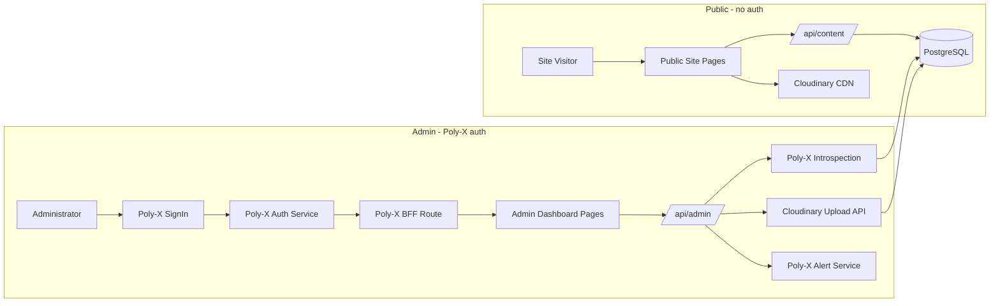

# Technical Architecture Document

| Project | Client | Version | Date |
| --- | --- | --- | --- |
| Alam Guest house | Abid Alam | 1.0 | 2026-11-01 |

## 1. Context

Alam Guest House operates a static Next.js marketing website that presents room listings, hero images, a gallery, and contact information to prospective guests. All content is hard-coded in TypeScript data files under the `data/` directory (`data/rooms.ts`, `data/hero.ts`, `data/gallery.ts`, `data/halls.ts`, `data/services.ts`, `data/siteConfig.ts`, `data/types.ts`), so every content change requires a developer to edit source code and redeploy. This project adds an admin dashboard and content management layer within the existing Next.js application, letting a single administrator manage room listings, hero section images, prices, promotions, the gallery, and blog posts dynamically. Identity (sign-in, sessions, MFA, the admin role) is provided by the Poly-X platform. Image upload and delivery use Cloudinary. The existing public website design and visitor experience are preserved; only the source of content changes from static files to a dynamic data store.

The existing repository is a Next.js App Router application with TypeScript. The `app/` directory contains `layout.tsx`, `page.tsx`, `globals.css`, `icon.tsx`, `opengraph-image.tsx`, `robots.ts`, and `sitemap.ts`. The `components/` directory has 20 component files plus an `icons/` subfolder. The `data/` directory holds the seven static data files listed above. The `lib/` directory contains utility files (`motionVariants.ts`, `useScrolled.ts`, `utils.ts`, `whatsapp.ts`). Components import from `data/` (19 import edges) and `lib/` (26 import edges, 17 call edges), confirming the static data coupling the migration must replace.

Constraints the architecture must live with:
- The admin dashboard is built within the existing Next.js App Router application (SCOPE-001, technical constraint).
- Identity and notifications are provided by Poly-X; the vendor integrates the SDK rather than building authentication, sessions, or password handling (SCOPE-001, technical constraint).
- Image upload and delivery use Cloudinary, mandated by the client (SCOPE-007, technical constraint).
- The existing static content in `data/rooms.ts`, `data/hero.ts`, `data/gallery.ts`, and related files is migrated to the dynamic data store as initial content (SCOPE-008, technical constraint).
- The preferred data store (PostgreSQL, MongoDB, or managed database service) is an open question to be confirmed by the client before design begins (RISK-001, REQ-FUNC-020).
- The existing hosting and deployment platform is unknown (Vercel, self-hosted Node, or other) and must be confirmed during kickoff (RISK-002, REQ-NFUNC-006).
- Expected content volumes are unknown and must be confirmed during kickoff (RISK-005, REQ-NFUNC-004).

Compliance frameworks that apply: CBUAE-IA-005 (Access Control and Identity Management), ISO-A8-001 (Access Control Policy), ISO-A8-009 (User Authentication and Password Management), ISO-A6-002 (Business Continuity Information Security), SBP-SEC-002 (Multi-Factor Authentication for System Access), SBP-RISK-005 (Role-Based Access Control and Segregation of Duties), SBP-OPS-001 (System Availability and Business Continuity), SBP-DATA-005 (Customer Consent and Privacy Management). The architecture satisfies these through Poly-X identity (MFA, RBAC, token introspection, fail-closed behaviour), data store persistence across deployments, and public site availability during Poly-X outages.

| Stakeholder | Concern | Answered in |
|---|---|---|
| Abid Alam (client sponsor, owner) | Project meets the need to update site content without a developer; deliverables accepted on his confirmation | § 1 Context, § 8 Architecture Decisions |
| Administrator (end user) | Can sign in and manage rooms, hero images, prices, promotions, gallery, and blog posts without technical assistance | § 5 Service Boundaries, § 10 UI Surfaces |
| Site visitors (guests) | See current room listings, prices, promotions, gallery images, and blog posts; public site available during Poly-X outages | § 3 High Availability and Disaster Recovery, § 5 Service Boundaries |
| Security officer | Data protection, MFA, RBAC, fail-closed authentication, no credential custody by the product | § 3 Security Architecture, § 8 TAD-001, TAD-002 |
| Developers (build team) | Build order, local setup, Poly-X SDK integration, migration script | § 3 Environments and Deployment Topology, § 8 Migration and Rollback |
| Auditors | Traceability of access control, MFA enforcement, business continuity | § 3 Security Architecture, § 8 Architecture Decisions |
| Operations team | Deployment guide, environment variables, monitoring, recovery procedures | § 3 Observability, § 3 Environments and Deployment Topology |

## 2. Architecture Drivers

| Driver | Source (REQ / scope) | Why it shapes the architecture |
|---|---|---|
| Security: admin authentication with MFA and RBAC | REQ-FUNC-001, REQ-FUNC-002, REQ-NFUNC-003, SCOPE-001 | Every admin dashboard operation requires a Poly-X authenticated session with the admin role, verified by token introspection. MFA is mandatory. This drives the choice of Poly-X for identity and the fail-closed middleware pattern. |
| Availability: fail-closed when Poly-X is unreachable | REQ-FUNC-003, REQ-NFUNC-002, REQ-NFUNC-007, SCOPE-001 | Admin dashboard returns 503 within 5 seconds when Poly-X is unreachable; public site continues serving content from the data store. This drives the separation of public and admin code paths and the data store as the content source for the public site. |
| Performance: public site content load time | REQ-NFUNC-001, SCOPE-009 | Public site pages must load within a response time comparable to the static version. This drives caching of data store reads and Next.js server components for content fetching. |
| Data residency and persistence | REQ-FUNC-020, REQ-NFUNC-006, SCOPE-008 | All managed content must persist across restarts and deployments. The data store replaces static TypeScript files. This drives the choice of a managed database service. |
| Integration: Poly-X identity | REQ-FUNC-001, REQ-FUNC-002, REQ-FUNC-003, SCOPE-001 | Poly-X provides sign-in, sessions, MFA, roles, and organizations. This drives the `@poly-x/next` and `@poly-x/sdk` integration and the BFF session model. |
| Integration: Cloudinary image upload | REQ-FUNC-010, SCOPE-007 | All dashboard images upload to Cloudinary; returned URLs are stored as image references. This drives the image upload service boundary and the Cloudinary SDK choice. |
| Scale: data store capacity | REQ-NFUNC-004, RISK-005 | The data store must handle expected content volumes without performance degradation. Volumes are an open question; the schema is designed with headroom for a guest house (tens of rooms, hundreds of images and blog posts). |
| Cost of change: migration from static files | REQ-FUNC-021, REQ-FUNC-026, SCOPE-008 | Existing static content must be migrated to the data store with the public site displaying migrated content unchanged. This drives the migration script and the parallel-run cutover approach. |
| Usability: WCAG 2.2 AA | REQ-NFUNC-005, SCOPE-001 | The admin dashboard must conform to WCAG 2.2 AA. This drives the UI library choice and component selection. |

**Sizing from NFRs:**
- Peak concurrent users: one administrator (dashboard) plus an unspecified number of public site visitors. The public site is read-only and served by Next.js server components reading from the data store.
- Requests per second: low. The admin dashboard serves a single user. The public site serves static-equivalent pages with data store reads. Estimated at tens of requests per second for the public site, negligible for admin.
- Data volume now: 3 room listings (from `data/rooms.ts`), 6 hero images (from `data/hero.ts`), 10 gallery images (from `data/gallery.ts`), plus halls and services data. Blog posts start at zero.
- Data volume after growth: tens of room listings, hundreds of gallery images and blog posts (to be confirmed by client, RISK-005). The schema accommodates this with headroom.
- RPO: 24 hours (daily data store backup, Assumed pending client confirmation of backup requirements).
- RTO: 1 hour (managed database restore from backup, Assumed pending client confirmation of recovery requirements).

## 3. Technology Stack

| Layer | Choice | Version | Licence / build or buy | Why (REQ ids) | Alternatives considered |
|---|---|---|---|---|---|
| Client (public site) | Next.js App Router with TypeScript | 15 | Open source (MIT) | Build within the existing application; preserve design and page structure (REQ-FUNC-026, SCOPE-009) | Remix (rejected: existing codebase is Next.js, rewriting would violate the constraint to build within the existing application) |
| Client (admin dashboard) | Next.js App Router with TypeScript | 15 | Open source (MIT) | Build within the existing application; single deployable unit (REQ-FUNC-001, SCOPE-001) | Separate React SPA (rejected: adds a second build and deployment, violates the constraint to build within the existing Next.js application) |
| API | Next.js Route Handlers (App Router) | 15 | Open source (MIT) | REST endpoints for admin content management and public content reads within the same application (REQ-FUNC-004 through REQ-FUNC-025) | Separate Express server (rejected: adds operational complexity for a single-admin dashboard with low request volume) |
| Services (identity) | Poly-X auth service (poly-auth) via `@poly-x/next` and `@poly-x/sdk` | SDK 0.18.3 | Managed service | Identity, sessions, MFA, RBAC, and token introspection (REQ-FUNC-001, REQ-FUNC-002, REQ-FUNC-003, REQ-NFUNC-003) | Auth0 (rejected: client constraints mandate Poly-X for identity; Poly-X provides existing tenancy and RBAC without credential custody by the product). Keycloak (rejected: self-hosted identity adds operational burden for a single-admin guest house site; Poly-X is the mandated platform) |
| Services (notifications) | Poly-X alert service (poly-alert) | SDK 0.18.3 | Managed service | Email and in-app notifications if the dashboard needs to notify the administrator (SCOPE-001, technical constraint) | SendGrid direct (rejected: client constraints mandate Poly-X for notifications; Poly-X provides a unified platform for identity and notifications without a product-owned mailer) |
| Services (image CDN) | Cloudinary | N/A (managed service) | Managed service | Image upload and delivery mandated by the client (REQ-FUNC-010, SCOPE-007) | AWS S3 with CloudFront (rejected: client mandates Cloudinary). ImageKit (rejected: client mandates Cloudinary) |
| Data | PostgreSQL (managed) | 16 | Managed service | Relational data with strong consistency for content management; survives restarts and deployments (REQ-FUNC-020, REQ-NFUNC-006, REQ-NFUNC-004). Assumed: client to confirm data store preference (RISK-001) | MongoDB (rejected: content is structured and relational; PostgreSQL provides stronger consistency and simpler schema for room listings, promotions, and blog posts). SQLite (rejected: not suitable for a managed deployment with automatic backups and HA) |
| Data (ORM) | Prisma | 6 | Open source (Apache-2.0) | Type-safe database access within the Next.js application; schema-first migration workflow (REQ-FUNC-020, REQ-FUNC-021) | Drizzle ORM (rejected: Prisma has a more mature migration toolset for the initial schema creation and data migration script). Raw SQL (rejected: loses type safety and increases maintenance burden) |
| Infrastructure | Vercel (Assumed) | N/A | Managed service | Next.js deployment with serverless functions, automatic CI/CD, and environment variable management (REQ-NFUNC-006, SCOPE-008). Assumed: client to confirm hosting platform (RISK-002) | Self-hosted Node on a VPS (rejected: adds operational burden for backups, TLS, and process management; Vercel provides automatic deployments and preview environments). AWS Amplify (rejected: Vercel has first-class Next.js App Router support) |
| CI/CD | Vercel Git integration | N/A | Managed service | Automatic deployment on git push; preview environments for testing (REQ-NFUNC-006) | GitHub Actions to self-hosted (rejected: adds CI infrastructure for a small project; Vercel Git integration is sufficient) |
| Observability | Vercel Analytics plus Sentry | N/A | Managed service (Vercel) + Open source (Sentry, MIT) | Error tracking, performance monitoring, and deployment analytics (REQ-NFUNC-002, REQ-NFUNC-007) | Datadog (rejected: adds cost and complexity for a single-admin guest house site). OpenTelemetry self-hosted (rejected: operational burden disproportionate to project size) |

### Environments and Deployment Topology

| Environment | Hosted on | What differs | Regions and zones |
|---|---|---|---|
| Local development | Developer machine | Local PostgreSQL (or Docker), Poly-X test organization, Cloudinary cloud name from `.env.local`, `NEXT_PUBLIC_POLYX_PUBLISHABLE_KEY` and `POLYX_SESSION_SECRET` from `.env.local` | Single zone |
| Preview (per pull request) | Vercel preview deployment | Separate `POLYX_SECRET_KEY`, `POLYX_SESSION_SECRET`, `CLOUDINARY_API_KEY` and `CLOUDINARY_API_SECRET` from Vercel environment variables; preview PostgreSQL database (Assumed: Vercel Postgres or equivalent managed PostgreSQL) | Single region, single zone |
| Production | Vercel production deployment | Production `POLYX_SECRET_KEY`, `POLYX_SESSION_SECRET`, `CLOUDINARY_API_KEY`, `CLOUDINARY_API_SECRET`, `DATABASE_URL` from Vercel environment variables; production PostgreSQL database | Single region (Assumed: nearest to the guest house's audience, to be confirmed during kickoff) |

All environments use the same Next.js application codebase. The `NEXT_PUBLIC_AUTH_MODE` environment variable is not needed for a new integration (greenfield Poly-X); it is relevant only if migrating an existing auth setup. The Poly-X organization, modules, and permission profiles are configured per environment in the Poly-X dashboard.

### High Availability and Disaster Recovery

**Redundancy per tier:**
- Next.js application: Vercel provides automatic redundancy with multiple serverless function instances (Assumed: Vercel hosting, RISK-002).
- PostgreSQL: Managed PostgreSQL provides automatic failover to a standby instance (Assumed: managed PostgreSQL with HA, to be confirmed with hosting choice).
- Cloudinary: Managed service with built-in CDN redundancy.
- Poly-X: Managed service; availability is the platform's responsibility. The product fails closed (503) when Poly-X is unreachable (REQ-FUNC-003, REQ-NFUNC-002).

**Failover:**
- Application: Vercel handles automatic failover at the platform level.
- Data store: Managed PostgreSQL automatic failover to standby (Assumed).
- Poly-X outage: Admin dashboard returns 503; public site continues serving content from the data store (REQ-NFUNC-007).

**Backups:**
- PostgreSQL: Daily automated backups with point-in-time recovery (Assumed: managed PostgreSQL default, RPO of 24 hours). The client must confirm backup requirements.
- Cloudinary: Image binaries are retained in Cloudinary; the data store holds only URL references.

**RPO and RTO:**
- RPO: 24 hours (daily automated backup, Assumed pending client confirmation).
- RTO: 1 hour (managed database restore from backup, Assumed pending client confirmation).
- The public site has no dependency on Poly-X for serving content (REQ-NFUNC-007), so a Poly-X outage does not affect the RTO for public site availability.

### Observability

- **Log aggregation:** Vercel build and runtime logs are available in the Vercel dashboard. Application-level errors are sent to Sentry.
- **Metrics:** Vercel Analytics provides web vitals (Core Web Vitals) for the public site. Sentry provides performance metrics for API routes.
- **Distributed tracing:** Not configured separately for this project size. Sentry's transaction tracing covers request flows through Next.js Route Handlers.
- **Dashboards:** Vercel dashboard for deployment status and analytics. Sentry dashboard for error rates and performance.
- **Alerting:** Sentry alerts on new errors and performance regressions. Alerts are sent to the development team (Assumed: the development team is the alert recipient; the client must confirm who is paged).
- **Who is paged:** The development team during the warranty period (Assumed; support model is an open question per the scope document).

### Security Architecture

- **Identity:** Poly-X auth service (poly-auth) provides sign-in, sessions, MFA, password management, and the admin role. The product does not build a local password store, login endpoint, or token signing. The Next.js frontend uses `@poly-x/next` 0.18.3: `createPolyXHandler()` mounted at `app/api/polyx/[...polyx]/route.ts`, `proxy({ protectedRoutes })` in `proxy.ts`, and `auth()` / `getSessionContext()` from `@poly-x/next/server`. The session is an AES-GCM sealed httpOnly cookie. The back end uses `@poly-x/sdk` 0.18.3 with `createPolyX({ secretKey: process.env.POLYX_SECRET_KEY })` and `polyx.express.requireUser()` middleware. Tokens are verified by introspection (`POST /v1/auth/authz/introspect`), not by local JWT verification. MFA is required for the admin role (REQ-FUNC-002). The product registers its modules (for example `alam_rooms`, `alam_hero`, `alam_gallery`, `alam_blog`, `alam_promotions`) and checks a grant of module and action on each admin route. The `organization-id` header is checked against the token's organization, with 403 on a mismatch. Fail closed: 401 when unauthenticated, 403 when the admin role is absent, 503 when Poly-X cannot be reached (REQ-FUNC-001, REQ-FUNC-003, REQ-NFUNC-003).
- **Secrets store:** Vercel environment variables. `POLYX_SECRET_KEY` (the App's `sk_` key, server-side only, never in a browser bundle), `POLYX_SESSION_SECRET`, `CLOUDINARY_API_KEY`, `CLOUDINARY_API_SECRET`, `DATABASE_URL`. The publishable key `NEXT_PUBLIC_POLYX_PUBLISHABLE_KEY` (a `pk_` key) is the only Poly-X key exposed to the browser.
- **Key management and rotation:** Poly-X secret keys are managed in the Poly-X dashboard; rotation creates a new `sk_` key and updates the environment variable. Cloudinary API keys are managed in the Cloudinary console. Database credentials are managed by the hosting platform (Vercel, Assumed).
- **Encryption in transit:** All API calls use HTTPS. Poly-X introspection, Cloudinary uploads, and database connections are over TLS.
- **Encryption at rest:** Managed PostgreSQL provides encryption at rest (Assumed: managed PostgreSQL default). Cloudinary provides encryption at rest for stored images.
- **Network segmentation:** The admin dashboard is protected by the Poly-X `proxy()` edge middleware, which gates `/admin/*` routes. Public content endpoints (`/api/content/*`) require no authentication. Admin content endpoints (`/api/admin/*`) require Poly-X token introspection and the admin role. The public site and admin dashboard run in the same Next.js application but are separated by route-level authorization.
- **Public surface:** The public website (pages and `/api/content/*` endpoints) and the Poly-X catch-all route (`/api/polyx/*`). All admin routes are protected.

## 4. Data Storage

| Store | Kind | Holds | Why (REQ ids) |
|---|---|---|---|
| PostgreSQL (managed) | Relational | Room listings, room images, promotions, hero images, gallery images, blog posts | Strong consistency for content management; structured relational data with foreign keys (room to images, room to promotions); survives restarts and deployments (REQ-FUNC-020, REQ-NFUNC-006, REQ-NFUNC-004). Assumed: client to confirm data store preference (RISK-001) |
| Cloudinary | Object (image CDN) | Image binaries for rooms, hero, gallery, and blog posts | Client-mandated image upload and delivery service; stores image binaries and returns URLs stored as references in PostgreSQL (REQ-FUNC-010, SCOPE-007) |

**PostgreSQL schema (managed by Prisma):**
- `Room` table: id (UUID PK), name (text, non-blank), description (text), amenities (text array), max_occupancy (integer), price (decimal), created_at (timestamp), updated_at (timestamp). Driven by REQ-FUNC-004, REQ-FUNC-005, REQ-FUNC-011.
- `RoomImage` table: id (UUID PK), room_id (UUID FK to Room), cloudinary_url (text), display_position (integer). Driven by REQ-FUNC-004, REQ-FUNC-010.
- `Promotion` table: id (UUID PK), room_id (UUID FK to Room), title (text), description (text), is_active (boolean), created_at (timestamp), updated_at (timestamp). Driven by REQ-FUNC-012, REQ-FUNC-013, REQ-FUNC-014, REQ-FUNC-015.
- `HeroImage` table: id (UUID PK), cloudinary_url (text), display_position (integer). Driven by REQ-FUNC-007, REQ-FUNC-008, REQ-FUNC-009.
- `GalleryImage` table: id (UUID PK), cloudinary_url (text), caption (text), alt_text (text), display_position (integer). Driven by REQ-FUNC-016, REQ-FUNC-017, REQ-FUNC-018.
- `BlogPost` table: id (UUID PK), title (text, non-blank), body (text), image_url (text, nullable), is_published (boolean), created_at (timestamp), updated_at (timestamp). Driven by REQ-FUNC-022, REQ-FUNC-023, REQ-FUNC-024, REQ-FUNC-025.

**Consistency:** Strong consistency (PostgreSQL, ACID). All writes require a Poly-X authenticated session with the admin role. Public reads require no authentication.

**Retention:** All content is retained until the administrator explicitly deletes it. No personal data is stored in the content data store. Image binaries are retained in Cloudinary; the data store holds only URL references. Retention and purge policy for managed content is an open question.

**Residency:** The hosting region is an open question (to be confirmed during kickoff, RISK-002). The data store holds no personal data; the administrator's identity is managed by Poly-X.

**Sizing:**
- Initial volume: 3 rooms, 6 hero images, 10 gallery images, 0 blog posts (from the existing static data files).
- Growth per year: estimated tens of room listings, hundreds of gallery images and blog posts (to be confirmed by client, RISK-005).
- The schema accommodates this volume with standard PostgreSQL indexing on primary keys and foreign keys.

**Backup and restore:** Daily automated backups with point-in-time recovery (Assumed: managed PostgreSQL default). Restore from backup via the hosting platform's database restore feature. RPO of 24 hours, RTO of 1 hour (Assumed, pending client confirmation).

## 5. Service Boundaries

The architecture is a modular monolith: a single Next.js application with two logical boundaries (public site and admin dashboard) separated by route-level authorization. There is one deployable unit. The boundary falls between public (unauthenticated, read-only) and admin (authenticated, read-write) because the public site must remain available during Poly-X outages while the admin dashboard must fail closed (REQ-FUNC-003, REQ-NFUNC-007).

| Unit | Responsibility | Owns data | Talks to |
|---|---|---|---|
| Next.js application (public site) | Serves public pages with content read from PostgreSQL; no authentication required | Reads from PostgreSQL (Room, RoomImage, Promotion, HeroImage, GalleryImage, BlogPost) | PostgreSQL, Cloudinary CDN |
| Next.js application (admin dashboard) | Provides authenticated CRUD UI for rooms, hero images, prices, promotions, gallery, and blog posts; uploads images to Cloudinary | Writes to PostgreSQL (all tables) | Poly-X auth service, Cloudinary upload API, PostgreSQL |
| Next.js application (API routes) | REST endpoints for admin content management and public content reads; Poly-X token introspection middleware | Reads and writes PostgreSQL | Poly-X auth service (introspection), PostgreSQL |

**Integration patterns:**
- **Admin dashboard to Poly-X auth service:** Synchronous REST. The `@poly-x/sdk` calls `POST /v1/auth/authz/introspect` to verify each admin request. Introspection results are cached briefly (seconds, keyed by user, session, and `permVersion`). This fits because authentication is a per-request authorization decision that must reflect real-time token validity and permissions.
- **Admin dashboard to Cloudinary:** Synchronous REST. The admin upload endpoint sends the image to Cloudinary and receives a URL. This fits because image upload is a per-action operation with an immediate success or failure response that the admin form must display.
- **Admin dashboard to PostgreSQL:** Synchronous via Prisma ORM. Read and write operations are per-request. This fits because content management requires immediate consistency feedback.
- **Public site to PostgreSQL:** Synchronous via Prisma ORM within Next.js server components. Reads are per-page-load. This fits because Next.js server components fetch data at render time with no client-side data fetching.
- **Public site to Cloudinary CDN:** Image URLs are referenced in HTML; the browser fetches images from the Cloudinary CDN. This fits because image delivery is a standard CDN pattern.
- **Admin dashboard to Poly-X alert service (if notifications are needed):** Synchronous REST (`POST /v1/email/send` or `POST /v1/push`). This fits because notifications are triggered by specific admin actions with a discrete payload. Which events trigger notifications is an open question.

## 6. Third-Party Services

| Service | Purpose | Requirement (REQ ids) | Alternatives considered | Integration (API, webhook, SDK) | When unavailable |
|---|---|---|---|---|---|
| Poly-X auth service (poly-auth) | Admin sign-in, session management, MFA, admin role, token introspection | REQ-FUNC-001, REQ-FUNC-002, REQ-FUNC-003, REQ-NFUNC-003 | Auth0 (rejected: client constraints mandate Poly-X; Poly-X provides existing tenancy and RBAC without credential custody). Keycloak (rejected: self-hosted identity adds operational burden for a single-admin guest house site) | SDK: `@poly-x/next` 0.18.3 on the frontend (createPolyXHandler, proxy, auth, getSessionContext); `@poly-x/sdk` 0.18.3 on the back end (createPolyX, requireUser, introspect). REST: `POST /v1/auth/authz/introspect` for token verification | Admin dashboard returns 503 (fail closed). Public site continues serving content from the data store (REQ-NFUNC-007) |
| Poly-X alert service (poly-alert) | Email and in-app notifications to the administrator if the dashboard needs to notify of content events | SCOPE-001 (technical constraint for notifications) | SendGrid direct (rejected: client constraints mandate Poly-X for notifications; Poly-X provides a unified platform without a product-owned mailer) | SDK: `@poly-x/sdk` 0.18.3. REST: `POST /v1/email/send` for email, `POST /v1/push` for in-app notifications. Base URLs from configuration (`POLY_ALERT_BASE_URL`) | Notification delivery fails; content management operations are not blocked. Specific retry behaviour is an open question |
| Cloudinary | Image upload from admin dashboard and image delivery to public site via CDN | REQ-FUNC-010, SCOPE-007 | AWS S3 with CloudFront (rejected: client mandates Cloudinary). ImageKit (rejected: client mandates Cloudinary) | SDK: `cloudinary` npm package. REST: Cloudinary upload API. Credentials from environment variables (`CLOUDINARY_API_KEY`, `CLOUDINARY_API_SECRET`, `CLOUDINARY_CLOUD_NAME`) | Upload fails with an error message; the system rejects the submission and does not store a partial image reference (REQ-FUNC-010). Previously stored Cloudinary URLs continue to be served from the CDN |

## 7. Libraries

| Library | Version | Used for | Why (REQ ids) |
|---|---|---|---|
| @poly-x/next | 0.18.3 | Poly-X auth integration on Next.js App Router: createPolyXHandler, proxy, auth, getSessionContext, SignIn component | Identity, sessions, MFA, and route protection (REQ-FUNC-001, REQ-FUNC-002, REQ-NFUNC-003) |
| @poly-x/sdk | 0.18.3 | Poly-X back-end token verification: createPolyX, requireUser, introspect | Token introspection and authorization enforcement on admin API routes (REQ-FUNC-003, REQ-NFUNC-003) |
| Prisma | 6 | PostgreSQL ORM, schema management, and migration tooling | Type-safe database access and schema-first migrations (REQ-FUNC-020, REQ-FUNC-021) |
| cloudinary | 2 | Cloudinary image upload SDK | Image upload from admin dashboard to Cloudinary (REQ-FUNC-010) |
| Sentry SDK for Next.js | 8 | Error tracking and performance monitoring | Observability for admin dashboard and public site (REQ-NFUNC-002, REQ-NFUNC-007) |
| zod | 3 | Form validation schemas for admin dashboard forms | Validation of room, promotion, gallery, and blog post submissions (REQ-FUNC-004, REQ-FUNC-022) |

## 8. Architecture Decisions

### TAD-001 - Poly-X for identity, authentication, and authorization

**Context:** The admin dashboard requires authenticated access with MFA and the admin role (REQ-FUNC-001, REQ-FUNC-002, REQ-NFUNC-003). The scope constraints mandate Poly-X for identity rather than building authentication, session management, or password handling.

**Options considered:**
1. Poly-X auth service via `@poly-x/next` and `@poly-x/sdk` (chosen).
2. Auth0 with a custom Next.js integration (rejected: client constraints mandate Poly-X; Poly-X provides existing tenancy and RBAC without credential custody by the product).
3. Keycloak self-hosted (rejected: adds operational burden for a single-admin guest house site; Poly-X is the mandated platform).

**Decision:** Use Poly-X auth service (poly-auth) with `@poly-x/next` 0.18.3 on the frontend and `@poly-x/sdk` 0.18.3 on the back end. The `createPolyXHandler()` catch-all is mounted at `app/api/polyx/[...polyx]/route.ts`. The `proxy({ protectedRoutes })` edge middleware gates admin routes. The back end calls `polyx.auth.introspect(token)` to verify each admin request. The session is an AES-GCM sealed httpOnly cookie. The product registers modules (`alam_rooms`, `alam_hero`, `alam_gallery`, `alam_blog`, `alam_promotions`) and checks module and action grants. MFA is enforced by Poly-X for the admin role. Fail closed: 401 unauthenticated, 403 no admin role, 503 Poly-X unreachable.

**Consequences:**
- Positive: No credential custody by the product; MFA, session management, and RBAC are handled by the platform; single SDK integration for frontend and back end; no local password store or token signing.
- Negative: The admin dashboard is unavailable when Poly-X is unreachable (mitigated by REQ-NFUNC-007: the public site remains available). The product depends on Poly-X availability for admin operations.
- Assumed: The client has or will create a Poly-X organization and admin user. The client must confirm the Poly-X organization setup and module and action matrix.

**Requirement ids:** REQ-FUNC-001, REQ-FUNC-002, REQ-FUNC-003, REQ-NFUNC-003

### TAD-002 - Fail-closed authentication with public site isolation

**Context:** When Poly-X is unreachable, the admin dashboard must return 503 within 5 seconds (REQ-FUNC-003, REQ-NFUNC-002) and the public site must continue serving content from the data store (REQ-NFUNC-007).

**Options considered:**
1. Fail closed with public and admin code path separation (chosen).
2. Fail open with cached admin session (rejected: violates REQ-FUNC-003 and REQ-NFUNC-003; security cannot be bypassed when the identity provider is unavailable).
3. Poly-X availability probe with graceful degradation (rejected: adds complexity; the fail-closed pattern is simpler and meets the 5-second response time requirement).

**Decision:** Admin API routes call `polyx.auth.introspect(token)` on every request. If Poly-X is unreachable, the middleware returns 503 immediately. Public site pages and `/api/content/*` endpoints do not call Poly-X; they read directly from PostgreSQL. This separation ensures the public site has no runtime dependency on Poly-X.

**Consequences:**
- Positive: The public site is fully available during Poly-X outages. Admin security is never bypassed. The 5-second 503 response time is met by the introspection call timeout.
- Negative: The admin dashboard is completely unavailable during Poly-X outages. The administrator cannot manage content until Poly-X recovers.

**Requirement ids:** REQ-FUNC-003, REQ-NFUNC-002, REQ-NFUNC-007

### TAD-003 - PostgreSQL (managed) as the content data store

**Context:** All managed content must persist across application restarts and deployments (REQ-FUNC-020, REQ-NFUNC-006) and be served to the public site without performance degradation (REQ-NFUNC-001, REQ-NFUNC-004). The preferred data store is an open question (RISK-001).

**Options considered:**
1. PostgreSQL 16 managed service with Prisma 6 ORM (chosen).
2. MongoDB (rejected: content is structured and relational; PostgreSQL provides stronger consistency and simpler schema for room listings, promotions, and blog posts with foreign key relationships).
3. SQLite (rejected: not suitable for a managed deployment with automatic backups and HA).

**Decision:** Use PostgreSQL 16 as a managed database service with Prisma 6 as the ORM. Prisma manages the schema, migrations, and the initial data migration script. The schema includes Room, RoomImage, Promotion, HeroImage, GalleryImage, and BlogPost tables.

**Consequences:**
- Positive: Strong consistency, ACID transactions, automatic backups, type-safe database access via Prisma, schema-first migration workflow.
- Negative: A managed PostgreSQL instance adds hosting cost. The client must confirm the data store preference and hosting platform.
- Assumed: The client confirms PostgreSQL as the preferred data store. The client confirms the hosting platform provides managed PostgreSQL (Assumed: Vercel Postgres or equivalent).

**Requirement ids:** REQ-FUNC-020, REQ-NFUNC-006, REQ-NFUNC-004

### TAD-004 - Cloudinary for image upload and delivery

**Context:** All dashboard images must be uploaded to Cloudinary and the returned URL stored as the image reference (REQ-FUNC-010, SCOPE-007). The client mandates Cloudinary.

**Options considered:**
1. Cloudinary via the `cloudinary` npm package (chosen).
2. AWS S3 with CloudFront (rejected: client mandates Cloudinary).
3. ImageKit (rejected: client mandates Cloudinary).

**Decision:** Use Cloudinary for image upload and delivery. The admin upload endpoint (`/api/admin/upload`) sends images to Cloudinary via the Cloudinary SDK and stores the returned URL in PostgreSQL. If Cloudinary returns an error, the endpoint rejects the submission and does not store a partial reference. The public site serves images from the Cloudinary CDN.

**Consequences:**
- Positive: Managed image storage with CDN delivery, automatic image optimization, no image binaries in the data store.
- Negative: The product depends on Cloudinary availability for image uploads. Existing images remain available from the CDN during upload outages.

**Requirement ids:** REQ-FUNC-010

### TAD-005 - Modular monolith within the existing Next.js application

**Context:** The admin dashboard and content management layer must be built within the existing Next.js application (SCOPE-001, SCOPE-008, technical constraint). The public site design must be preserved (REQ-FUNC-026).

**Options considered:**
1. Modular monolith: single Next.js application with public and admin boundaries separated by route-level authorization (chosen).
2. Separate admin SPA with a dedicated API server (rejected: violates the constraint to build within the existing Next.js application; adds a second build and deployment).
3. Microservices with separate admin and content services (rejected: disproportionate complexity for a single-admin guest house site with low request volume).

**Decision:** Build the admin dashboard within the existing Next.js App Router application. Public pages and `/api/content/*` endpoints are unauthenticated. Admin pages under `/admin/*` and `/api/admin/*` endpoints are protected by Poly-X `proxy()` middleware and token introspection. The existing public components (Hero, RoomsSection, GallerySection) are modified to read from PostgreSQL instead of static data files, preserving their visual design.

**Consequences:**
- Positive: Single deployable unit, single build, no additional infrastructure, existing design preserved, public and admin code paths share the same codebase but are isolated by authorization.
- Negative: Admin and public code share the same deployment; a deployment affects both. Mitigated by Vercel preview deployments for testing before production.

**Requirement ids:** REQ-FUNC-019, REQ-FUNC-026, REQ-NFUNC-006

### TAD-006 - Poly-X for notifications

**Context:** The scope constraints mandate Poly-X for notifications (email, in-app) rather than building a product-owned mailer. Which content events should notify the administrator and through which channel is an open question.

**Options considered:**
1. Poly-X alert service (poly-alert) via `@poly-x/sdk` 0.18.3 (chosen).
2. SendGrid used directly (rejected: client constraints mandate Poly-X for notifications; Poly-X provides a unified platform for identity and notifications without a product-owned mailer).
3. No notifications (rejected: the scope lists notifications as a constraint, and the dashboard may need to notify the administrator of content events).

**Decision:** Use Poly-X alert service for email and in-app notifications. Email via `POST /v1/email/send` with `organization-id` header. In-app notifications via `POST /v1/push`. Base URLs from configuration (`POLY_ALERT_BASE_URL`). The notification dispatcher is a unit within the Next.js application that calls poly-alert with retries and a dead-letter path. Content management operations are not blocked if a notification cannot be sent.

**Consequences:**
- Positive: No product-owned mailer; unified platform for identity and notifications; existing templates and sender identity from Poly-X.
- Negative: Notification delivery depends on Poly-X alert service availability. Which events trigger notifications is an open question.
- Assumed: The client confirms which content events should trigger notifications and through which channel.

**Requirement ids:** REQ-FUNC-001

### Migration and Rollback

The existing system uses static TypeScript data files (`data/rooms.ts`, `data/hero.ts`, `data/gallery.ts`, `data/halls.ts`, `data/services.ts`, `data/siteConfig.ts`) as the content source. The migration replaces these with PostgreSQL as the source of truth.

**Cutover approach:**
1. Provision the PostgreSQL database and run the Prisma migration to create the schema.
2. Run the data migration script (`scripts/migrate-static-content.ts`) that reads the existing static data files and writes their content into PostgreSQL. The script maps `data/rooms.ts` to the Room and RoomImage tables, `data/hero.ts` to the HeroImage table, `data/gallery.ts` to the GalleryImage table, and so on.
3. Modify the public-facing components (Hero, RoomsSection, GallerySection) to read from PostgreSQL via Prisma instead of importing from `data/`. The visual design and page structure remain unchanged (REQ-FUNC-026).
4. Deploy to a Vercel preview environment and verify the public site displays migrated content unchanged (REQ-FUNC-021).
5. Promote to production.

**Parallel run:**
During testing, the migration script can be run multiple times (it is idempotent: it upserts content by matching existing IDs from the static files). The public site can be tested against the data store in a preview deployment before promoting to production.

**Rollback:**
- Before cutover: the static data files remain in the repository. Rolling back means reverting the component changes to import from `data/` instead of reading from PostgreSQL. No data loss occurs because the static files are unchanged.
- After cutover: if the data store causes issues in production, revert the deployment to the previous version (which reads from static files). The static files remain in the repository as a fallback until the client confirms the migration is stable.
- The migration script is reversible: it does not delete or modify the static data files.

**Existing static data structure (from repository inspection):**
- `data/rooms.ts`: exports `rooms: Room[]` with 3 rooms (Standard, Superior, Deluxe), each with id, name, shortDescription, amenities (AmenenityKey[]), images (ImageItem[]), maxOccupancy, and priceHint (string like "PKR 8,000/night").
- `data/hero.ts`: exports `heroImages: ImageItem[]` with 6 hero images, each with src, optional srcMobile, alt, and caption.
- `data/gallery.ts`: exports `galleryImages: GalleryImage[]` with 10 gallery images, each with id, src, alt, optional category and aspect.
- `data/types.ts`: defines `ImageItem` (src, srcMobile, alt, caption) and `AmenityKey` union type.
- `data/siteConfig.ts`: exports site configuration (name, tagline, contact info, nav links, stats, landmarks). This file is not migrated to the data store in this phase (site config management is out of scope).
- `data/halls.ts` and `data/services.ts`: not migrated in this phase (management of About, Services, Location, or Contact sections is out of scope).

**Note on image URLs:** The existing static data references local image paths (for example `/images/rooms/S-room.jpeg`). During migration, these local paths are stored as-is in PostgreSQL. New images uploaded through the dashboard use Cloudinary URLs. The public site serves local paths from the Next.js public directory and Cloudinary URLs from the Cloudinary CDN. A future migration of local images to Cloudinary is out of scope.

### Risks and Technical Debt

| Risk or debt | Cause | Impact | Mitigation or repayment |
|---|---|---|---|
| Data store preference unconfirmed | RISK-001: the RFP does not specify the data store | The architecture assumes PostgreSQL; if the client prefers MongoDB, the schema and ORM must change | Confirm with the client before design begins; the schema is designed for PostgreSQL but the migration script can be adapted |
| Hosting platform unconfirmed | RISK-002: the existing hosting platform is unknown | The deployment guide and environment variable setup assume Vercel | Confirm during kickoff; the Next.js application is portable to self-hosted Node if required |
| Content volumes unconfirmed | RISK-005: expected content volumes are unknown | The schema may need additional indexing or partitioning at higher volumes | Confirm during kickoff; design the schema with headroom for tens of rooms and hundreds of images and posts |
| Local image paths in migrated content | Static data files reference local paths, not Cloudinary URLs | The public site must serve both local and Cloudinary images | Store local paths as-is during migration; the public site serves local paths from the public directory and Cloudinary URLs from the CDN. A future migration of local images to Cloudinary is out of scope |
| Notification events undefined | Which content events should notify the administrator is an open question | The notification dispatcher is built but no events are wired | Confirm with the client before UAT; wire specific events once confirmed |
| Backup and recovery unconfirmed | No RPO or RTO is stated in the requirements | The architecture assumes daily backups with 24-hour RPO and 1-hour RTO | Confirm with the client; adjust backup frequency if a tighter RPO is required |
| Draft or approval step undecided | Whether content needs a draft or approval step before going live is an open question | The architecture publishes changes live instantly | Confirm with the client before UAT; add a draft status field if required |
| Support model undefined | Support, warranty, and maintenance expectations are not specified | No defined support hours or response times after handover | Confirm with the client before handover |
| Sign-off authority assumed | Abid Alam's sign-off authority is an assumption | Acceptance process may be unclear | Confirm during kickoff |

## 9. System Architecture

**Synchronous paths:**
- Site visitor loads a public page: the Next.js server component reads from PostgreSQL via Prisma and renders the page. Images are served from the Cloudinary CDN via stored URLs.
- Administrator signs in: the browser calls the Poly-X BFF route (`/api/polyx/signin`), which redirects to the Poly-X auth service. After MFA, Poly-X returns a token sealed in an httpOnly cookie.
- Administrator performs a content operation: the browser calls an admin API route (`/api/admin/*`). The route calls `polyx.auth.introspect(token)` to verify the session and admin role. If valid, the route reads or writes PostgreSQL via Prisma. For image uploads, the route sends the image to Cloudinary and stores the returned URL.

**Asynchronous paths:** None. All operations are synchronous request-response.

**Inbound integrations (webhooks, callbacks):**
- Poly-X sign-in callback: Poly-X redirects back to the application after authentication. The `@poly-x/next` `callback` action on the catch-all route handles this.
- No other inbound integrations are required. Cloudinary uploads are outbound API calls. Poly-X introspection is an outbound API call.

## 10. UI Surfaces

| ID | Screen | Users | What it lets them do | Requirements |
|---|---|---|---|---|
| UI-01 | Admin sign-in | Administrator | Sign in with Poly-X credentials and complete MFA | REQ-FUNC-001, REQ-FUNC-002 |
| UI-02 | Room listings list | Administrator | View all room listings, select a room to edit or delete, click create to add a new room | REQ-FUNC-004, REQ-FUNC-005, REQ-FUNC-006 |
| UI-03 | Create or edit room form | Administrator | Enter or edit room name, description, amenities, images, maximum occupancy, and price; upload images to Cloudinary; save or cancel | REQ-FUNC-004, REQ-FUNC-005, REQ-FUNC-010, REQ-FUNC-011 |
| UI-04 | Hero images management | Administrator | View hero carousel images, add a new hero image, remove a hero image, reorder images by display position | REQ-FUNC-007, REQ-FUNC-008, REQ-FUNC-009 |
| UI-05 | Promotions list | Administrator | View all promotions, select a promotion to edit or remove, click create to add a new promotion | REQ-FUNC-012, REQ-FUNC-013, REQ-FUNC-014 |
| UI-06 | Create or edit promotion form | Administrator | Select a room, enter or edit promotion title and description, set active status, save or cancel | REQ-FUNC-012, REQ-FUNC-013 |
| UI-07 | Gallery management | Administrator | View gallery images with captions and alt text, add a new gallery image, edit caption and alt text, remove a gallery image | REQ-FUNC-016, REQ-FUNC-017, REQ-FUNC-018 |
| UI-08 | Blog posts list | Administrator | View all blog posts with published status, select a post to edit or delete, click create to add a new post | REQ-FUNC-022, REQ-FUNC-023, REQ-FUNC-025 |
| UI-09 | Create or edit blog post form | Administrator | Enter or edit blog post title, body content, and image; upload image to Cloudinary; save, publish, or cancel | REQ-FUNC-022, REQ-FUNC-023, REQ-FUNC-024, REQ-FUNC-010 |
| UI-10 | Public homepage | Site visitor | View hero carousel, room listings with prices and promotions, gallery preview, and contact information | REQ-FUNC-019, REQ-FUNC-015, REQ-FUNC-026 |
| UI-11 | Public blog page | Site visitor | View published blog posts | REQ-FUNC-019, REQ-FUNC-024 |
| UI-12 | Public gallery page | Site visitor | View gallery images with captions | REQ-FUNC-019, REQ-FUNC-026 |

## Decision Register

The architecture decisions and trust boundaries as recorded data: what later steps check against.

| ID | Title | Decision | Requirements | Alternative rejected | Reason |
| --- | --- | --- | --- | --- | --- |
| TAD-001 | Poly-X for identity, authentication, and authorization | Use Poly-X auth service (poly-auth) with @poly-x/next 0.18.3 on the frontend and @poly-x/sdk 0.18.3 on the back end. createPolyXHandler() mounted at app/api/polyx/[...polyx]/route.ts, proxy() edge middleware gates admin routes, back end calls polyx.auth.introspect(token) for each admin request. Session is an AES-GCM sealed httpOnly cookie. MFA enforced by Poly-X for the admin role. Fail closed: 401, 403, 503. | REQ-FUNC-001, REQ-FUNC-002, REQ-FUNC-003, REQ-NFUNC-003 | Auth0 with a custom Next.js integration: rejected because client constraints mandate Poly-X for identity, and Poly-X provides existing tenancy and RBAC without credential custody by the product | The scope constraints mandate Poly-X for identity (SCOPE-001). Poly-X provides MFA, RBAC, session management, and token introspection without the product building or storing credentials (REQ-FUNC-001, REQ-FUNC-002, REQ-NFUNC-003). Fail-closed behaviour meets REQ-FUNC-003. |
| TAD-002 | Fail-closed authentication with public site isolation | Admin API routes call polyx.auth.introspect(token) on every request; if Poly-X is unreachable, return 503 immediately. Public site pages and /api/content/ endpoints do not call Poly-X; they read directly from PostgreSQL. | REQ-FUNC-003, REQ-NFUNC-002, REQ-NFUNC-007 | Fail open with cached admin session: rejected because it violates REQ-FUNC-003 and REQ-NFUNC-003; security cannot be bypassed when the identity provider is unavailable | REQ-FUNC-003 and REQ-NFUNC-002 require 503 within 5 seconds when Poly-X is unreachable. REQ-NFUNC-007 requires the public site to continue serving content during Poly-X outages. Separating public and admin code paths achieves both. |
| TAD-003 | PostgreSQL (managed) as the content data store | Use PostgreSQL 16 as a managed database service with Prisma 6 as the ORM. Schema includes Room, RoomImage, Promotion, HeroImage, GalleryImage, and BlogPost tables. | REQ-FUNC-020, REQ-NFUNC-006, REQ-NFUNC-004 | MongoDB: rejected because content is structured and relational; PostgreSQL provides stronger consistency and simpler schema for room listings, promotions, and blog posts with foreign key relationships | REQ-FUNC-020 requires content to persist across restarts and deployments. REQ-NFUNC-006 requires no data loss. PostgreSQL with Prisma provides ACID transactions, automatic backups, and a schema-first migration workflow for the initial data migration (REQ-FUNC-021). Assumed: client confirms PostgreSQL preference (RISK-001). |
| TAD-004 | Cloudinary for image upload and delivery | Use Cloudinary via the cloudinary npm package. The admin upload endpoint sends images to Cloudinary and stores the returned URL in PostgreSQL. If Cloudinary returns an error, the endpoint rejects the submission without storing a partial reference. | REQ-FUNC-010 | AWS S3 with CloudFront: rejected because the client mandates Cloudinary (SCOPE-007) | REQ-FUNC-010 requires all dashboard images to be uploaded to Cloudinary with the returned URL stored as the image reference. SCOPE-007 mandates Cloudinary. |
| TAD-005 | Modular monolith within the existing Next.js application | Build the admin dashboard within the existing Next.js App Router application. Public and admin boundaries are separated by route-level authorization. Existing public components are modified to read from PostgreSQL instead of static data files, preserving visual design. | REQ-FUNC-019, REQ-FUNC-026, REQ-NFUNC-006 | Separate admin SPA with a dedicated API server: rejected because it violates the constraint to build within the existing Next.js application and adds a second build and deployment | SCOPE-001 and SCOPE-008 require the admin dashboard to be built within the existing Next.js application. REQ-FUNC-026 requires preserving the existing visual design. A modular monolith with route-level authorization is the simplest architecture that meets these constraints. |
| TAD-006 | Poly-X for notifications | Use Poly-X alert service (poly-alert) via @poly-x/sdk 0.18.3. Email via POST /v1/email/send, in-app notifications via POST /v1/push. Content management operations are not blocked if a notification cannot be sent. | REQ-FUNC-001 | SendGrid used directly: rejected because client constraints mandate Poly-X for notifications, and Poly-X provides a unified platform for identity and notifications without a product-owned mailer | The scope constraints mandate Poly-X for notifications (SCOPE-001). Poly-X provides email and in-app notification delivery without the product building or owning a mailer. |

### Trust Boundaries

| ID | Name | Between |
| --- | --- | --- |
| TB-01 | Internet to Next.js application (Vercel edge) | Site Visitor, Public Site Pages |
| TB-02 | Internet to admin dashboard (Poly-X protected) | Administrator, Admin Dashboard Pages |
| TB-03 | Next.js application to Poly-X auth service | Admin Dashboard Pages, Poly-X Auth Service |
| TB-04 | Next.js application to Poly-X alert service | Admin Dashboard Pages, Poly-X Alert Service |
| TB-05 | Next.js application to Cloudinary | Admin Dashboard Pages, Cloudinary Upload API |
| TB-06 | Next.js application to PostgreSQL | Public Site Pages, PostgreSQL |
| TB-07 | Admin API to PostgreSQL | Admin Dashboard Pages, PostgreSQL |

## Version History

| Version | Date | Author | Changes | Status |
| --- | --- | --- | --- | --- |
| 1.0 | 2026-11-01 | Alara Code | Technical architecture decided from the approved requirements | Draft |
