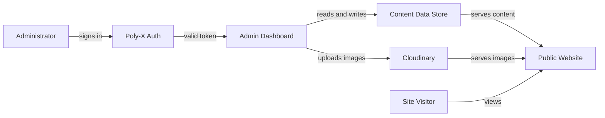

# Project Scope

| Project | Client | Version | Date |
| --- | --- | --- | --- |
| Alam Guest house | Abid Alam | 1.0 | 2026-11-01 |

## Project Overview

Alam Guest House operates a static Next.js marketing website that presents room listings, hall listings, services, a gallery, and contact information to prospective guests. All content is hard-coded in TypeScript data files under the `data/` directory, so every change to rooms, prices, images, promotions, or blog posts requires a developer to edit source code and redeploy the site.

This project adds an admin dashboard and content management layer that lets a single administrator manage room listings, hero section images, prices, promotions, the gallery, and blog posts dynamically, without code changes or redeployment. Login, authentication, and the admin role are provided by the Poly-X platform, and image upload and delivery use Cloudinary. The intended outcome is that the guest house owner or their staff can update the website content themselves, keeping the site current without developer involvement.

The existing public website design and visitor experience are preserved; only the source of content changes from static files to a dynamic data store. Several items remain open, including the preferred data store, hosting platform, expected content volumes, and whether a draft or approval step is needed before content goes live.

## Objectives

- Enable the administrator to create, edit, and delete room listings (name, description, amenities, images, maximum occupancy, price) without code changes or redeployment. Success is measured by the client confirming each room field can be managed through the dashboard.
- Enable the administrator to manage hero section images on the homepage carousel without code changes. Success is measured by the client confirming images can be added, removed, and reordered.
- Enable the administrator to set and update room prices and promotions on the public site without code changes. Success is measured by the client confirming price and promotion changes appear on the live site.
- Enable the administrator to add, edit, and remove gallery images without code changes. Success is measured by the client confirming gallery management works for add, edit, and remove.
- Enable the administrator to create, edit, and publish blog posts without code changes. Success is measured by the client confirming a blog post can be created, published, and appears on the public site.
- Preserve the existing public website design and visitor experience while serving content dynamically from a data store. Success is measured by the public site displaying migrated content unchanged.

## In Scope

| Id | Capability | Description | Objective served |
|---|---|---|---|
| SCOPE-001 | Admin login and authentication | An admin login page integrated with the Poly-X platform for authentication, session management, MFA, and the single admin role. Unauthenticated requests return 401; non-admin requests return 403. | All objectives (enables admin access) |
| SCOPE-002 | Room listing management | Create, edit, and delete room listings with name, description, amenities, images, maximum occupancy, and price. | Room listing management without code changes |
| SCOPE-003 | Hero section image management | Add, remove, and reorder hero section images displayed on the homepage carousel. | Hero image management without code changes |
| SCOPE-004 | Price and promotion management | Set and update room prices; create, edit, and remove promotions with active promotions displayed on the public site. | Price and promotion management without code changes |
| SCOPE-005 | Gallery management | Add gallery images, edit captions and alt text, and remove gallery images. | Gallery management without code changes |
| SCOPE-006 | Blog post management | Create, edit, publish, and delete blog posts with title, body content, and an image. | Blog post management without code changes |
| SCOPE-007 | Image upload and delivery via Cloudinary | All dashboard images uploaded to Cloudinary; returned URLs stored as image references; images served through the Cloudinary CDN. | All content image objectives |
| SCOPE-008 | Dynamic content data store | A data store persists all managed content, replacing static TypeScript data files as the source of truth. Content survives restarts and deployments. | Preserve design while serving dynamic content |
| SCOPE-009 | Public site component modification | Existing components (Hero, RoomsSection, GallerySection, and related) read content from the data store instead of static files, preserving visual design and page structure. | Preserve design while serving dynamic content |

## Out of Scope

- Guest login, guest accounts, or guest booking functionality (the client stated only admins log in).
- Additional admin roles or permission tiers (the client stated a single admin role with nothing else).
- Online booking or reservation system (not requested in this RFP).
- Payment processing (not requested in this RFP).
- Redesign of the public website layout or visual design (the RFP requires preserving the existing design).
- Management of the About, Services, Location, or Contact sections through the dashboard (deferred unless the client later adds them).
- Email marketing or newsletter functionality (not requested in this RFP).

## Stakeholders

| Name | Role | Organization | Contact type | Key concern |
|---|---|---|---|---|
| Abid Alam | Owner and client; defines requirements, accepts deliverables, owns source code and data | Alam Guest House | client sponsor | Project meets the need to update site content without a developer; deliverables are accepted on his confirmation |
| Administrator | Single admin role; signs in through Poly-X, manages all dynamic content, publishes changes | Alam Guest House | end user | Can sign in and manage rooms, hero images, prices, promotions, gallery, and blog posts without technical assistance |
| Site visitors (guests) | View the public website with up-to-date content; no login required | Public | end user | See current room listings, prices, promotions, gallery images, and blog posts |

Sign-off authority for the scope and all deliverables is assumed to rest with Abid Alam as the owner and client sponsor. This is an assumption the client must confirm.

## Operational Scenarios

1. **Administrator updates a room price** - The administrator navigates to the admin login page and signs in through Poly-X with MFA. Poly-X returns a valid token. The administrator opens the room listings section of the dashboard, selects a room, edits the price field, and saves. The dashboard writes the updated price to the content data store. The public website's RoomsSection component reads the updated price from the data store on the next page load and displays it to visitors without a code deployment.

2. **Administrator publishes a blog post** - The administrator signs in through Poly-X, opens the blog posts section, creates a new post with a title, body content, and an image. The image is uploaded to Cloudinary and the returned URL is stored. The administrator clicks publish. The blog post appears on the public site, served from the data store.

3. **Administrator manages gallery images** - The administrator signs in, opens the gallery section, adds a new image (uploaded to Cloudinary), edits the caption and alt text, and saves. The GallerySection component on the public site reads the updated gallery from the data store and displays the new image with its caption.

4. **Unauthenticated access attempt (failure path)** - A visitor attempts to navigate directly to the admin dashboard URL without signing in. The system calls Poly-X for token introspection, finds no valid session, and returns HTTP 401. The dashboard is not displayed.

5. **Poly-X unavailable (exception path)** - The administrator attempts to sign in, but the Poly-X auth service cannot be reached. The system fails closed and returns HTTP 503. The administrator cannot access the dashboard until Poly-X is available again. The public website continues serving existing content from the data store.

## Assumptions

- The admin dashboard and content management layer are built within the existing Next.js application using the App Router with TypeScript.
- A single admin role is sufficient with no additional roles or permission tiers.
- No guest login, guest accounts, or booking functionality is needed.
- The existing static content in `data/rooms.ts`, `data/hero.ts`, `data/gallery.ts`, and related files can be migrated to the dynamic data store as initial content.
- The client, Abid Alam, holds sign-off authority for the scope and all deliverables (to be confirmed).
- The administrator publishes changes live instantly unless the client later specifies a draft or approval step (open question).
- Poly-X provides identity, session management, MFA, and notifications; the vendor integrates the Poly-X SDK rather than building these capabilities.

## Constraints

| Type | Description |
|---|---|
| technical | The admin dashboard and content management layer shall be built within the existing Next.js application using the App Router with TypeScript |
| technical | Identity (sign-in, sessions, MFA, roles, organizations) is provided by the Poly-X platform; the vendor shall integrate Poly-X rather than building authentication, session management, or password handling |
| technical | Notifications (email, in-app) are provided by the Poly-X platform; the vendor shall integrate Poly-X for any notification needs rather than building a notification sender |
| technical | Image upload and delivery shall use Cloudinary, as mandated by the client |
| technical | The existing static content in `data/rooms.ts`, `data/hero.ts`, `data/gallery.ts`, and related files shall be migrated to the dynamic data store as the initial content |

## Risks

| Id | Description (cause -> event -> consequence) | Likelihood | Impact | Mitigation |
|---|---|---|---|---|
| RISK-001 | The preferred data store is not specified in the RFP, which may lead to the vendor proposing an incompatible or suboptimal data store, resulting in rework or a data store that does not meet the client's hosting constraints | medium | medium | Raise the data store preference as an open question before design begins, and propose a data store compatible with the existing Next.js deployment model |
| RISK-002 | The existing hosting and deployment platform is unknown, which may lead to integration assumptions that do not hold, resulting in deployment delays or environment configuration issues | medium | medium | Confirm the hosting platform (for example Vercel, self-hosted Node) during kickoff before finalising the deployment guide |
| RISK-003 | Migrating existing static content to the dynamic data store may reveal data structure mismatches or missing fields, resulting in incomplete or incorrect content on the public site after migration | medium | high | Write and test the migration script against the actual static data files before deployment, and verify the public site displays migrated content unchanged as an acceptance criterion |
| RISK-004 | Poly-X platform unavailability may prevent admin authentication, resulting in the administrator being unable to access the dashboard to manage content | low | high | Implement fail-closed behaviour (503 when Poly-X cannot be reached) and document the recovery procedure in the deployment guide |
| RISK-005 | The expected content volume (blog posts, gallery images, room listings) is unknown, which may lead to a data store schema that does not scale, resulting in performance degradation as content grows | low | medium | Confirm expected content volumes during kickoff and design the schema to accommodate the stated volumes with headroom |

## Deliverables

| Deliverable | Description | Acceptance criterion |
|---|---|---|
| Admin dashboard source code | Source code in the existing Next.js repository | The admin dashboard builds without errors, all FR-01 through FR-16 are demonstrated, and the client confirms each content type can be managed |
| Poly-X integration | Source code and configuration for Poly-X auth and notifications | Admin login authenticates through Poly-X, unauthenticated access returns 401, non-admin access returns 403, and MFA is demonstrated |
| Cloudinary integration | Source code and configuration for image upload and delivery | Image upload through the admin dashboard stores a Cloudinary URL, and the uploaded image is served on the public site |
| Content data store schema and migration | Schema definition and migration script | The migration script loads existing static data into the data store, and the public site displays the migrated content unchanged |
| Admin dashboard documentation | Markdown documentation | Documentation covers how to sign in, manage each content type, upload images, and publish blog posts, and the client confirms it is understandable |
| Deployment guide | Markdown documentation | The guide describes environment variables, Poly-X keys, Cloudinary credentials, and deployment steps, and the client confirms a deployment can be completed from it |
| Knowledge transfer session | Live session | The client demonstrates the ability to manage room listings, hero images, prices, promotions, gallery images, and blog posts without assistance |

## Technical Context

### Tech Stack

- **Frontend and backend:** Next.js (App Router) with TypeScript, built within the existing application.
- **Image CDN:** Cloudinary for image upload and delivery.
- **Data store:** Preference is an open question (the RFP lists PostgreSQL, MongoDB, or a managed database service as candidates).
- **Identity and notifications:** Poly-X platform (poly-auth for sign-in, sessions, MFA, and the admin role; poly-alert for email and in-app notifications).

### Delivery Model

- **Type:** Full-stack (the vendor builds the admin dashboard UI within the existing Next.js application).
- **Channels:** admin-dashboard (the public website is the existing Next.js front end, modified to read from the data store).
- **Frontend owner:** This team.

### Integrations

- **Poly-X platform (poly-auth):** Admin sign-in, session management, MFA, and the admin role. The system calls Poly-X for token introspection on protected admin routes. Protocol: REST, direction: outbound.
- **Poly-X platform (poly-alert):** Email and in-app notifications if the dashboard needs to notify the administrator of content events. Protocol: REST, direction: outbound.
- **Cloudinary:** Image upload from the admin dashboard and image delivery to the public site through its CDN. Protocol: REST, direction: outbound.

### Identity and Notification Needs

- **Who signs in:** A single administrator with the admin role assigned through Poly-X.
- **Roles:** One admin role only; no additional roles or permission tiers.
- **Notifications:** If the dashboard needs to notify the administrator of content events (which events and through which channel is an open question), the system uses Poly-X notifications (poly-alert) rather than a product-owned mailer.
- **MFA:** Provided by Poly-X as part of the authentication flow.

### Data and Migration Scope

- **Systems being replaced:** The static TypeScript data files (`data/rooms.ts`, `data/hero.ts`, `data/gallery.ts`, `data/halls.ts`, `data/services.ts`, `data/siteConfig.ts`) are replaced by the dynamic data store as the source of truth for managed content.
- **Data to move:** Existing room listings, hero images, gallery images, and related content are migrated to the data store as initial content.
- **Volumes:** Expected volumes of blog posts, gallery images, and room listings are an open question.

### Support Model

- Support, warranty, and maintenance expectations after handover are not specified and are listed as open questions, including support hours and response times.
- The client owns the source code and all content data.

### Success KPIs

- The client can manage room listings, hero images, prices, promotions, gallery images, and blog posts without developer assistance (validated in the knowledge transfer session).
- Changes made by the administrator appear on the public website without a code deployment.
- The public site displays migrated content unchanged after migration.

### Open Questions Affecting Technical Context

- Preferred data store (PostgreSQL, MongoDB, managed database service).
- Existing hosting and deployment platform (Vercel, self-hosted Node, or other).
- Expected content volumes.
- Whether a draft or approval step is needed before content goes public.
- Which content events should notify the administrator and through which channel.
- Any regulatory or data-protection requirements beyond what Poly-X provides for identity.

## Scope Change Control

The scope is baselined on approval. Any change is raised, impact-assessed for effort, schedule, and requirements affected, and approved by the client sponsor before it is built. Items currently listed as open questions (data store preference, hosting platform, content volumes, draft or approval step, notification events, additional dynamic sections) are resolved through this process before they enter the build.

## Version History

| Version | Date | Author | Changes | Status |
| --- | --- | --- | --- | --- |
| 1.0 | 2026-11-01 | Alara Code | Initial draft - scope extracted from RFP/brief | Draft |
