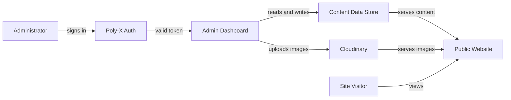

# Request for Proposal

| Project | Client | Version | Date |
| --- | --- | --- | --- |
| Alam Guest house | Abid Alam | 1.0 | 2026-11-01 |

# Alam Guest House Admin Dashboard and Content Management

## Executive Summary

Alam Guest House currently operates a static Next.js marketing website that presents room listings, hall listings, services, a gallery, and contact information to prospective guests. All content is hard-coded in TypeScript data files under the `data/` directory, which means every change to rooms, prices, images, promotions, or blog posts requires a developer to edit source code and redeploy the site.

This RFP asks vendors to propose an admin dashboard and content management layer that lets a single administrator manage room listings, hero section images, prices, promotions, the gallery, and blog posts dynamically, without code changes. Login, authentication, and the admin role will be provided by the Poly-X platform, and image upload and delivery will use Cloudinary. The intended outcome is that the guest house owner or their staff can update the website content themselves, keeping the site current without developer involvement.

## Background

Abid Alam owns and operates Alam Guest House, a lodging business in Booni, Upper Chitral, Khyber Pakhtunkhwa, Pakistan. The existing website is a Next.js application using the App Router, with TypeScript components in a `components/` directory and static content in a `data/` directory. The site renders a hero section, an about section, room listings, hall listings, services, a gallery, a location section, and a contact section. Content such as room names, descriptions, amenities, prices, and images is defined in files like `data/rooms.ts`, `data/hero.ts`, `data/gallery.ts`, `data/halls.ts`, and `data/services.ts`, and the site configuration lives in `data/siteConfig.ts`.

Because all content is hard-coded, updating a room price, adding a promotion, swapping a hero image, or publishing a blog post currently requires a developer to modify the source files and trigger a new deployment. The client needs to make these changes themselves, on their own schedule, without technical assistance. This project adds the admin dashboard and dynamic content infrastructure to make that possible.

## Objectives

- Enable the administrator to create, edit, and delete room listings, including name, description, amenities, images, maximum occupancy, and price, without code changes or redeployment.
- Enable the administrator to manage hero section images displayed on the homepage carousel without code changes.
- Enable the administrator to set and update room prices and promotions displayed on the public site without code changes.
- Enable the administrator to add, edit, and remove gallery images without code changes.
- Enable the administrator to create, edit, and publish blog posts without code changes.
- Preserve the existing public website design and visitor experience while serving content dynamically from a data store instead of static files.

## Users and Stakeholders

| Group | What they need |
|---|---|
| Administrator (single admin role) | Signs in through a secure login, manages all dynamic site content through an admin dashboard, publishes changes to the live site. |
| Site visitors (guests) | View the public website with up-to-date room listings, prices, promotions, gallery images, and blog posts. No login required. |
| Abid Alam (owner/client) | Owns the project, defines requirements, accepts deliverables, owns the source code and data. |

## Scope

### In Scope

- Admin login page integrated with the Poly-X platform for authentication and the single admin role.
- Admin dashboard with a content management interface for room listings (name, description, amenities, images, maximum occupancy, price).
- Admin dashboard interface for managing hero section images.
- Admin dashboard interface for managing prices and promotions.
- Admin dashboard interface for managing the gallery (add, edit, remove images).
- Admin dashboard interface for blog posts (create, edit, publish).
- Image upload and delivery through Cloudinary for all managed content images.
- A data store to persist dynamic content, replacing the static TypeScript data files as the source of truth for managed content.
- Modification of existing public-facing components (`Hero`, `RoomsSection`, `GallerySection`, and related components) to read content from the data store instead of static files.

### Out of Scope

- Guest login, guest accounts, or guest booking functionality. The client stated only admins log in.
- Additional admin roles or permission tiers. The client stated a single admin role with nothing else.
- Online booking or reservation system.
- Payment processing.
- Redesign of the public website layout or visual design.
- Management of the About, Services, Location, or Contact sections through the dashboard, unless the client later adds them.
- Email marketing or newsletter functionality.

## Functional Requirements

- **FR-01** - The system shall provide an admin login page that authenticates the administrator through the Poly-X platform.
- **FR-02** - The system shall restrict access to the admin dashboard to authenticated users holding the admin role assigned through the Poly-X platform.
- **FR-03** - The system shall provide an admin dashboard interface where the administrator can create a new room listing with name, description, amenities, images, maximum occupancy, and price.
- **FR-04** - The system shall provide an admin dashboard interface where the administrator can edit an existing room listing's name, description, amenities, images, maximum occupancy, and price.
- **FR-05** - The system shall provide an admin dashboard interface where the administrator can delete an existing room listing.
- **FR-06** - The system shall provide an admin dashboard interface where the administrator can add, remove, and reorder hero section images displayed on the homepage.
- **FR-07** - The system shall provide an admin dashboard interface where the administrator can set and update the price displayed for each room listing.
- **FR-08** - The system shall provide an admin dashboard interface where the administrator can create, edit, and remove promotions, and display active promotions on the public site.
- **FR-09** - The system shall provide an admin dashboard interface where the administrator can add gallery images, edit gallery image captions and alt text, and remove gallery images.
- **FR-10** - The system shall provide an admin dashboard interface where the administrator can create a new blog post with a title, body content, and an image.
- **FR-11** - The system shall provide an admin dashboard interface where the administrator can edit an existing blog post's title, body content, and image.
- **FR-12** - The system shall provide an admin dashboard interface where the administrator can publish a blog post so it appears on the public site.
- **FR-13** - The system shall provide an admin dashboard interface where the administrator can delete an existing blog post.
- **FR-14** - The system shall upload all images submitted through the admin dashboard to Cloudinary and store the returned Cloudinary URL as the image reference.
- **FR-15** - The system shall serve room listings, hero images, prices, promotions, gallery images, and blog posts on the public website from the dynamic data store rather than from static data files.
- **FR-16** - The system shall display changes made by the administrator on the public website without requiring a code deployment.

## Non-Functional Requirements

- **NFR-01** - The system shall authenticate admin sessions through the Poly-X platform, which provides sign-in, session management, and multi-factor authentication.
- **NFR-02** - The system shall deny access to the admin dashboard for any request that is unauthenticated, returning an HTTP 401 response.
- **NFR-03** - The system shall deny access to the admin dashboard for any authenticated user who does not hold the admin role, returning an HTTP 403 response.
- **NFR-04** - The system shall store admin credentials and manage authentication through the Poly-X platform, not in a local password store maintained by the product.
- **NFR-05** - The system shall persist all managed content in a data store so that content survives application restarts and deployments.
- **NFR-06** - The system shall serve images through Cloudinary's content delivery network so that image delivery does not burden the application server.
- **NFR-07** - The system shall preserve the existing public website's visual design and page structure when serving content dynamically.

## Integrations

- **Poly-X platform (poly-auth)** - Provides admin sign-in, session management, multi-factor authentication, and the admin role. The vendor integrates the Poly-X SDK rather than building authentication. The system calls Poly-X for token introspection on protected admin routes.
- **Poly-X platform (poly-alert)** - Provides email and in-app notifications. If the admin dashboard needs to notify the administrator of content events, the system shall use Poly-X notifications rather than a product-owned mailer.
- **Cloudinary** - Receives image uploads from the admin dashboard and serves images to the public website through its content delivery network. The system exchanges uploaded image files for Cloudinary URLs stored in the content data store.

## Constraints and Assumptions

- The existing website is a Next.js application using the App Router with TypeScript. The admin dashboard and content management layer shall be built within this existing application.
- Identity (sign-in, sessions, multi-factor authentication, roles, organizations) is provided by the Poly-X platform. The vendor shall integrate Poly-X rather than building authentication, session management, or password handling.
- Notifications (email, in-app) are provided by the Poly-X platform. The vendor shall integrate Poly-X for any notification needs rather than building a notification sender.
- Image upload and delivery shall use Cloudinary, as mandated by the client.
- The existing static content in `data/rooms.ts`, `data/hero.ts`, `data/gallery.ts`, and related files shall be migrated to the dynamic data store as the initial content.
- The project assumes a single admin role with no additional roles or permission tiers.
- The project assumes no guest login, guest accounts, or booking functionality.

## Deliverables

| Deliverable | Format | Acceptance criteria |
|---|---|---|
| Admin dashboard source code | Source code in the existing Next.js repository | The admin dashboard builds without errors, all FR-01 through FR-16 are demonstrated, and the client confirms each content type can be managed. |
| Poly-X integration | Source code and configuration | Admin login authenticates through Poly-X, unauthenticated access returns 401, non-admin access returns 403, and MFA is demonstrated. |
| Cloudinary integration | Source code and configuration | Image upload through the admin dashboard stores a Cloudinary URL, and the uploaded image is served on the public site. |
| Content data store schema and migration | Schema definition and migration script | The migration script loads existing static data into the data store, and the public site displays the migrated content unchanged. |
| Admin dashboard documentation | Markdown documentation | Documentation covers how to sign in, manage each content type, upload images, and publish blog posts, and the client confirms it is understandable. |
| Deployment guide | Markdown documentation | The guide describes environment variables, Poly-X keys, Cloudinary credentials, and deployment steps, and the client confirms a deployment can be completed from it. |
| Knowledge transfer session | Live session | The client demonstrates the ability to manage room listings, hero images, prices, promotions, gallery images, and blog posts without assistance. |

## Timeline and Budget

Not specified.

## Support, Warranty and Ownership

- The client, Abid Alam, shall own the source code and all content data produced for the project.
- The client shall own the data stored in the content data store.
- Support, warranty, and maintenance expectations after handover are not specified and listed in Open Questions.
- Security and data-protection obligations for admin credentials and content data are handled by the Poly-X platform for identity; the vendor shall state how content data is protected at rest and in transit.

## Proposal Submission Instructions

A vendor response must contain the following sections, in this order:

1. **Understanding of the requirement** - A restatement of the problem and scope showing the vendor understands the existing Next.js site, the dynamic content requirements, the Poly-X identity integration, and the Cloudinary image integration.
2. **Technical approach** - The proposed data store, how existing components will be modified to read dynamic content, how the Poly-X SDK will be integrated for authentication, and how Cloudinary will be integrated for image upload and delivery.
3. **Delivery plan** - A milestone-based plan with activities and dependencies, from kickoff through deployment and knowledge transfer.
4. **Team** - The roles and individuals assigned to the project, with their relevant qualifications.
5. **Relevant experience** - Examples of comparable content management or admin dashboard projects, preferably in hospitality or small business websites.
6. **Assumptions and exceptions** - Any assumptions the vendor makes beyond this RFP and any exceptions taken to stated requirements.
7. **Commercial offer** - A priced proposal covering all deliverables, with a breakdown by milestone or deliverable.
8. **Compliance matrix** - A table answering every numbered requirement (FR-01 through FR-16, NFR-01 through NFR-07) with Compliant, Partial, or Non-compliant and a brief explanation.

### RFP Calendar

| Event | Date |
|---|---|
| RFP issue date | Not specified |
| Deadline for vendor questions | Not specified |
| Answers published | Not specified |
| Proposal submission deadline | Not specified |
| Expected award date | Not specified |

## Evaluation Criteria

The following mandatory criteria must be met for a proposal to be scored. A proposal that fails any of these will not be evaluated further:

- The vendor must integrate the Poly-X platform for authentication and the admin role, not build a custom authentication system.
- The vendor must integrate Cloudinary for image upload and delivery, as mandated by the client.
- The vendor must build the admin dashboard within the existing Next.js application.

The following weights are proposed, as the client has not specified evaluation weights:

| Criterion | Weight (%) | What scores well |
|---|---|---|
| Technical approach | 30 | A clear, well-reasoned data store design, a sound plan for modifying existing components to read dynamic content, and a correct Poly-X and Cloudinary integration approach. |
| Relevant experience | 20 | Demonstrated experience building admin dashboards or content management for similar small business or hospitality websites. |
| Delivery plan and timeline | 20 | A realistic, milestone-based plan that covers all deliverables and includes a knowledge transfer session. |
| Cost | 15 | A competitive and transparent price covering all deliverables. |
| Support and warranty | 15 | A clear post-delivery support and warranty offer with defined response times and coverage. |

## Open Questions

- What does the existing site run on today in terms of hosting and deployment (for example, Vercel, a self-hosted Node server, or another platform)?
- Should the administrator publish changes live instantly, or is a draft or approval step required before content goes public?
- How many administrators are expected to use the dashboard?
- What is the expected volume of blog posts, gallery images, and room listings the data store must handle?
- What is the project budget?
- What is the project timeline or target completion date?
- What are the RFP calendar dates (issue date, vendor question deadline, answers publication date, submission deadline, expected award date)?
- What are the support, warranty, and maintenance expectations after handover, including support hours and response times?
- What data store does the client prefer or currently have available (for example, PostgreSQL, MongoDB, a managed database service)?
- Does the admin dashboard need to notify the administrator of any content events, and if so, which events and through which channel?
- Are there any regulatory or data-protection requirements that apply to the content data or admin credentials beyond what the Poly-X platform provides?
- Should the About, Services, Location, or Contact sections also become dynamic through the admin dashboard?
- What are the evaluation criteria weights, or are the proposed weights acceptable?

