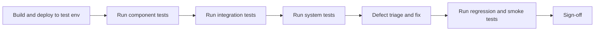
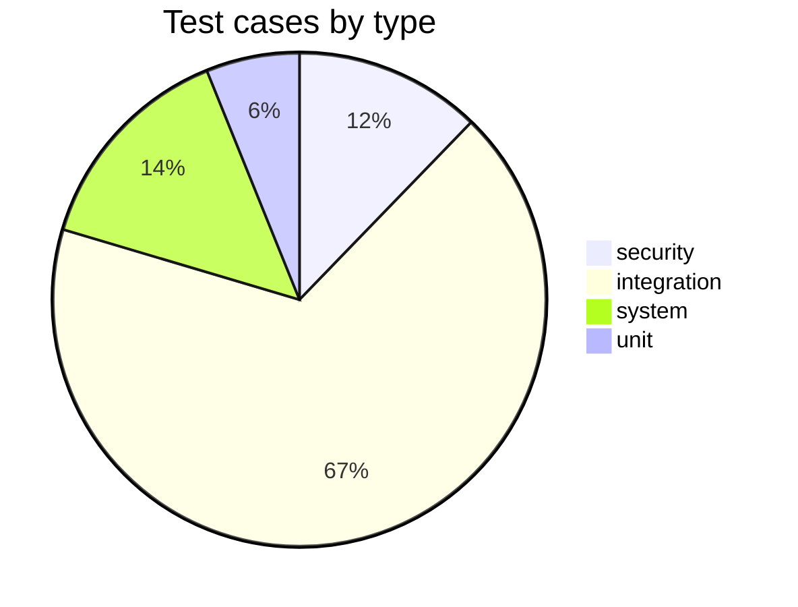

# Software Test Specification

| Project | Client | Version | Date |
| --- | --- | --- | --- |
| Alam Guest house | Abid Alam | 1.0 | 2026-11-01 |

## 1. Introduction

### Purpose

This Software Test Specification (STS) defines the risk-based test plan for the Alam Guest House admin dashboard and content management system. The system adds a Poly-X-authenticated admin dashboard to an existing Next.js marketing website, enabling a single administrator to manage room listings, hero section images, prices, promotions, gallery images, and blog posts dynamically through a PostgreSQL data store, with images uploaded to Cloudinary. This test cycle exists to verify that all 33 approved requirements (26 functional, 7 non-functional) are met before the system is released to the client, Abid Alam. The plan covers 49 test cases (TC-001 through TC-049) across component, integration, and system levels, with full requirement coverage at 100%.

### Test Scope

**In scope:**
- Poly-X authentication, MFA, admin role enforcement, fail-closed behaviour, and organization-id mismatch handling (REQ-FUNC-001, REQ-FUNC-002, REQ-FUNC-003, REQ-NFUNC-002, REQ-NFUNC-003).
- Room listing CRUD and price updates (REQ-FUNC-004, REQ-FUNC-005, REQ-FUNC-006, REQ-FUNC-011).
- Hero section image add, remove, and reorder (REQ-FUNC-007, REQ-FUNC-008, REQ-FUNC-009).
- Promotion create, edit, remove, and public display of active promotions (REQ-FUNC-012, REQ-FUNC-013, REQ-FUNC-014, REQ-FUNC-015).
- Gallery image add, edit caption and alt text, and remove (REQ-FUNC-016, REQ-FUNC-017, REQ-FUNC-018).
- Blog post create, edit, publish, and delete (REQ-FUNC-022, REQ-FUNC-023, REQ-FUNC-024, REQ-FUNC-025).
- Image upload to Cloudinary and failure handling (REQ-FUNC-010).
- Data store persistence across restarts and deployments (REQ-FUNC-020, REQ-NFUNC-006).
- Static content migration to the data store, idempotency, and error reporting (REQ-FUNC-021).
- Public site content delivery from the data store and design preservation (REQ-FUNC-019, REQ-FUNC-026).
- Notification dispatcher delivery, retry, and dead-letter behaviour (TC-047, TC-048, TC-049).
- Non-functional testing: performance (REQ-NFUNC-001), availability (REQ-NFUNC-002, REQ-NFUNC-006, REQ-NFUNC-007), security (REQ-NFUNC-003), scalability (REQ-NFUNC-004), and accessibility (REQ-NFUNC-005).

**Out of scope:**
- Guest login, guest accounts, or booking functionality (not in requirements).
- Additional admin roles or permission tiers beyond the single admin role.
- Payment processing or reservation systems.
- Redesign of the public website layout or visual design.
- Management of the About, Services, Location, or Contact sections through the dashboard.
- Email marketing or newsletter functionality.
- Poly-X platform internals (poly-auth and poly-alert are external dependencies; their internal behaviour is stubbed or exercised through the sandbox, not tested directly).

### Conformance

This test plan conforms to ISO/IEC/IEEE 29119-3:2021 with the following tailoring: the test plan and test cases are combined in one document, and entry criteria are added from ISTQB practice.

### Definitions

| Term | Definition | Source |
|---|---|---|
| STS | Software Test Specification, the test plan of ISO/IEC/IEEE 29119-3:2021 | ISO/IEC/IEEE 29119-3 |
| Poly-X | The platform providing identity (poly-auth) and notification (poly-alert) services | poly-x-platform.md |
| poly-auth | The Poly-X authentication service for sign-in, sessions, MFA, roles, and organizations | poly-x-platform.md |
| poly-alert | The Poly-X notification service for email and in-app notifications | poly-x-platform.md |
| Token introspection | Validating a Poly-X access token by calling POST /v1/auth/authz/introspect | poly-x-platform.md |
| Fail closed | Returning 401, 403, or 503 when authentication or authorization cannot be verified, never allowing a request through | poly-x-platform.md |
| MFA | Multi-factor authentication, provided by Poly-X during admin sign-in | ISTQB |
| Cloudinary | The cloud-based image upload and content delivery network service | Internal |
| WCAG 2.2 AA | Web Content Accessibility Guidelines version 2.2, conformance level AA | ISTQB |
| MoSCoW | Priority model: must, should, could, wont | ISTQB |
| Risk-based testing | Testing where the depth of testing follows the risk and the MoSCoW priority of each requirement | ISO/IEC/IEEE 29119 |
| Smoke test | A small set of test cases run after every deployment to prove the build is alive | ISTQB |
| Dead-letter path | A storage location for messages that could not be delivered after maximum retries | Internal |

### References

| Document | Version or date |
|---|---|
| Software Requirements Specification (SRS) | Version 1 |
| Software Design Specification (SDS) | Version 1 |
| API Contract | Version 1 |
| poly-x-platform.md (Poly-X platform services reference) | Attached |
| poly-x-integration.md (Poly-X integration steps) | Attached |
| ISO/IEC/IEEE 29119-3:2021 (Test documentation) | 2021 |
| ISO/IEC/IEEE 29119-1 (Test concepts and definitions) | Current |

## 2. Test Items

### Items to Be Tested

- Poly-X Authentication and Authorization Middleware (DC-001): token introspection, admin role enforcement, organization-id mismatch, MFA, and fail-closed behaviour covering REQ-FUNC-001, REQ-FUNC-002, REQ-FUNC-003, REQ-NFUNC-002, REQ-NFUNC-003.
- Content Data Store (DC-002): PostgreSQL persistence of managed content across restarts and deployments covering REQ-FUNC-020, REQ-NFUNC-006, REQ-NFUNC-004.
- Cloudinary Image Upload Service (DC-003): image upload and failure handling covering REQ-FUNC-010.
- Room Listing Management (DC-004): create, edit, delete, and price update covering REQ-FUNC-004, REQ-FUNC-005, REQ-FUNC-006, REQ-FUNC-011.
- Hero Section Image Management (DC-005): add, remove, and reorder covering REQ-FUNC-007, REQ-FUNC-008, REQ-FUNC-009.
- Promotion Management (DC-006): create, edit, remove, and public display of active promotions covering REQ-FUNC-012, REQ-FUNC-013, REQ-FUNC-014, REQ-FUNC-015.
- Gallery Management (DC-007): add, edit caption and alt text, and remove covering REQ-FUNC-016, REQ-FUNC-017, REQ-FUNC-018.
- Blog Post Management (DC-008): create, edit, publish, and delete covering REQ-FUNC-022, REQ-FUNC-023, REQ-FUNC-024, REQ-FUNC-025.
- Public Content Delivery (DC-009): serving managed content from the data store, design preservation, and Poly-X outage isolation covering REQ-FUNC-019, REQ-FUNC-026, REQ-NFUNC-001, REQ-NFUNC-007.
- Static Content Migration (DC-010): migration script, idempotency, and error reporting covering REQ-FUNC-021.
- Admin Dashboard Shell and Accessibility (DC-011): WCAG 2.2 AA conformance covering REQ-NFUNC-005.
- Notification Dispatcher (DC-012): notification delivery, retry, and dead-letter behaviour covering TC-047, TC-048, TC-049.

### Items Not to Be Tested

- Poly-X platform internals (poly-auth and poly-alert): Poly-X is an external managed service, not a product under test. Its behaviour is a dependency stubbed or exercised through the sandbox.
- Cloudinary platform internals: Cloudinary is an external service. Only the integration endpoint (POST /api/admin/upload) and failure handling are tested.
- Public website visual design: The existing design is preserved (REQ-FUNC-026); only the data source change is verified, not a redesign.
- Guest-facing features (booking, payment, guest accounts): not in scope per the SRS.
- About, Services, Location, and Contact section management: not in scope per the SRS.

## 3. Test Approach

### Test Levels

- **Component level:** Unit tests for form validation logic (zod schemas) covering room name and price validation (TC-011, TC-021) and blog post title validation (TC-037). These prove that validation rejects invalid input at the schema level before it reaches the data store.
- **Integration level:** Tests exercising the admin API endpoints with a real or sandboxed Poly-X auth service and a test PostgreSQL database, covering authentication flows (TC-001 through TC-009), CRUD operations for rooms (TC-010, TC-012, TC-013, TC-014), hero images (TC-015, TC-016, TC-017), promotions (TC-022, TC-023, TC-024), gallery (TC-026, TC-027, TC-028), blog posts (TC-036, TC-038, TC-039, TC-041), image upload (TC-018, TC-019), price updates (TC-020), migration (TC-032, TC-034, TC-035), persistence (TC-031), and notification dispatch (TC-047, TC-048, TC-049). These prove that the components work together correctly with their dependencies.
- **System level:** End-to-end tests exercising the full stack from public site to data store, covering public content delivery (TC-029, TC-030), active promotion display (TC-025), Poly-X outage isolation (TC-006, TC-046), migration cutover (TC-033), blog post visibility (TC-040), design preservation (TC-042), performance (TC-043, TC-044), and accessibility (TC-045). These prove that the system as a whole meets its requirements.

### Testing Approach

The testing approach is risk-based, following ISO/IEC/IEEE 29119. The depth of testing for each requirement follows its MoSCoW priority and its risk to the system.

**Must requirements (deepest testing):** All 24 must requirements receive critical-priority test cases with integration or system level coverage. Authentication and authorization (REQ-FUNC-001, REQ-FUNC-002, REQ-FUNC-003, REQ-NFUNC-002, REQ-NFUNC-003) receive the deepest testing with 9 test cases (TC-001 through TC-009) because a security failure could expose all admin data or block all admin access. Content CRUD operations for rooms, hero images, promotions, gallery, and blog posts each receive integration tests covering the happy path and validation failures. Data store persistence (REQ-FUNC-020, REQ-NFUNC-006) is tested by verifying content survives a restart. Migration (REQ-FUNC-021) receives 4 test cases covering correctness, idempotency, and error reporting because a failed migration could corrupt the initial data set.

**Should requirements (moderate testing):** Performance (REQ-NFUNC-001), scalability (REQ-NFUNC-004), and accessibility (REQ-NFUNC-005) receive system-level tests with high or medium priority. The response time target for REQ-NFUNC-001 is to be confirmed by the client, so the test compares against the static baseline rather than a fixed threshold.

**Design techniques used:**
- **Equivalence partitioning:** Valid and invalid input classes for form fields (room name blank vs non-blank, price positive vs zero, blog title blank vs non-blank) in TC-011, TC-021, TC-037.
- **Boundary values:** Price set to zero (boundary between valid and invalid) in TC-021; empty amenities list in TC-013.
- **Decision tables:** Poly-X authentication outcomes (unauthenticated 401, authenticated without admin role 403, authenticated with admin role 200, Poly-X unreachable 503) in TC-001 through TC-005, TC-007, TC-008.
- **State transition:** Blog post state machine (Draft to Published on publish, Published to Draft on unpublish, either state to deleted) covered by TC-036, TC-039, TC-040, TC-041.

### Regression Approach

After a fix or change, the following are re-run:
- All critical-priority test cases (28 cases) to confirm no security or core functionality regression.
- The test cases linked to the changed requirement or design component.
- The smoke test suite (below) after every deployment.

**Smoke test (run after every deployment):**
- TC-003: authenticated admin can access the dashboard (proves the build is alive and Poly-X integration works).
- TC-029: public content endpoints return content from the data store (proves the data store is connected and the public site is serving).
- TC-001: unauthenticated request returns 401 (proves the auth middleware is active).

### Test Automation



Component-level validation tests (TC-011, TC-021, TC-037) are automated as unit tests using a JavaScript test runner with zod schema validation. Integration tests are automated against a test PostgreSQL database and the Poly-X sandbox, using an HTTP client to call the admin and public API endpoints. System-level tests are automated as end-to-end tests loading the public site and admin dashboard in a headless browser. Performance tests (TC-043, TC-044) use a load testing tool to measure page response times against the static baseline. The accessibility audit (TC-045) uses an automated WCAG 2.2 AA audit tool such as axe-core against each dashboard screen. The migration script tests (TC-032, TC-034, TC-035) are automated by running the migration script against a test database and inspecting the results.

### Non-Functional Testing

**Performance and load (REQ-NFUNC-001, REQ-NFUNC-004):**
- Load profile: 1 concurrent administrator (dashboard) plus an unspecified number of public site visitors. Ramp-up over 60 seconds, sustained for 5 minutes, transaction mix of 80% public page loads and 20% admin content operations.
- TC-043 measures public site page load time against the static version baseline. The threshold is a response time comparable to the static version (specific target value to be confirmed by the client per REQ-NFUNC-001).
- TC-044 measures data store read and write performance at expected content volumes (tens of rooms, hundreds of images and posts, exact volumes to be confirmed by the client per REQ-NFUNC-004). The threshold is no performance degradation relative to baseline.

**Security (REQ-NFUNC-003):**
- Static analysis (SAST): run a static analysis tool against the codebase to detect injection, authentication, and authorisation vulnerabilities.
- Dependency scanning: scan npm dependencies for known vulnerabilities.
- Dynamic scanning (DAST): run a DAST tool against the deployed test environment, targeting admin and public endpoints.
- Penetration test: a penetration test is conducted before go-live, covering token theft and replay, introspection outage (fail closed), forged organization-id header, and notification spoofing.
- Security test cases TC-001, TC-002, TC-005, TC-007, TC-008, TC-009 cover the Poly-X authentication and authorization outcomes (401 unauthenticated, 403 missing admin role, 403 organization mismatch, 503 Poly-X unreachable). No threat model with THR ids is provided in the input; if one is produced, each security case will be mapped to its THR id.

**Accessibility (REQ-NFUNC-005):**
- Automated WCAG 2.2 AA checks: TC-045 runs an automated audit (such as axe-core) against each admin dashboard screen (/admin/rooms, /admin/hero, /admin/promotions, /admin/gallery, /admin/blog-posts) with a target of 0 violations.
- Manual keyboard navigation passes: verify all dashboard screens are navigable by keyboard alone, including forms, dialogs, and the reorder interface.
- Manual screen-reader passes: verify semantic HTML, ARIA labels, and alt text are announced correctly by a screen reader on each dashboard screen.

**Localisation:**
- Not in scope: no localisation requirement is stated in the input. The existing public website language and locale are not specified. Localisation requirements (languages, right-to-left scripts, locale formats, time zones) are open questions to be confirmed by the client.

**Recovery (REQ-NFUNC-002, REQ-NFUNC-006, REQ-NFUNC-007):**
- Failover: TC-005 and TC-006 verify that when the Poly-X auth service is unreachable, the admin dashboard returns 503 within 5 seconds (REQ-NFUNC-002) and the public site continues serving content from the data store (REQ-NFUNC-007). TC-046 confirms no Poly-X API calls are made in the public code path.
- Backup and restore: TC-031 verifies that managed content survives an application restart or redeployment (REQ-NFUNC-006). The architecture assumes daily automated backups with point-in-time recovery, RPO of 24 hours and RTO of 1 hour, pending client confirmation. A backup restore test restores the PostgreSQL database from a backup and verifies content integrity.

### Migration and Rollback Verification

The system migrates existing static content from data/rooms.ts, data/hero.ts, data/gallery.ts, and related files into the PostgreSQL data store (REQ-FUNC-021).

- **Reconciliation counts:** The migration script (DC-010-01) logs the number of records upserted per table (Room, RoomImage, HeroImage, GalleryImage). After migration, TC-032 compares the data store contents against the static data files to confirm the migrated content matches. TC-033 verifies the public site displays migrated content unchanged from the previous static version.
- **Rollback rehearsal:** The rollback procedure reverts the deployment to the previous version (which reads from static data files). The static files remain in the repository as a fallback. A rollback rehearsal is performed in the preview environment: revert the component changes to import from data/ instead of reading from PostgreSQL, confirm the public site serves static content, and confirm no data loss. The migration script is idempotent (TC-034), so re-running it after a rollback is safe.

## 4. Entry and Exit Criteria

### Entry Criteria

- The SRS, SDS, and API Contract are approved at version 1.
- The Poly-X test organization is provisioned with a test admin user (admin role, MFA enrolled), a non-admin test user, and a second organization for mismatch testing.
- The test PostgreSQL database is provisioned with the Prisma schema created (all 6 tables).
- Cloudinary test credentials are configured in the test environment.
- The migration script (scripts/migrate-static-content.ts) is available and the static data files are present in the repository.
- The application builds and deploys successfully to the test environment.
- At least 1 test case per requirement is ready for execution (49 test cases prepared, 33 requirements covered).

### Exit Criteria

- 100% of critical and high priority test cases executed (40 of 40 critical and high cases).
- 100% of medium priority test cases executed (2 of 2 medium cases: TC-044, TC-045).
- 0 open Critical defects and 0 open Major defects.
- Overall pass rate of at least 95% across all executed test cases.
- Every must requirement verified by at least one passing test case (24 of 24 must requirements).
- Every should requirement verified by at least one passing test case (4 of 4 should requirements: REQ-NFUNC-001, REQ-NFUNC-004, REQ-NFUNC-005, and REQ-FUNC-015 where applicable).
- The migration script has been run successfully and the data store contains migrated content matching the static files.
- The WCAG 2.2 AA automated audit reports 0 violations for each admin dashboard screen.
- No open questions that block go-live remain unresolved (data store preference, hosting platform, and content volumes must be confirmed by the client).

### Suspension and Resumption Criteria

- **Suspension:** Testing is suspended if the Poly-X test organization becomes unavailable for more than 2 hours, blocking all integration and security test cases (TC-001 through TC-009, TC-047 through TC-049). Testing is also suspended if the test PostgreSQL database becomes unavailable, blocking all data-dependent test cases. Testing is suspended if the critical defect rate exceeds 20% of executed critical test cases (more than 5 critical defects from 28 critical cases).
- **Resumption:** Testing resumes when the Poly-X test organization is available again, the test PostgreSQL database is restored, and the suspended test cases are re-executed from the beginning of the suspended suite. The defect rate must drop below 20% of critical cases before resumption.

### Sign-off

- **Component level exit:** Approved by the Test Lead role, against the unit test execution logs and pass rate for TC-011, TC-021, TC-037.
- **Integration level exit:** Approved by the Test Lead role, against the integration test execution logs, defect reports, and pass rate for all integration-level test cases.
- **System level exit:** Approved by the Test Lead role, against the system test execution logs, performance test results, accessibility audit results, and defect reports.
- **Go-live:** Approved by the Client Sponsor (Abid Alam) role, against the test completion report showing all exit criteria met, residual risks acknowledged, and open questions resolved or accepted.

## 5. Test Environment

**Hardware:** The test environment runs on the hosting platform (Vercel or equivalent, pending client confirmation). No dedicated test hardware is required; the application is a single Next.js deployable unit. The test PostgreSQL database is a managed instance. Load testing for TC-043 and TC-044 may require a temporary load generator instance.

**Software:** Next.js application with App Router and TypeScript, Prisma 6 ORM, PostgreSQL 16, Poly-X SDK 0.18.3 (@poly-x/next and @poly-x/sdk), Cloudinary npm package, zod for validation, axe-core or equivalent for WCAG 2.2 AA audits, a JavaScript test runner for unit and integration tests, a headless browser for end-to-end tests, and a load testing tool for performance tests.

**Network:** HTTPS for all API calls. The test environment must be able to reach the Poly-X auth service (poly-auth), the Poly-X alert service (poly-alert), and the Cloudinary API over HTTPS. The test PostgreSQL database is accessible via TCP with TLS.

**Test data:**
- Room listings with name, description, amenities, images, max occupancy, and price (e.g. name 'Deluxe Room', price { amount: '3000.00', currency: 'PKR' }).
- Hero images with Cloudinary URLs and display positions.
- Gallery images with Cloudinary URLs, captions, alt text, and display positions.
- Blog posts with title, body, image URL, and published status.
- Promotions with room association, title, description, and active status.
- Poly-X test tokens for admin and non-admin users.
- No personal data is required beyond the Poly-X test user identities, which are managed by Poly-X. The content data store holds no personal data.

**Environment set-up:**
1. Provision the test PostgreSQL database and run Prisma migrations to create the schema.
2. Run the migration script (npx tsx scripts/migrate-static-content.ts) to populate initial content.
3. Configure environment variables: NEXT_PUBLIC_POLYX_PUBLISHABLE_KEY, POLYX_SESSION_SECRET, POLYX_BASE_URL, POLYX_SECRET_KEY, POLY_ALERT_BASE_URL, CLOUDINARY_API_KEY, CLOUDINARY_API_SECRET, CLOUDINARY_CLOUD_NAME, DATABASE_URL, POLYX_COOKIE_SECURE=false for local http.
4. Deploy the application to the test environment.
5. Verify the Poly-X test organization is accessible and test users can sign in.

### Environment Parity

The test and staging environments match production in the following ways: same Next.js application codebase, same Prisma schema, same Poly-X organization configuration (modules and permissions), same Cloudinary cloud name, and same environment variable structure. Known differences and their risks:
- The test environment uses a separate PostgreSQL database instance with test data, not production content. Risk: low, because the schema is identical and migration is tested separately.
- The test environment uses Poly-X test keys (pk_ and sk_) separate from production keys. Risk: low, because the Poly-X sandbox mirrors production auth behaviour.
- POLYX_COOKIE_SECURE is false in local http testing and true in production https. Risk: low, because this only affects cookie transport security in local development.
- The hosting platform (Vercel) is an assumption pending client confirmation. Risk: medium, because a different platform may require deployment and environment configuration changes.

### Third-Party Sandboxes

- **Poly-X test organization:** A dedicated Poly-X test organization is used for all authentication and notification tests. It contains:
  - Test users per role: one admin user with the admin role and MFA enrolled, one non-admin user without the admin role.
  - A second organization for organization-id mismatch testing (TC-009).
  - Modules and permissions: alam_rooms, alam_hero, alam_gallery, alam_blog, alam_promotions registered with create, read, update, delete, and manage actions.
  - Test keys: NEXT_PUBLIC_POLYX_PUBLISHABLE_KEY (pk_ key) and POLYX_SECRET_KEY (sk_ key) for the test environment.
  - A test sender for email notifications configured in poly-alert.
  - Poly-X itself is not under test: its behaviour is a dependency exercised through the sandbox. The plan covers token expiry and revocation (401, TC-001, TC-007), missing permissions and organization mismatch (403, TC-002, TC-008, TC-009), Poly-X unreachable (503, TC-005), and notification delivery (sent, content, failure and retry, TC-047, TC-048, TC-049).
- **Cloudinary:** A Cloudinary test account with test API credentials (CLOUDINARY_API_KEY, CLOUDINARY_API_SECRET, CLOUDINARY_CLOUD_NAME) is used for image upload tests (TC-018, TC-019). The test account is separate from production.

### Test Data Management

- **Data sets per level:**
  - Component level: in-memory zod schema validation inputs (no database required).
  - Integration level: a test PostgreSQL database populated by the migration script, with additional test records created by the test cases (rooms, hero images, promotions, gallery images, blog posts).
  - System level: the same test PostgreSQL database, with content verified through the public content endpoints.
- **Ownership:** The test data is owned by the Test Lead role. The migration script output is owned by the development team.
- **Refresh and reset between runs:** The test database is reset before each integration test run by truncating all tables and re-running the migration script. This ensures a known starting state.
- **Masking or synthetic generation:** No personal data is stored in the content data store. Poly-X test user identities are managed by Poly-X and not copied into the product. Test images are synthetic files uploaded to the Cloudinary test account. No production data is used in the test environment.
- **Deletion:** Test data is deleted by truncating the test database tables between runs. Poly-X test users are managed through the Poly-X dashboard and are not deleted by the test suite. Cloudinary test images are deleted through the Cloudinary API or test account cleanup.

## 6. Coverage

Coverage is 100%: all 33 requirements (26 functional, 7 non-functional) are covered by at least one test case. There are no uncovered requirements.

| Level / type | Test cases | Requirements covered |
|---|---|---|
| Component | 3 (TC-011, TC-021, TC-037) | REQ-FUNC-004, REQ-FUNC-011, REQ-FUNC-022 |
| Integration | 33 | REQ-FUNC-001, REQ-FUNC-002, REQ-FUNC-003, REQ-FUNC-004, REQ-FUNC-005, REQ-FUNC-006, REQ-FUNC-007, REQ-FUNC-008, REQ-FUNC-009, REQ-FUNC-010, REQ-FUNC-011, REQ-FUNC-012, REQ-FUNC-013, REQ-FUNC-014, REQ-FUNC-016, REQ-FUNC-017, REQ-FUNC-018, REQ-FUNC-020, REQ-FUNC-021, REQ-FUNC-022, REQ-FUNC-023, REQ-FUNC-024, REQ-FUNC-025, REQ-NFUNC-002, REQ-NFUNC-003, REQ-NFUNC-006 |
| System | 13 | REQ-FUNC-015, REQ-FUNC-019, REQ-FUNC-021, REQ-FUNC-024, REQ-FUNC-026, REQ-NFUNC-001, REQ-NFUNC-004, REQ-NFUNC-005, REQ-NFUNC-007 |
| Security | 6 (TC-001, TC-002, TC-005, TC-007, TC-008, TC-009) | REQ-FUNC-001, REQ-FUNC-003, REQ-NFUNC-002, REQ-NFUNC-003 |
| Performance | 2 (TC-043, TC-044) | REQ-NFUNC-001, REQ-NFUNC-004 |
| Unit | 3 (TC-011, TC-021, TC-037) | REQ-FUNC-004, REQ-FUNC-011, REQ-FUNC-022 |
| Integration (type) | 33 | (as above) |
| System (type) | 13 | (as above) |

Coverage by requirement type: functional 26 of 26 (100%), non-functional 7 of 7 (100%).

Coverage by test count per requirement: 21 requirements have 1 test, 9 requirements have 2 tests, 3 requirements have 3 or more tests.



All 33 requirements are covered. There are no coverage gaps to close.

## 7. Schedule and Resources

```mermaid
gantt
  title Test phases
  section Preparation
    Environment setup and data migration :a1, 0d, 3d
    Test case review and refinement :a2, after a1, 2d
  section Execution
    Component tests :a3, after a2, 2d
    Integration tests :a4, after a3, 5d
    System tests :a5, after a4, 4d
    Performance and accessibility tests :a6, after a5, 3d
  section Closure
    Regression and smoke tests :a7, after a6, 2d
    Defect resolution and retest :a8, after a7, 3d
    Test completion report :a9, after a8, 2d
```

| Role | Allocation | Responsibilities |
|---|---|---|
| Test Lead | 1 FTE throughout | Owns the test plan, reviews and approves test cases, monitors execution, approves level exits, produces status reports and the test completion report |
| Test Engineer (automation) | 1 FTE during execution and closure | Automates component, integration, and system tests, runs the automated suites, triages failures, performs regression and smoke tests |
| Test Engineer (manual) | 0.5 FTE during execution | Performs manual accessibility passes (keyboard and screen-reader), exploratory testing, and validates migration cutover visually |
| Developer (support) | 0.5 FTE on demand | Fixes defects found during testing, supports environment setup, provides the migration script and deployment support |
| Client Sponsor (Abid Alam) | At milestones | Reviews and approves go-live, confirms open questions (data store, hosting, content volumes, response time target) |

## 8. Defect Management

**Defect reporting:** Each defect report contains: a unique defect id, a summary, the steps to reproduce, the expected result versus the actual result, the severity (Critical, Major, Minor, or Cosmetic), the priority, the environment in which it was found, and the linked test case id and requirement id.

**Severity classification:**

| Severity | Example | SLA |
|---|---|---|
| Critical | An unauthenticated user can access the admin dashboard (REQ-FUNC-001, TC-001 fails) | Fix within 4 hours; blocks release |
| Major | Creating a room listing with valid data returns 500 instead of 201 (REQ-FUNC-004, TC-010 fails) | Fix within 1 business day; blocks the affected feature from release |
| Minor | A gallery image caption displays with trailing whitespace (REQ-FUNC-017, TC-027 passes with a note) | Fix within 1 week; does not block release |
| Cosmetic | A dashboard navigation label is misaligned on one screen (REQ-NFUNC-005) | Fix when convenient; does not block release |

**Defect lifecycle:** A defect is reported (New), triaged and assigned (Assigned), fixed by a developer (Fixed), verified by a test engineer (Verified), and closed (Closed). A defect can be reopened (Reopened) if it recurs during regression. A defect can be deferred (Deferred) with the client sponsor's approval if it is Minor or Cosmetic and does not block release.

**Defect tracking:** Defects are tracked in the project's issue tracker. Each defect is linked to its test case id and requirement id for traceability. The defect age is measured from the date it is reported to the date it is closed.

### Metrics and Reporting

The following measures are reported:
- Test cases executed, passed, failed, and blocked (by level and by type).
- Defects open by severity (Critical, Major, Minor, Cosmetic).
- Defect age (average and maximum days from report to closure).
- Requirement coverage (requirements with at least one passing test case, by type).
- Pass rate (percentage of passed test cases out of executed test cases).

**Reporting cadence:**
- A daily test status report is produced during execution cycles, showing executed, passed, failed, blocked, defects open by severity, and pass rate. The report is sent to the Test Lead, the Developer (support), and the Client Sponsor (Abid Alam) by role.
- A test completion report is produced at each level exit (component, integration, system) and at go-live, showing the final execution summary, defect summary, requirement coverage, residual risks, and open questions. The go-live completion report is reviewed and signed by the Client Sponsor (Abid Alam) role.

## 9. Risks

| Id | Description | Probability | Impact | Mitigation | Affected REQ/TC |
|---|---|---|---|---|---|
| RISK-001 | The preferred data store (PostgreSQL) is not confirmed by the client. If the client prefers MongoDB, the schema and migration script must be redesigned. | Medium | High | The schema is designed for PostgreSQL but can be adapted. Confirm the data store preference before design begins. | REQ-FUNC-020, REQ-NFUNC-004, TC-031, TC-032 |
| RISK-002 | The hosting and deployment platform (Vercel) is not confirmed by the client. A different platform may require deployment and environment configuration changes. | Medium | Medium | Confirm the hosting platform during kickoff. Test environment setup is platform-agnostic until confirmed. | REQ-NFUNC-006, TC-031 |
| RISK-003 | The Poly-X test organization may become unavailable during the test cycle, blocking all security and integration tests. | Low | High | The Poly-X sandbox is a managed service with high availability. Suspension and resumption criteria define the response. Use stubs for offline development. | REQ-FUNC-001, TC-001, TC-002, TC-003, TC-004, TC-005 |
| RISK-004 | The migration script encounters unexpected structure in a static data file, halting migration and blocking the test environment setup. | Medium | High | TC-035 verifies the script reports the specific file and field error. The administrator resolves the mismatch and re-runs. The script is idempotent so re-runs are safe. | REQ-FUNC-021, TC-032, TC-035 |
| RISK-005 | Expected content volumes are not confirmed by the client, so the performance test (TC-044) cannot set a definitive threshold. | Medium | Medium | TC-044 tests against estimated volumes (tens of rooms, hundreds of images and posts). Confirm volumes during kickoff to set a precise threshold. | REQ-NFUNC-004, TC-044 |
| RISK-006 | The response time target for the public site (REQ-NFUNC-001) is not confirmed by the client, so the performance test (TC-043) compares against the static baseline without a fixed threshold. | Medium | Low | TC-043 measures against the static version baseline. Confirm the target value before UAT to set a precise threshold. | REQ-NFUNC-001, TC-043 |

## 10. Deliverables

- This Software Test Specification (test plan and test cases in one document).
- The full test case catalogue (49 test cases, TC-001 through TC-049, with type, level, priority, linked requirements, and expected results).
- Test execution logs (automated and manual run results per test case).
- Defect reports (one per defect, with id, summary, steps, expected vs actual, severity, priority, environment, linked TC/REQ).
- Daily test status reports (executed, passed, failed, blocked, defects open by severity, pass rate).
- Test completion report at each level exit and at go-live, including the final execution summary, defect summary, requirement coverage, residual risks (RISK-001 through RISK-006), and open questions (data store preference, hosting platform, content volumes, response time target, notification triggers and channels, draft or approval step, regulatory requirements, backup RPO and RTO, data store unavailability handling, retention and purge policy).

## Test Case Catalogue

| ID | Description | Type | Level | Priority | Requirements | Expected result |
| --- | --- | --- | --- | --- | --- | --- |
| TC-001 | Verify that an unauthenticated request to an admin dashboard route is rejected with HTTP 401 and the dashboard is not displayed | security | integration | critical | REQ-FUNC-001 | The system returns HTTP 401 with error code UNAUTHENTICATED and shouldRelogin: true. The admin dashboard is not displayed. The response includes an X-Request-Id header. |
| TC-002 | Verify that an authenticated request whose Poly-X token lacks the admin role is rejected with HTTP 403 and the dashboard is not displayed | security | integration | critical | REQ-FUNC-001, REQ-NFUNC-003 | The system returns HTTP 403 with error code FORBIDDEN. The admin dashboard is not displayed. No admin data is returned. |
| TC-003 | Verify that an authenticated request with the admin role is granted access to the admin dashboard | integration | integration | critical | REQ-FUNC-001 | The system returns HTTP 200 and displays the admin dashboard room listings section. Access is granted. |
| TC-004 | Verify that the dashboard is accessible only after the Poly-X MFA second factor is verified during admin sign-in | integration | integration | critical | REQ-FUNC-002 | After entering an incorrect second factor, the system remains on the MFA prompt and does not grant dashboard access. After entering the correct second factor, the system redirects to /admin and the dashboard is accessible. |
| TC-005 | Verify that the system returns HTTP 503 within 5 seconds when the Poly-X auth service is unreachable during an admin dashboard request | security | integration | critical | REQ-FUNC-003, REQ-NFUNC-002 | The system returns HTTP 503 with error code SERVICE_UNAVAILABLE within 5 seconds. The admin dashboard is not displayed. No admin request is allowed through. |
| TC-006 | Verify that the public site continues serving existing content from the data store when the Poly-X auth service is unreachable | system | system | critical | REQ-FUNC-003, REQ-NFUNC-007 | The public content endpoints return HTTP 200 with content from the data store. The public site serves existing content with no dependency on Poly-X. No 503 or 401 is returned. |
| TC-007 | Verify that a request to an admin operation with no Poly-X token returns HTTP 401 after introspection | security | integration | critical | REQ-NFUNC-003 | The system returns HTTP 401 with error code UNAUTHENTICATED. No room is created. |
| TC-008 | Verify that a request to an admin operation with a Poly-X token that does not have the admin role returns HTTP 403 after introspection | security | integration | critical | REQ-NFUNC-003 | The system returns HTTP 403 with error code FORBIDDEN. No room is created. |
| TC-009 | Verify that a request whose organization-id header differs from the token's organization is rejected with HTTP 403 and returns no data from either organization | security | integration | critical | REQ-FUNC-001 | The system returns HTTP 403 with error code FORBIDDEN. No data from organization A or organization B is returned. |
| TC-010 | Verify that an authenticated admin can create a room listing with all required fields and it is stored and displayed in the room listings list | integration | integration | critical | REQ-FUNC-004 | The system returns HTTP 201 with the created room object and a Location header. The room is stored in the data store and appears in the room listings list. |
| TC-011 | Verify that submitting a create-room form with a blank name is rejected with a 422 validation error naming the name field | unit | component | critical | REQ-FUNC-004 | The system returns HTTP 422 with error code VALIDATION_ERROR and an errors array containing an item with field '/name' and code 'FIELD_REQUIRED'. No room is stored in the data store. |
| TC-012 | Verify that an admin can edit an existing room listing by changing the price field to 4500 and the updated price appears in the room listings list | integration | integration | critical | REQ-FUNC-005 | The system returns HTTP 200 with the updated room object where price is 4500. The room listings list shows the updated price of 4500. |
| TC-013 | Verify that removing all amenities from an existing room and saving stores the room with an empty amenities list | integration | integration | high | REQ-FUNC-005 | The system returns HTTP 200 with the updated room object where amenities is an empty array. The data store reflects the empty amenities list. |
| TC-014 | Verify that deleting an existing room listing removes it from the data store and it no longer appears in the room listings list or on the public site | integration | integration | critical | REQ-FUNC-006 | The system returns HTTP 204. The room is removed from the data store. The room does not appear in the room listings list or on the public site. Associated RoomImage and Promotion records are cascade-deleted. |
| TC-015 | Verify that an admin can add a hero section image with a display position and it appears in the hero carousel management list | integration | integration | critical | REQ-FUNC-007 | The system returns HTTP 201 with the created heroImage object. The image reference and display position are stored in the data store and the image appears in the hero carousel management list. |
| TC-016 | Verify that removing an existing hero section image removes it from the data store and it no longer appears in the hero carousel on the public site | integration | integration | critical | REQ-FUNC-008 | The system returns HTTP 204. The image is removed from the data store and no longer appears in the hero carousel on the public site. |
| TC-017 | Verify that reordering hero images by moving position 3 to position 1 updates the display order and the public site reflects the new order on the next page load | integration | integration | critical | REQ-FUNC-009 | The system returns HTTP 200 with the heroImages array in the new order. The data store stores the updated display positions. The public site displays the carousel images in the new order. |
| TC-018 | Verify that an image submitted through the admin dashboard is uploaded to Cloudinary and the returned Cloudinary URL is stored as the image reference | integration | integration | critical | REQ-FUNC-010 | The system returns HTTP 200 with { url: '<cloudinaryUrl>' }. The image is sent to Cloudinary and the returned Cloudinary URL is available for storage as the image reference in the data store. |
| TC-019 | Verify that when the Cloudinary upload fails the system rejects the submission with a 422 error and does not store a partial image reference | integration | integration | critical | REQ-FUNC-010 | The system returns HTTP 422 with an error message indicating the upload failed. No partial image reference is stored in the data store. |
| TC-020 | Verify that updating a room price from 3000 to 3500 stores the updated price and the public site displays 3500 on the next page load | integration | integration | critical | REQ-FUNC-011 | The system returns HTTP 200 with the updated room where price is 3500. The public site displays 3500 for that room on the next page load. |
| TC-021 | Verify that updating a room price with a non-positive value is rejected with a 422 validation error naming the price field | unit | component | high | REQ-FUNC-011 | The system returns HTTP 422 with error code VALIDATION_ERROR and an errors array containing an item with field '/price'. The stored price remains unchanged. |
| TC-022 | Verify that an admin can create a promotion associated with a room and it is stored and displayed in the promotions list | integration | integration | critical | REQ-FUNC-012 | The system returns HTTP 201 with the created promotion object. The promotion is stored in the data store associated with the room and appears in the promotions list. |
| TC-023 | Verify that an admin can edit an existing promotion and the updated promotion appears in the promotions list | integration | integration | critical | REQ-FUNC-013 | The system returns HTTP 200 with the updated promotion object where title is 'Winter Special'. The updated promotion appears in the promotions list. |
| TC-024 | Verify that removing an existing promotion deletes it from the data store and it no longer appears on the public site | integration | integration | critical | REQ-FUNC-014 | The system returns HTTP 204. The promotion is removed from the data store and no longer appears on the public site. |
| TC-025 | Verify that a room with an active promotion displays the promotion on the public site and a room whose promotion has been removed does not | system | system | critical | REQ-FUNC-015 | The public content response includes the active promotion for Room A. No promotion appears for Room B. Only promotions where is_active is true are included. |
| TC-026 | Verify that an admin can add a gallery image with a caption and alt text and it appears in the gallery management list | integration | integration | critical | REQ-FUNC-016 | The system returns HTTP 201 with the created galleryImage object. The image reference, caption, and alt text are stored in the data store and the image appears in the gallery management list. |
| TC-027 | Verify that an admin can edit the caption and alt text of an existing gallery image and the management list reflects the changes | integration | integration | critical | REQ-FUNC-017 | The system returns HTTP 200 with the updated galleryImage object where caption is 'Poolside view' and altText is 'Poolside view from room balcony'. The gallery management list reflects the changes. |
| TC-028 | Verify that removing an existing gallery image deletes the image, caption, and alt text from the data store and it no longer appears in the gallery on the public site | integration | integration | critical | REQ-FUNC-018 | The system returns HTTP 204. The image, caption, and alt text are removed from the data store. The image no longer appears in the gallery on the public site. |
| TC-029 | Verify that the public site serves managed content from the data store including rooms, hero images, gallery images, and blog posts | system | system | critical | REQ-FUNC-019 | All four public content endpoints return HTTP 200 with content read from the PostgreSQL data store. The content matches what is stored in the data store. |
| TC-030 | Verify that the public site displays the correct price for a room stored in the data store | system | system | critical | REQ-FUNC-019 | The public content response includes the room with price { amount: '4000.00', currency: 'PKR' }. The public site displays 4000 for that room. |
| TC-031 | Verify that managed content persisted in the data store remains available and unchanged after an application restart or redeployment | integration | integration | critical | REQ-FUNC-020, REQ-NFUNC-006 | After restart or redeployment, all managed content is present in the data store and unchanged. No data loss occurs. |
| TC-032 | Verify that the migration script reads existing static content from data files and writes it into the data store matching the static files | integration | integration | critical | REQ-FUNC-021 | The migration script completes successfully. The data store contains migrated content matching the static files. Room, RoomImage, HeroImage, and GalleryImage records are populated correctly. |
| TC-033 | Verify that after the migration script runs, the public site displays migrated content unchanged from the previous static version | system | system | critical | REQ-FUNC-021 | The public site displays the migrated content unchanged from the previous static version. Room listings, hero carousel images, and gallery images match the pre-migration static version. |
| TC-034 | Verify that the migration script is idempotent: running it a second time upserts by ID and does not create duplicates | integration | integration | high | REQ-FUNC-021 | The migration script completes successfully. No duplicate records are created. Existing records are upserted by ID match. The data store content is unchanged in count and values. |
| TC-035 | Verify that the migration script reports the specific file and field error and halts when a static data file has unexpected structure | integration | integration | high | REQ-FUNC-021 | The migration script reports the specific file and field that caused the error and halts. No partial data is written to the data store. The script exits with a non-zero exit code. |
| TC-036 | Verify that an admin can create a blog post with title, body content, and an image and it is stored and displayed in the blog posts list | integration | integration | critical | REQ-FUNC-022 | The system returns HTTP 201 with the created blogPost object where is_published is false. The blog post is stored in the data store and appears in the blog posts list. |
| TC-037 | Verify that submitting a create-blog-post form with a blank title is rejected with a 422 validation error naming the title field | unit | component | critical | REQ-FUNC-022 | The system returns HTTP 422 with error code VALIDATION_ERROR and an errors array containing an item with field '/title' and code 'FIELD_REQUIRED'. No blog post is stored. |
| TC-038 | Verify that an admin can edit an existing blog post's body content and the updated content appears in the blog posts list | integration | integration | critical | REQ-FUNC-023 | The system returns HTTP 200 with the updated blogPost object where body is 'Updated content here'. The updated content appears in the blog posts list. |
| TC-039 | Verify that publishing an unpublished blog post marks it as published in the data store and it appears on the public site | integration | integration | critical | REQ-FUNC-024 | The system returns HTTP 200 with the blogPost object where is_published is true. The blog post is marked as published in the data store and appears on the public site. |
| TC-040 | Verify that an unpublished blog post does not appear on the public site | system | system | high | REQ-FUNC-024 | The public content response does not include the unpublished blog post. Only posts where is_published is true appear on the public site. |
| TC-041 | Verify that deleting an existing blog post removes it from the data store and it no longer appears in the blog posts list or on the public site | integration | integration | critical | REQ-FUNC-025 | The system returns HTTP 204. The blog post is removed from the data store and no longer appears in the blog posts list or on the public site. |
| TC-042 | Verify that the public site preserves its existing visual design and page structure when serving content from the data store after migration | system | system | critical | REQ-FUNC-026 | The layout and visual design of the public site after migration match the pre-migration version. The JSX structure and styling are unchanged. Only the data source changes from static files to the data store. |
| TC-043 | Verify that public site pages serving content from the data store render within a response time comparable to the static version baseline | performance | system | high | REQ-NFUNC-001 | The page rendering content from the data store has a response time comparable to the static version baseline. The response time does not degrade the existing visitor experience. (Specific target value to be confirmed by the client.) |
| TC-044 | Verify that the data store reads and writes managed content without performance degradation at the expected content volumes | performance | system | medium | REQ-NFUNC-004 | The data store responds to read and write operations without performance degradation at the expected content volumes. Query times remain within acceptable bounds. (Target content volumes to be confirmed by the client.) |
| TC-045 | Verify that the admin dashboard interface conforms to WCAG 2.2 AA with 0 violations on automated audit | system | system | medium | REQ-NFUNC-005 | The automated WCAG 2.2 AA audit reports 0 violations for each admin dashboard screen. All screens use semantic HTML, ARIA labels, and keyboard navigation. |
| TC-046 | Verify that the public site serves existing content from the data store with no dependency on Poly-X when the Poly-X auth service is unavailable | system | system | critical | REQ-NFUNC-007 | The public site renders with content from the data store. No Poly-X API calls are made. The public site has no runtime dependency on Poly-X and remains fully available. |
| TC-047 | Verify that the notification dispatcher sends a notification through Poly-X poly-alert on a content event trigger to the correct recipient | integration | integration | high | REQ-FUNC-001 | The notification dispatcher calls poly-alert with the correct recipient, channel, and content. The notification is sent on the trigger. Delivery status is recorded. (Specific triggers and channels to be confirmed by the client.) |
| TC-048 | Verify that a failed notification send is retried with exponential backoff and delivery status is recorded, and after max retries the message is routed to a dead-letter path | integration | integration | high | REQ-FUNC-001 | The dispatcher retries the notification up to 3 times with exponential backoff and jitter. Delivery status is recorded for each attempt. After 3 failed retries, the message is routed to the dead-letter path. The content management operation is not blocked. |
| TC-049 | Verify that no notification is sent when the trigger does not occur | integration | integration | high | REQ-FUNC-001 | No notification is dispatched. No call is made to poly-alert. No delivery status record is created. |

## Version History

| Version | Date | Author | Changes | Status |
| --- | --- | --- | --- | --- |
| 1.0 | 2026-11-01 | Alara Code | Initial STS with 49 test cases covering 33 requirements | Draft |
